# OpenCongregationHelper

[](https://github.com/OpenCHelper/OpenCongregationHelper/releases)

[](https://github.com/SamKirkland/FTP-Deploy-Action)
[](https://vscode.dev/redirect?url=vscode://ms-vscode-remote.remote-containers/cloneInVolume?url=https://github.com/OpenCHelper/OpenCongregationHelper)

Open source **self-hosted** territory management system for congregations of Jehovah's Witnesses: it replaces the paper territory
register, and works in the browser, also on smartphones.

You choose where to host the webapp, you own the data.

## Features

| Feature | What it does | Screenshot |
| --- | --- | --- |
| **Setup wizard** | Install from the browser, no terminal needed: it checks the server, fills in the `.env` file, creates the database and the root user, and sets up the congregation step by step | <a href="docs/user-documentation/en/setup.md#from-the-browser">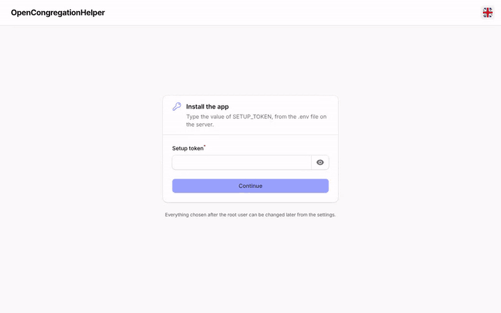</a> |
| **Territories and zones** | Create territories one by one or import them from a CSV file, group them into zones, and add a map, an image (e.g. a scanned paper card), notes and tags | <a href="docs/user-documentation/en/territories/assets/territory-view.webp">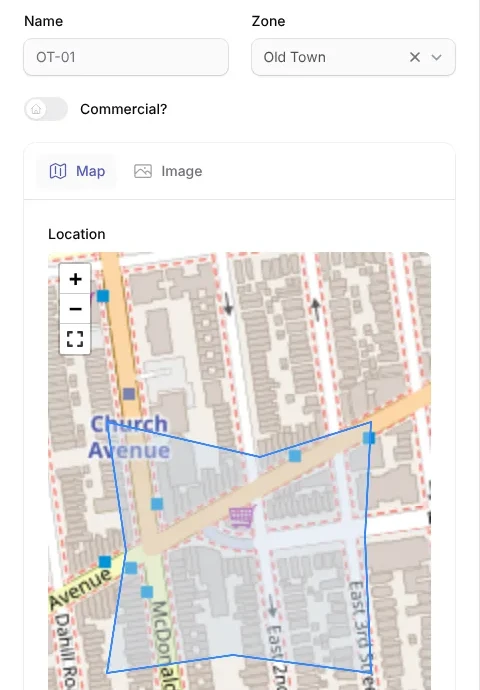</a> |
| **Assignments** | Record when a territory is given out and returned, with the full history of each one | <a href="docs/user-documentation/en/territories/assets/territory-assignment-history.webp">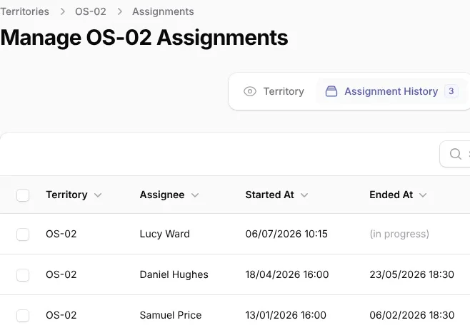</a> |
| **Campaigns** | Follow special activities (e.g. the Memorial invitations) separately, with their dates and progress | <a href="docs/user-documentation/en/assignments/assets/campaign-view.webp">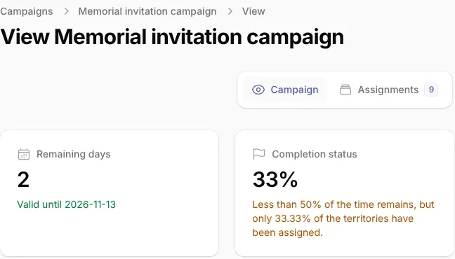</a> |
| **Dashboard** | Key statistics and a map of all the territories, colored by zone, availability, how often they were worked or campaign progress | <a href="docs/user-documentation/en/basics/assets/dashboard.webp">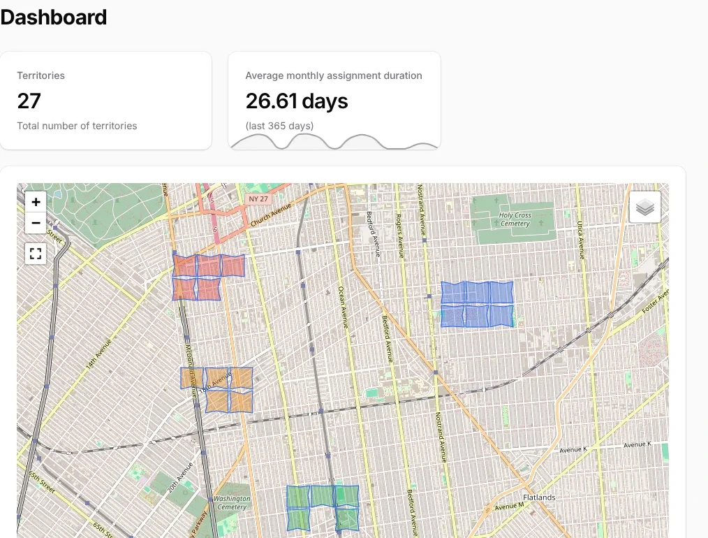</a> |
| **Notifications** | In the app and by email, when a territory is assigned or returned, a campaign starts, or a territory has been out for more than 60 days | <a href="docs/user-documentation/en/basics/assets/notifications.webp">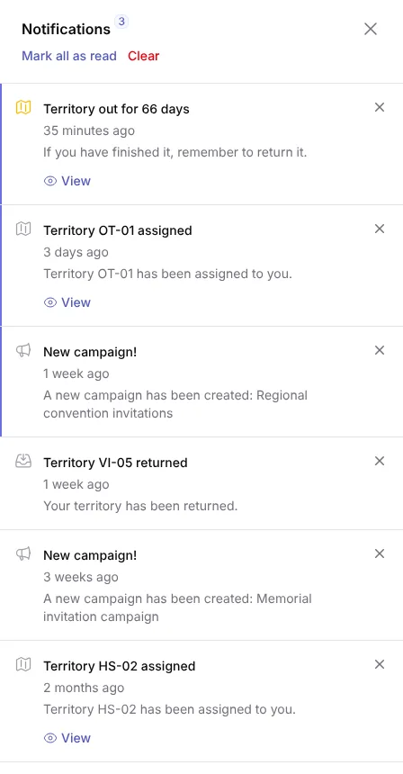</a> |
| **Link sharing** | Send an assignment to a publisher as a link that opens without an account, and revoke it any time | <a href="docs/user-documentation/en/assignments/assets/shared-page.webp">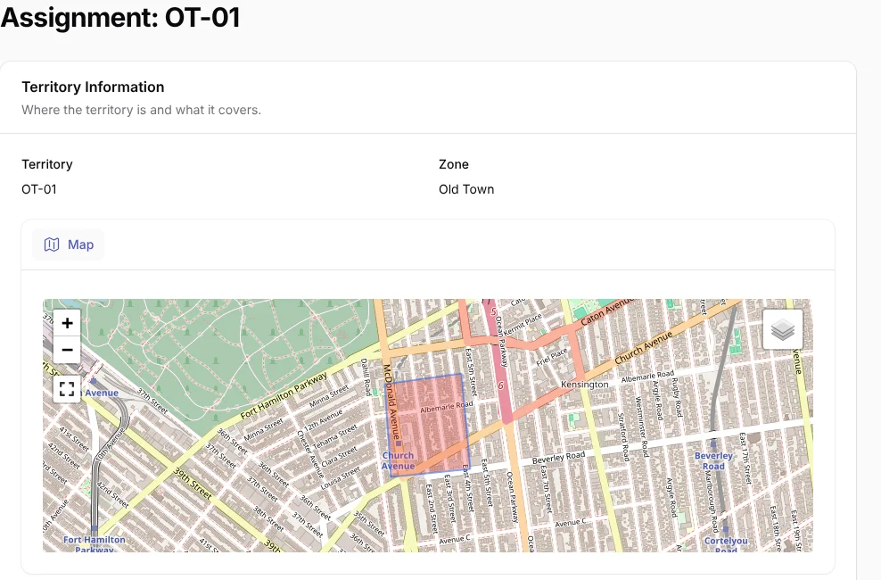</a> |
| **AI assistants** | Optional and off by default: connect ChatGPT, Claude, Gemini and other assistants (MCP) to ask about the territories or have them assigned and returned, with the permissions of the user who connects them | <a href="docs/user-documentation/en/basics/assets/profile-ai-assistants.webp">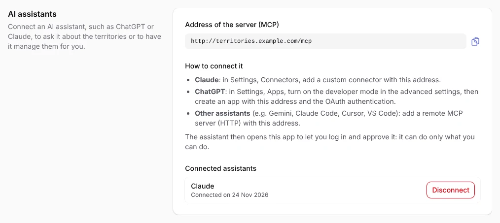</a> |
| **Users and roles** | Permissions by role, users without login who can still receive territories, and a log of who changed what | <a href="docs/user-documentation/en/administration/assets/users-list.webp">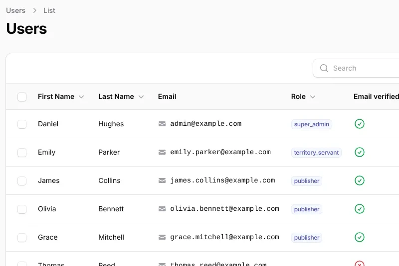</a> |
| **Languages** | Interface in English, Italian and Spanish | <a href="docs/user-documentation/en/basics/assets/language-switch.webp">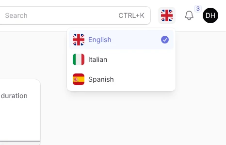</a> |
| **User guide** | Built into the app (English and Italian), with a **Help** button on each page | <a href="docs/user-documentation/en/basics/assets/help-slideover.webp">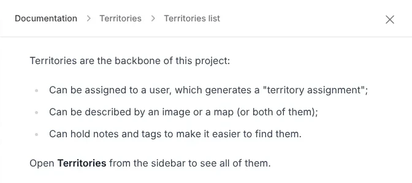</a> |

## Demo

See it in action, no installation needed: both demos come with dummy data and sign you in as administrator in one click.

| | Runs | Data reset |
| --- | --- | --- |
| 🚀 **[Public demo](https://ochdemo.altervista.org)** | The latest release | Every night |
| 🌙 **[Nightly demo](https://ochtest.altervista.org)** | The latest code of `main`, a sneak peek of what's coming | On every push to `main` |

The public demo is deployed by [OpenCongregationHelper-demo](https://github.com/OpenCHelper/OpenCongregationHelper-demo),
the nightly one by [`deploy-nightly.yml`](.github/workflows/deploy-nightly.yml).

> [!WARNING]
> Anyone can sign in as administrator and the data is regularly wiped: **never enter real data** in the demos. The
> nightly demo runs unreleased code, so expect bugs and unfinished features.

## Tech stack

- Laravel 12
- Filament 5
- Livewire 4

## Support

To receive support and/or propose new features please open an issue.

## Changelog

For the full list of changes, please read the [**Changelog**](CHANGELOG.md).

## Alternatives

If OpenCongregationHelper does not fit the needs of your congregation, these are valid alternatives:

| Application | Type | Territories |
| --- | --- | --- |
| [Territory Helper](https://territoryhelper.com) | Web app, with a companion mobile app for the publishers | Dedicated to territories: maps, heat maps and assignment statistics, campaigns, S-13 forms, and publishers requesting and returning their territories from their own account |
| [Hourglass](https://www.hourglass-app.com) | Web app, with the *Hourglass Time* mobile app for the publishers | One of the features of a complete congregation management application (field service groups, reports, schedules...) |
| [NW Publisher](https://nwscheduler.com) | Mobile app, companion of the *New World Scheduler* congregation software | Territories are managed in New World Scheduler; publishers see the ones assigned to them, to the congregation or to their field service group, request new ones and mark them as completed |
| [Organized](https://github.com/sws2apps/organized-app) | Open source (MIT) Progressive Web App, for desktop and mobile | Congregation management application (schedules, reports, publisher records...): territory management is under development ([sws2apps/organized-app#5523](https://github.com/sws2apps/organized-app/pull/5523)) |

## Development

The preferred way of developing is by using **Docker Compose** to build the containers that will be used to develop the application locally. If you don't want to use Docker, then it's up to you.

> [!NOTE]
> The steps listed in the following paragraph assume you are using [Laravel Sail](https://laravel.com/docs/12.x/sail) in a local environment.
>
> If you are working on this project using the provided DevContainer, just run the actual command (_usually, omitting `sail` before each command is enough_).
>
> For example:
> - Locally: `sail composer install`
> - DevContainer: `composer install`

### Steps

1. Install the dependencies:
    ```shell
    docker run --rm \
        -u "$(id -u):$(id -g)" \
        -v "$(pwd):/var/www/html" \
        -w /var/www/html \
        laravelsail/php82-composer:latest \
        composer install --ignore-platform-reqs
    ```
2. If not present, create the `.env` file with the same contents as the `.env.example` file, then set `APP_ENV=local`, `APP_DEBUG=true` and `LOG_LEVEL=debug` in it (the example is production-safe).
3. Build the local images:
    ```shell
    sail build --no-cache
    ```
4. Spin up the containers:
    ```shell
    sail up -d
    ```

    > [!TIP]
    > Before starting the application, check that no other program (e.g. Apache) is using the port you set up for the application, as it may interfere with the application.

5. Now we can start tweaking the application to make it work:
    1. Install dependencies:
        ```shell
        sail composer install
        ```
    2. Generate the [encryption key](https://laravel.com/docs/12.x/encryption) for the project:
        ```shell
        sail artisan key:generate
        ```
    3. Run database migrations:
        ```shell
        sail artisan migrate
        ```
    4. Create the permissions, the keys of the AI assistants (MCP server) and the root user (from the
       `INITIAL_ROOT_*` variables) with the super admin role:
        ```shell
        sail artisan och:install
        ```
    5. Seed dummy data for development:
        ```shell
        sail artisan db:seed --class=FakeDataSeeder
        ```
6. Install the frontend dependencies and run the Vite server:
    ```shell
    sail npm install && sail npm run dev
    ```

### End-to-end tests

The browser tests in [`tests/e2e`](./tests/e2e) use [Playwright](https://playwright.dev) on two instances of the
application, each with its own `.env.e2e-*` file, storage (`storage/e2e/`) and database, so they never touch the
development ones: `app`, installed and seeded with `E2eSeeder` (a user for each role, password `password`), and
`setup`, empty, for the setup wizard. They are served by
[`tests/e2e/support/serve.sh`](./tests/e2e/support/serve.sh) on the ports 8010 and 8011.

They run on Chromium (desktop), and the ones tagged `@mobile` in their title also on a phone: an Android one (Pixel 7,
Chromium) and an iPhone (iPhone 14, WebKit, the engine of Safari and of every browser on iOS). Run the tests of one of
them with `npx playwright test --project=<name>` (`chromium`, `mobile` or `mobile-webkit`).

1. Build the frontend assets and install the browsers (once):
    ```shell
    npm run build && npx playwright install chromium webkit
    ```
2. Run the tests (`npm run test:e2e:ui` opens the interactive runner):
    ```shell
    npm run test:e2e
    ```

They use SQLite by default: set `E2E_DB_CONNECTION` (`mysql`, `mariadb` or `pgsql`) and `E2E_DB_HOST`, `E2E_DB_PORT`,
`E2E_DB_USERNAME`, `E2E_DB_PASSWORD` to run them on another database (the databases `e2e_app` and `e2e_setup` are
created). Outside of CI, servers already running on the ports are reused: stop them to start from fresh data. The
`E2E tests` workflow (`run-e2e-tests.yml`) runs them on MySQL, and the setup wizard on SQLite and MySQL: the support of
the databases is tested by the `Pest tests` workflow (`run-pest-tests.yml`), on MySQL and SQLite, each with and
without a table prefix.

### Run workflows locally

You can run the Github Action workflows locally using [`nektos/act`](https://github.com/nektos/act) (already included in the [DevContainer](./.devcontainer/devcontainer.json)).

For example, to deploy the preview of a pull request:

```shell
act --rm --verbose=false \
    -s GITHUB_TOKEN="$(gh auth status &>/dev/null || gh auth login >&2; gh auth token)" \
    --pull=false \
    --rebuild=false \
    --workflows .github/workflows/deploy-preview.yml \
    --job 'deploy' \
    --input action=deploy --input pr=123 \
    --secret-file .act/.secrets \
    --env-file .act/.env \
    --var-file .act/.vars \
    --insecure-secrets
```

This command will run the `deploy` job of the `.github/workflows/deploy-preview.yml` workflow:
- use [`gh`](https://cli.github.com/) to retrieve a token to authenticate Act against GitHub (_higher quotas and access to private repositories, may be omitted if not needed_).
- read the [workflow secrets](https://docs.github.com/en/actions/how-tos/write-workflows/choose-what-workflows-do/use-secrets) (`${{ secrets.[*] }}`) from `.act/.secrets`
- read the [workflow environment variables](https://docs.github.com/en/actions/how-tos/write-workflows/choose-what-workflows-do/use-variables#defining-environment-variables-for-a-single-workflow) (`${{ env.[*] }}`) from `.act/.env`
- read the [workflow configuration variables](https://docs.github.com/en/actions/how-tos/write-workflows/choose-what-workflows-do/use-variables#defining-configuration-variables-for-multiple-workflows) (`${{ vars.[*] }}`) from `.act/.vars`

The deploy workflows read the settings of their GitHub environment (e.g. `PREVIEW`, see [Deploy](#deploy)) and the
repository variables. Locally, `act` reads all of them from the files above, under
the same names whatever the environment, so keep one pair of files for each space (both are ignored by git):

```dotenv
# .act/.vars
FTP_SERVER=ftp.{username}.altervista.org
FTP_USERNAME={username}

# Router of the space
SPACE_DEFAULT_ENVIRONMENT=demo
SPACE_PHP_HANDLER=av-php82
```

```dotenv
# .act/.secrets
FTP_PASSWORD=password

# PREVIEW only: password of the root user of the previews, and API key of cron-job.org
ROOT_PASSWORD=MyVerySecretPassword
CRON_JOB_ORG_API_KEY=MyCronJobOrgApiKey
```

## Deploying

### Altervista

| Feature | Details |
| --- | --- |
| Disk space | 3.072 MB (shared between file system and database) |
| HTTPS | Yes |
| Traffic | 30 GB / month |
| Subdomain | `{username}.altervista.org` |
| PHP versions | 8.2<br/>8.0<br/>~~7.3~~ (_deprecated_)<br/>~~5.6~~ (_deprecated_) |
| Shell access | No |

#### Examples

This site itself, along with all the PR previews, is hosted on Altervista.


| Workflow | Deploys to |
| --- | --- |
| [`deploy-preview.yml`](.github/workflows/deploy-preview.yml) | `https://pr-<N>.<site>`, a preview of each PR (see below) |
| [`deploy-nightly.yml`](.github/workflows/deploy-nightly.yml) | The [nightly demo](#demo), on every push to `main` |

Which PRs get a preview is set by the `PREVIEW_MODE` repository variable, and by the labels of each PR:

| `PREVIEW_MODE` | Previews |
| --- | --- |
| `opt-out` (default) | Every PR, unless it has the opt-out label |
| `opt-in` | Only the PRs with the opt-in label |
| `off` | None |

The labels are `preview: on` (opt-in) and `preview: off` (opt-out), unless set otherwise by the
`PREVIEW_OPT_IN_LABEL` and `PREVIEW_OPT_OUT_LABEL` repository variables. Adding or removing a label deploys or removes
the preview right away; the opt-out label wins over the opt-in one. The workflow creates the labels when they are
missing. While the last commit of a PR has `[skip ci]` in its message, GitHub ignores its label changes: run the
workflow manually instead (`deploy` or `destroy` action, with the number of the PR).

Other installations call the reusable
[`upload-altervista-reusable.yml`](.github/workflows/upload-altervista-reusable.yml) workflow from their own repository
(see its inputs).

