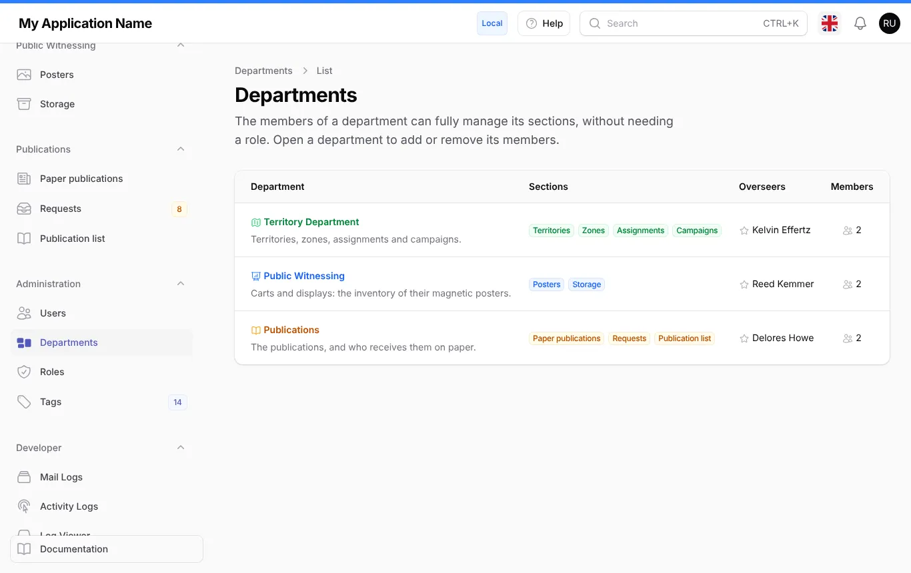
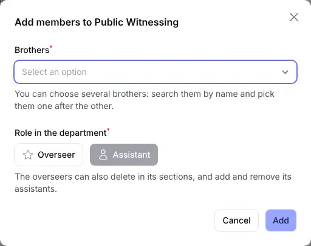

The work of the congregation is organized in **departments**, each one with its own section of the menu:

| Department | Sections |
|------------|----------|
| **Territory Department** | Territories, Zones, Assignments, Campaigns |
| **Public Witnessing** | [Posters and their storage places](../public-witnessing/posters) |
| **Publications** | [Regular publications](../publications/periodicals), [Requests](../publications/requests), Publication list |

Open **Administration → Departments** to see them, with their overseers and the number of members.

## What the members can do

The **members** of a department can **manage its sections** (see, create and edit; the overseers delete too), without
needing a [role](roles) with those permissions. For example, a brother in the *Public Witnessing* department sees the
**Public Witnessing** section of the menu and can update the posters, even if his roles give him nothing else.

Everything else (e.g. the other departments, or the users) still depends on the roles, as before.

Each member has a **role in the department**:

- **Overseer**: can also delete in its sections, and add and remove the assistants of the department (only an
  administrator appoints, changes or removes the overseers);
- **Assistant**: manages the sections of the department, but cannot delete (e.g. a publication, which would also
  delete its history), unless their roles allow it.

## Adding or removing members

1. Open **Administration → Departments** and click the department.
2. Click **Add members**, choose one or more brothers and their **Role in the department**, then click **Add**.
3. To change the role of a member, click **Change role**; to remove them, click **Remove**.

To add **many users at once**, e.g. when setting up a department, you can also start from the [users list](users):
select them, open **Bulk actions** and click **Add to department**, then choose the **Department** and the **Role in
the department**. Those who already serve in the department keep their role.

The administrators can manage the members of every department; the overseers only those of their own departments.
The **Departments** column and filter of the [users list](users) show who serves where.
