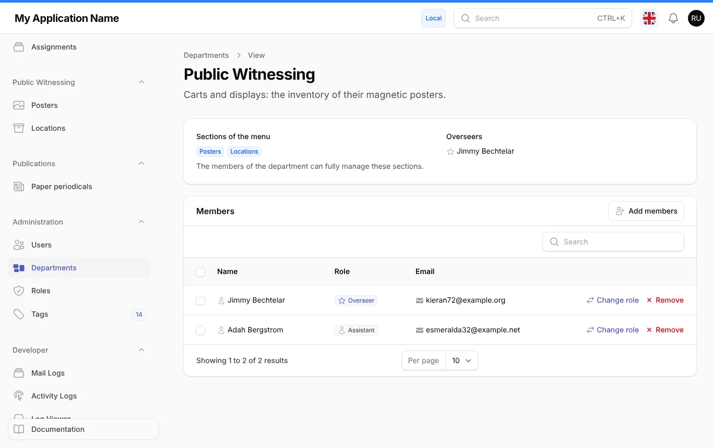

The work of the congregation is organized in **departments**, each one with its own section of the menu:

| Department | Sections |
|------------|----------|
| **Territory Department** | Territories, Zones, Assignments, Campaigns |
| **Public Witnessing** | [Posters and their storage places](../public-witnessing/posters) |
| **Publications** | [Regular publications](../publications/periodicals), [Requests](../publications/requests), Publication list |

Open **Administration → Departments** to see them, with their overseers and the number of members.

## What the members can do

The **members** of a department can **fully manage its sections** (see, create, edit and delete), without needing a
[role](roles) with those permissions. For example, a brother in the *Public Witnessing* department sees the
**Public Witnessing** section of the menu and can update the posters, even if his roles give him nothing else.

Everything else (e.g. the other departments, or the users) still depends on the roles, as before.

Each member has a **role in the department**:

- **Overseer**: can also add and remove the members of the department, and change their role;
- **Assistant**: manages the sections of the department.

## Adding or removing members

1. Open **Administration → Departments** and click the department.
2. Click **Add members**, choose one or more brothers and their **Role in the department**, then click **Add**.
3. To change the role of a member, click **Change role**; to remove them, click **Remove**.

The administrators can manage the members of every department; the overseers only those of their own departments.
The **Departments** column and filter of the [users list](users) show who serves where.
