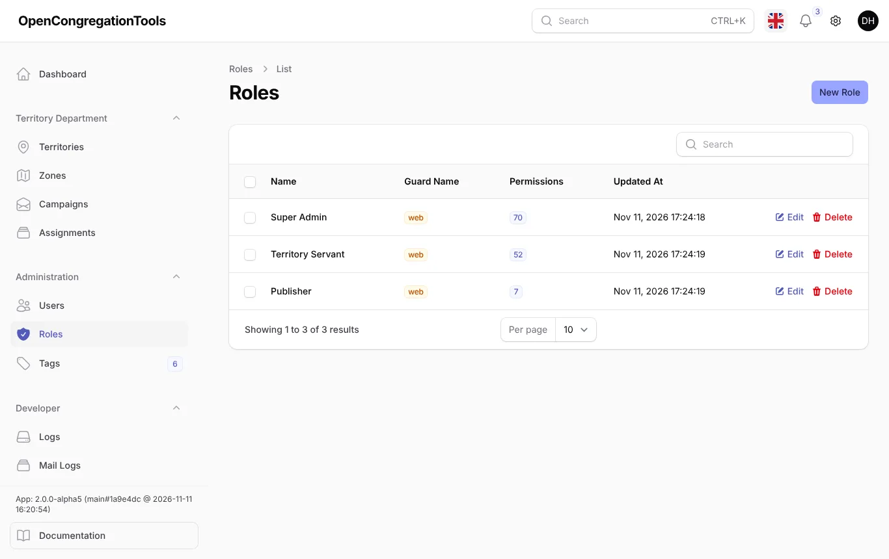

What each user can see and do is decided by their **roles**. A role is a named set of **permissions**. Open
**Administration → Roles** to manage them.

## The super administrator

The **super_admin** role (*Super Admin*) can do everything, including the actions reserved to it:

- assigning roles to users;
- impersonating users;
- changing the [settings](settings);
- reading the application logs.

## Creating or editing a role

1. Click **New Role** (or **Edit** on an existing one).
2. Enter the **Name** (e.g. `publisher`). Leave **Guard Name** set to `web`.
3. Tick the permissions in the **Resources** and **Pages** tabs. **Select all** in each box ticks all the permissions
   of that resource; the **Select All** toggle at the top ticks everything.
4. Click **Save changes**.

## Meaning of the permissions

For most resources (Territory, Territory Zone, Territory Assignment, Campaign, User, …) there are the same
permissions (*Department* has only **View Any**, **View** and **Update**, *Role* only **View Any**, **View**,
**Create**, **Update** and **Delete**):

| Permission | Allows to |
|------------|-----------|
| **View Any** | open the list of that resource |
| **View** | open the details of a record |
| **Create** / **Update** / **Delete** | create, edit, delete records |
| **Restore**, **Force Delete** (and their *Any* versions) | restore deleted records, delete them permanently |
| **Replicate**, **Reorder** | not used at the moment |

Some permissions have a special meaning:

- **Create** on *Territory Assignment* allows to **assign** territories, **Update** allows to **return** them;
- without **View Any** on *Territory Assignment*, the user only sees **their own** assignments;
- **View Any** on *Territory* shows the statistics, the territory coverage and the map on the
  [dashboard](../basics/dashboard);
- the *Pages* tab controls, for example, the access to the profile page.

## Suggested roles

| Role | Suggested permissions |
|------|-----------------------|
| **Publisher** | View / View Any on Territory and Territory Zone, View on Territory Assignment, the profile page. Publishers see the territories and only their own assignments. |
| **Territory servant** | Everything on Territory, Territory Zone, Territory Assignment and Campaign, plus View / View Any on User. |
| **Administrator** | The **super_admin** role. |

> 💡 **Tip:** after changing a role, [impersonate](users) a user with that role to check what they see.
