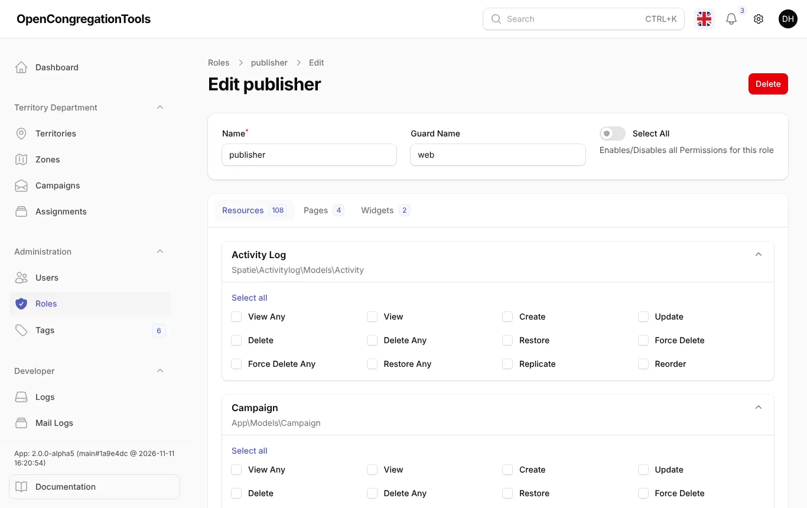

What each user can see and do is decided by their **roles**. A role is a named set of **permissions**. Open
**Administration → Roles** to manage them.

## The super administrator

The **super_admin** role (*Super Admin*) can do everything, including the actions reserved to it:

- assigning roles to users;
- impersonating users;
- changing the [settings](settings);
- reading the application logs.

## Creating or editing a role

1. Click **New Role** (or **Edit** on an existing one).
2. Enter the **Name** (e.g. `publisher`). Leave **Guard Name** set to `web`.
3. Tick the permissions in the **Resources** tab. **Select all** in each box ticks all the permissions of that
   resource; the **Select All** toggle at the top ticks everything.
4. Click **Save changes**.

## Meaning of the permissions

Each resource has the permissions of the actions it offers:

| Permission | Allows to | Resources |
|------------|-----------|-----------|
| **View Any** | open the list of that resource | all |
| **View** | open the details of a record | all |
| **Create** / **Update** | create, edit records | all (*Department* only **Update**) |
| **Delete** | delete a record | all but *Department* and *Regular publications* |
| **Delete Any** | delete the selected records at once | Territory, Territory Zone, Territory Assignment, Campaign, User, Poster, Request, Tag, Role |
| **Restore**, **Force Delete** (and their *Any* versions) | restore deleted records, delete them permanently | Territory, Territory Zone, Territory Assignment, Campaign, User |
| **Reorder** | change the order of the list | Publication |

*User* also has **Replicate** and **Reorder**, not used at the moment. The activity log and the mail log have no
permissions: only the super administrators read them.

Some permissions have a special meaning:

- **Create** on *Territory Assignment* allows to **assign** territories, **Update** allows to **return** them;
- without **View Any** on *Territory Assignment*, the user only sees **their own** assignments;
- **View Any** on *Territory* shows the statistics, the territory coverage and the map on the
  [dashboard](../basics/dashboard).

The pages have no permissions of their own: everyone can open their [profile](../basics/profile), and only the super
administrators the [settings](settings) and the application logs.

## Suggested roles

| Role | Suggested permissions |
|------|-----------------------|
| **Publisher** | View / View Any on Territory and Territory Zone, View on Territory Assignment. Publishers see the territories and only their own assignments. |
| **Territory servant** | Everything on Territory, Territory Zone, Territory Assignment and Campaign, plus View / View Any on User. |
| **Administrator** | The **super_admin** role. |

> 💡 **Tip:** after changing a role, [impersonate](users) a user with that role to check what they see.
