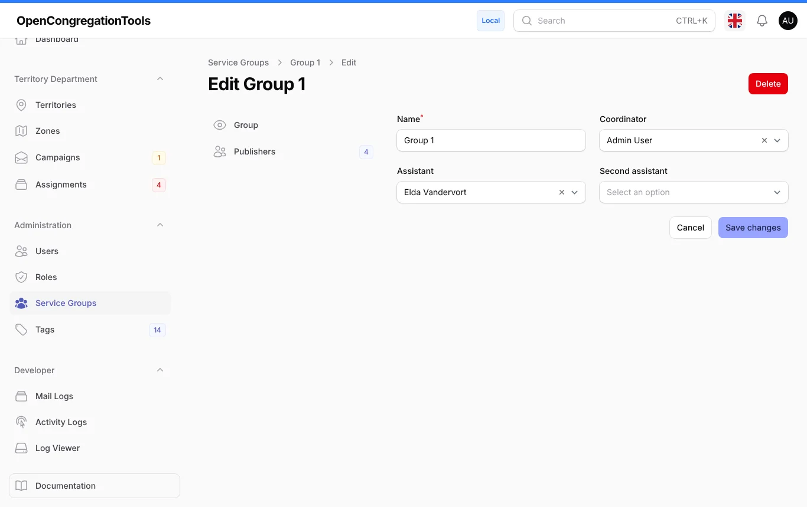
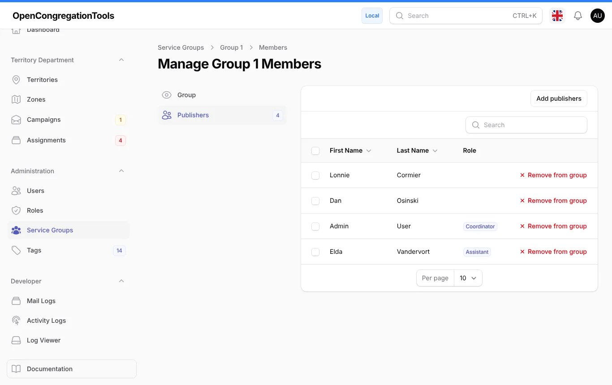
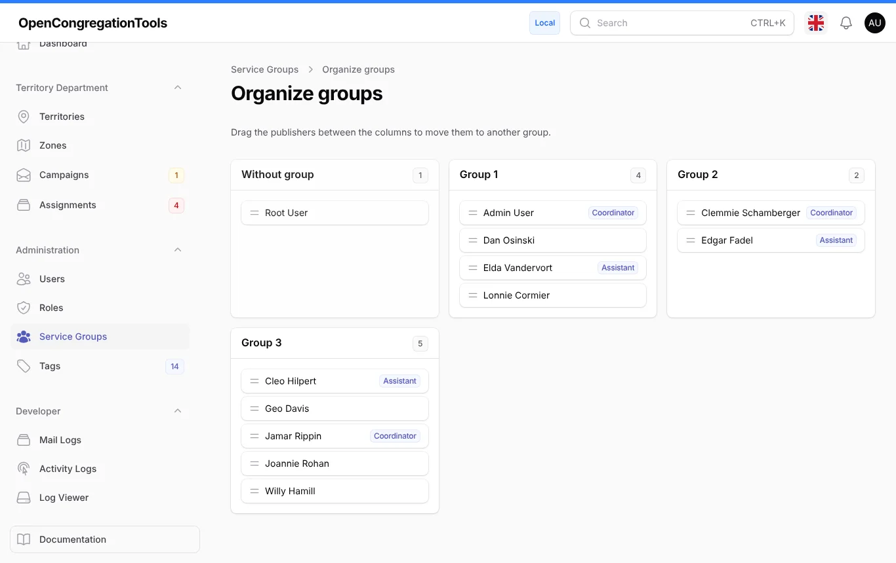

The publishers of the congregation can be gathered in **service groups**. Each group can have a **Coordinator** and up
to two assistants. Open **Administration → Service Groups** to manage them: the table shows each group with its
coordinator, its assistants and how many publishers it has.

## Creating a group

1. Click **New service group**.
2. Fill in the **Name** and, optionally, choose the **Coordinator**, the **Assistant** and the **Second assistant**.
3. Click **Create**.

> ℹ️ **Note:** the same person cannot have two roles in the same group. Choosing someone as coordinator or assistant
> does not move them into the group: add them to its publishers too.

## Publishers of a group

Click a group, then open the **Publishers** tab to see who belongs to it; the people leading the group are marked as
**Coordinator** or **Assistant**.

- **Add publishers** adds one or more people to the group. Those who were in another group are moved;
- **Remove from group** leaves a publisher without a group.

Deleting a group does not delete its publishers: they are left without a group.

## Moving publishers between groups

Click **Organize groups** in the list of the groups to see all of them side by side, together with the publishers that
are **Without group**. Drag a publisher to another column to move them: the change is saved right away.

To move many people at once (or from a phone), open **Administration → Users**, select them and use the
**Change service group** bulk action.

## The group on the page of a user

The **Service Group** of a user is shown on their page, and can be changed when [editing them](users). The users table
has a **Service Group** column and filter too.
