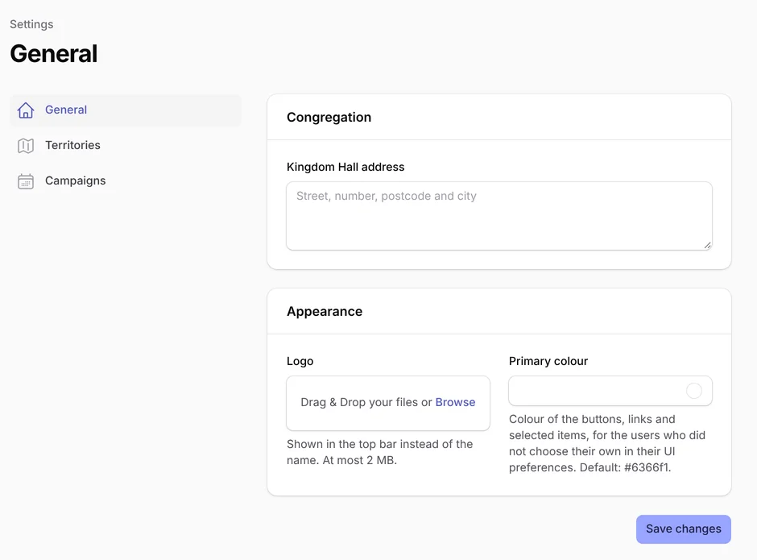

The **Settings** pages let the super administrators change the options of the application without editing the `.env`
file on the server. Open **Administration → Settings**: the pages are shown only to the users with the `super_admin`
role. The options are grouped by area, with one page each in the menu on the side.

## General

- **Name of the application**: shown in the top bar, in the browser tab, in the emails and in the installed app;
- **Default language**: the language of the users who did not choose one;
- **Timezone**: used to show the dates.

## Territories

- **Default map centre**: where the maps open while no territory has a map yet, as `latitude, longitude` (e.g.
  `41.159063, -74.255188`). Afterwards the maps open on the territories;
- **Show personal data on shared pages**: when on, the public page of a [shared assignment](../assignments/sharing)
  also shows the name of the assignee and the notes of the territory.

Click **Save changes** to apply them: they take effect immediately, for every user.

## Default values

Under each option, **Default** shows the value set in `.env` by whoever installed the application (see the
[Setup guide](../setup)). An option keeps following `.env` until it is changed here; to make it follow `.env` again,
set it back to its default value and save.
