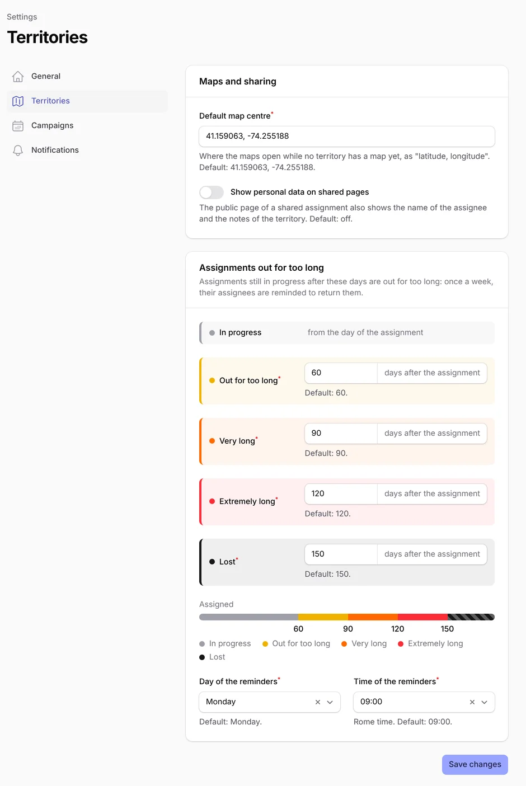
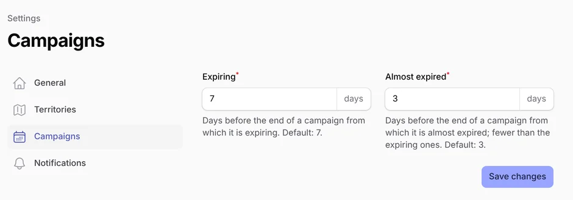
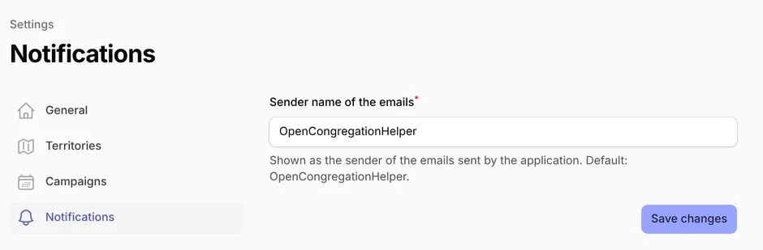

The **Settings** pages let the super administrators change the options of the application without editing the `.env`
file on the server. Open **Administration → Settings**: the pages are shown only to the users with the `super_admin`
role. The options are grouped by area, with one page each in the menu on the side.

## General

- **Name of the application**: shown in the top bar, in the browser tab, in the emails and in the installed app;
- **Default language**: the language of the users who did not choose one;
- **Timezone**: used to show the dates;
- **Logo**: shown in the top bar instead of the name (at most 2 MB);
- **Primary colour**: the colour of the buttons, links and selected items, for the users who did not choose their own
  in their UI preferences.

## Territories

- **Default map centre**: where the maps open while no territory has a map yet, as `latitude, longitude` (e.g.
  `41.159063, -74.255188`). Afterwards the maps open on the territories;
- **Show personal data on shared pages**: when on, the public page of a [shared assignment](../assignments/sharing)
  also shows the name of the assignee and the notes of the territory.

Under **Assignments out for too long**:

- the days after which an assignment still in progress is out for too long, very long, extremely long or lost. Each
  must be more than the previous one;
- the **day** and **time** (Rome time, on the hour) of the weekly reminders sent to the assignees of the assignments out
  for too long. On a hosting without cron, the external service must call the scheduler at that time (see the
  [Setup guide](../setup)).

## Campaigns

The days before its end from which a campaign is **expiring** and **almost expired**: the latter must be fewer.

## Notifications

- **Sender name of the emails**: shown as the sender of the emails sent by the application.

Click **Save changes** to apply them: they take effect immediately, for every user.

## Default values

Under each option, **Default** shows its value before it is changed here: for the name, language, timezone, map centre,
personal data and sender name, the value set in `.env` by whoever installed the application (see the
[Setup guide](../setup)). These options keep following `.env` until they are changed here; to make one follow `.env`
again, set it back to its default value and save.
