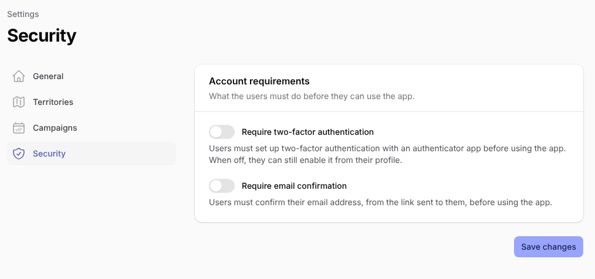

The **Settings** pages let the super administrators change the options of the application without editing the `.env`
file on the server. Open **Administration → Settings**: the pages are shown only to the users with the `super_admin`
role. The options are grouped by area, with one page each in the menu on the side.

## General

- **Kingdom Hall address**: the address of the Kingdom Hall of the congregation (optional);
- **Logo**: shown in the top bar instead of the name (at most 2 MB);
- **Primary colour**: the colour of the buttons, links and selected items, for the users who did not choose their own
  in their UI preferences. It also colours the bar of the [installed app](../basics/interface#installing-the-app).

## Territories

- **Default map centre**: where the maps open while no territory has a map yet, as `latitude, longitude` (e.g.
  `41.159063, -74.255188`). Afterwards the maps open on the territories.

Under **Privacy of shared pages** you first choose whether assignments can be [shared](../assignments/sharing) at all
(**Share assignments**, enabled by default). When disabled, **Share** is no longer offered to anyone and the existing
links are deleted when you save: they stop working for good, even if sharing is enabled again. If there are any, you are
asked to confirm first. The options below are shown only while sharing is enabled.

Then you choose what the public page of a shared assignment shows to anyone who has its link:

- **Hide personal data** (recommended): only the territory, its map and the dates;
- **Show personal data**: also the name of the assignee and the notes of the territory, which may describe
  householders. The shared links never expire and can be forwarded, so choose it only if the congregation has agreed to
  it and the notes hold no personal data. Before choosing it you are asked to confirm that you understand what it
  means: if you cancel, the personal data stay hidden.

There you also choose whether anyone who opens the public page can **ask to return** the territory, without an
account: the members of the territory department are then notified, as when the assignee asks from the application.

Under **Assignments out for too long** the levels are listed in order, each with its colour, and the bar below draws
them to scale while you type:

- the days after which an assignment still in progress is out for too long and then lost: the latter must be more;
- the **day** and **time** (in the timezone of the application, `APP_TIMEZONE`) of the weekly reminders sent to the
  assignees of the assignments out for too long. The members of the territory department (see
  **Departments**) receive a summary of all of them by email and in the app at the same time. They are sent only if
  the scheduler is running at that time, as a cron job or as a long-running process (e.g. with Supervisor); on a
  hosting without cron, the external service must call it then (see the [Setup guide](../setup));
- the **Recipients of the summary**: all the members of the territory department (default) or only its overseers.

Under **Assignment frequency** you choose how the **Assignment frequency** of the [dashboard map](../basics/dashboard)
colours the territories:

- the **months counted**: only the assignments started in these last months are counted;
- the assignments from which a territory is assigned with a **medium** frequency, and then **frequently**: the latter
  must be more. With fewer assignments, or none, the frequency is **low**. The bar below draws them to scale while you
  type.

Under **Territory coverage** you choose the periods of the [territory coverage](../basics/dashboard#territory-coverage)
of the dashboard:

- the **periods**, in months, offered in its menu (6, 12 and 24 by default): press Enter after each one;
- the **period shown by default** (12 months by default), one of the periods.

## Campaigns

The days before its end from which a campaign is **expiring** and **almost expired**: the latter must be fewer. The
statuses are listed in order, with the colours of the campaign badges, and the bar below draws them to scale while you
type.

## Security

Under **Account requirements** you choose what every user must do before using the application. Both are disabled by
default:

- **Require two-factor authentication**: the users who have not set it up are asked to do it, with an authenticator
  app, before they can open any page. When disabled, each user can still enable it from their
  [profile](../basics/profile#two-factor-authentication);
- **Require email confirmation**: the users whose email address is not confirmed are asked to confirm it, from the link
  sent to them by email, before they can open any page. The email is sent when they first reach that page; they can
  ask for it again from there.

The users already logged in are asked at their next page. With both enabled, they first confirm their email, then set
up two-factor authentication.

> ⚠️ **Warning:** so that the root user (the first user created during the installation) can never be locked out, a
> requirement can be enabled only once the root user meets it: set up two-factor authentication or confirm the email
> address of the root user first. Disabling a requirement is always possible. The root user is also never asked to
> confirm its email, even if it changes it later, so that it can always reach these settings.

Under **Passwords**, **Refuse compromised passwords** checks the passwords that the users choose (from an invitation,
**Forgot password?** or their profile) against the known data leaks of [Have I Been
Pwned](https://haveibeenpwned.com/Passwords), and refuses one found there. The application sends only the first 5
characters of the SHA-1 hash of the password, never the password itself. If the service does not answer within 5
seconds, the password is accepted. It is enabled by default in production and disabled elsewhere (see
`PASSWORD_LEAK_CHECK` in the [Setup guide](../setup)): disable it if the server cannot reach the service.

Under **AI assistants**, **Allow AI assistants** lets the users connect an AI assistant (e.g. ChatGPT, Claude or
Gemini) to the application, from their [profile](../basics/profile#ai-assistants). It is disabled by default:

- each assistant works on behalf of the user who connected it, and can read and change only what that user can (it has
  the same roles and permissions), so what it reads is sent to the company that provides the assistant;
- disabling it disconnects every assistant at once: the users must approve them again once it is enabled.

Click **Save changes** to apply them: they take effect immediately, for every user.

## Default values

Under each option, **Default** shows its value before it is changed here: for the map centre, the personal data, the
return requests from the public page and the check of compromised passwords, the value set in `.env` by whoever
installed the application (see the [Setup guide](../setup)). These four options keep following `.env` until they are
changed here; to make one follow `.env` again, set it back to its default value and save. The name, language and
timezone of the application are set only in `.env`.
