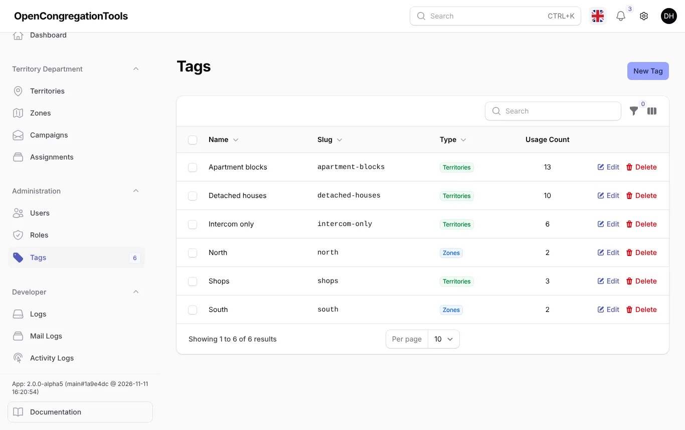
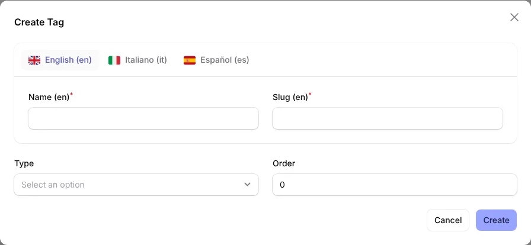

Tags are short labels that help to describe and find territories and zones, e.g. *Apartment blocks*, *Intercom only*
or *North*. Open **Administration → Tags** to manage them; the number next to the menu item is the total number of tags.

There are two **types** of tags, shown with different colors:

- **Territories**: used in the territory form and in the **Tags** filter of the territories list;
- **Zones**: used in the zone form and filter.

The **Usage Count** column tells how many territories or zones use each tag. Use the **Filter by Type** filter to see
only one type.

## Creating and editing tags

Tags are created automatically when you type a new one in a territory or zone form. From this page you can also:

1. Click **New Tag** (or **Edit** on an existing one).
2. Fill in **Name** and **Slug** (a simplified version of the name, e.g. `apartment-blocks`: when creating a tag, it is
   filled in from the name). A tag has one name, the same in every interface language.
3. Choose the **Type** and, optionally, an **Order** number to sort the tags.
4. Click **Create** (or **Save changes**).

## Deleting tags

Deleting a tag also removes it from every territory and zone that uses it (they are kept). Before deleting, the
confirmation says how many territories and zones use it (the selected tags, when deleting more than one).
