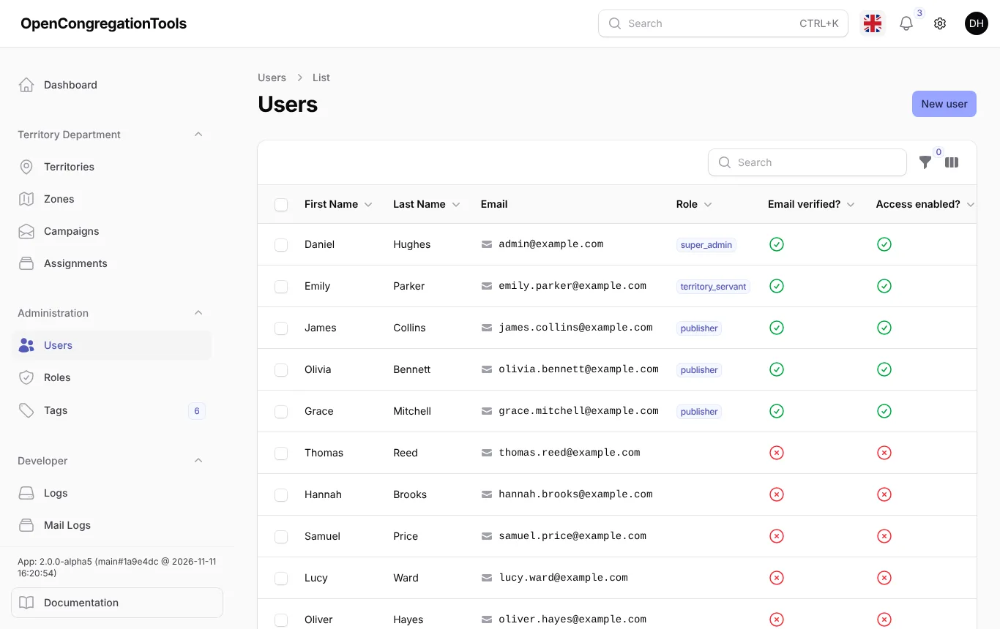
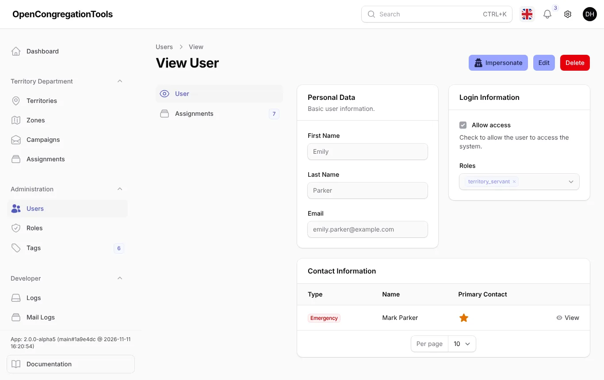
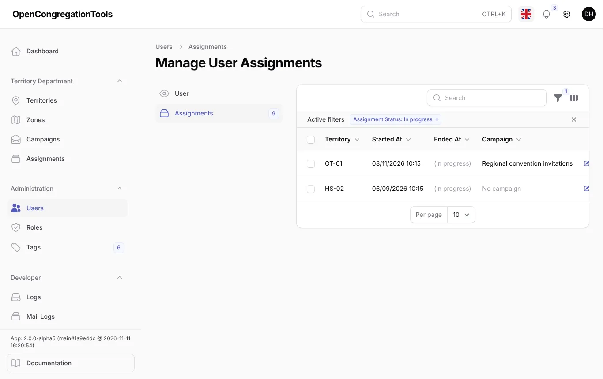
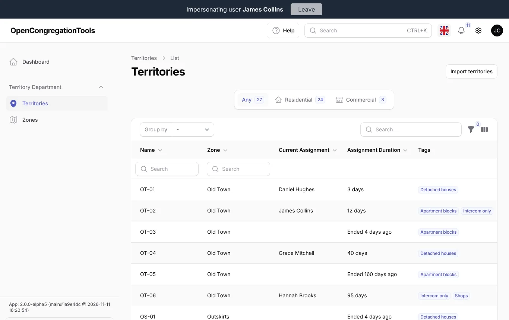

Open **Administration → Users** to manage the people registered in the application.

The table shows name, email, **Role**, whether the email has been verified and whether the user can log in
(**Access enabled?**). The **Access enabled?** filter shows only the users who can, or cannot, log in.

## Users and virtual users

Not everybody who works the territories needs to use the application:

- **Users with access** log in with their email and password, and see what their [roles](roles) allow;
- **Virtual users** (without **Allow access**) cannot log in, but territories can be assigned to them. They are
  useful for publishers who receive the territory on paper or through a [shared link](../assignments/sharing).

## Creating a user

1. Click **New user**.
2. Fill in **First Name**, **Last Name** and **Email**.
3. To let the person log in, tick **Allow access**, then set a **Password** and the **Roles**.
4. Click **Create**.

> ℹ️ **Note:** only super administrators can assign roles. When editing a user, leave **Password** empty to keep the
> current one.

## User page

Click a user to open their page:

- the **User** tab shows their data and their **Contact Information** (e.g. emergency contacts), which you can add,
  edit or delete here too. **Call** and **Open in Maps** start a phone call or open the address;
- the **Assignments** tab lists the territories assigned to them.

## Impersonating a user

Super administrators can use the application **as another user**, for example to check what a publisher sees.

1. Click **Impersonate** on the user's row (or on their page) and confirm.
2. You are taken to the home page: open the application to use it as that user. A banner at the top reminds you who
   you are impersonating.
3. Click **Leave** in the banner to go back to your account.

Virtual users can be impersonated too; the root user cannot.

## Deleting users

Use **Delete** in the user page, or select some users and use the **Delete selected** bulk action.

## The root user

The root user is the first user, created during the installation. To avoid losing access to the application:

- it can never be deleted (it is skipped by the bulk delete) nor impersonated;
- outside of the production environment, its email, password, access and roles cannot be changed, and its **Edit**
  button is disabled.
