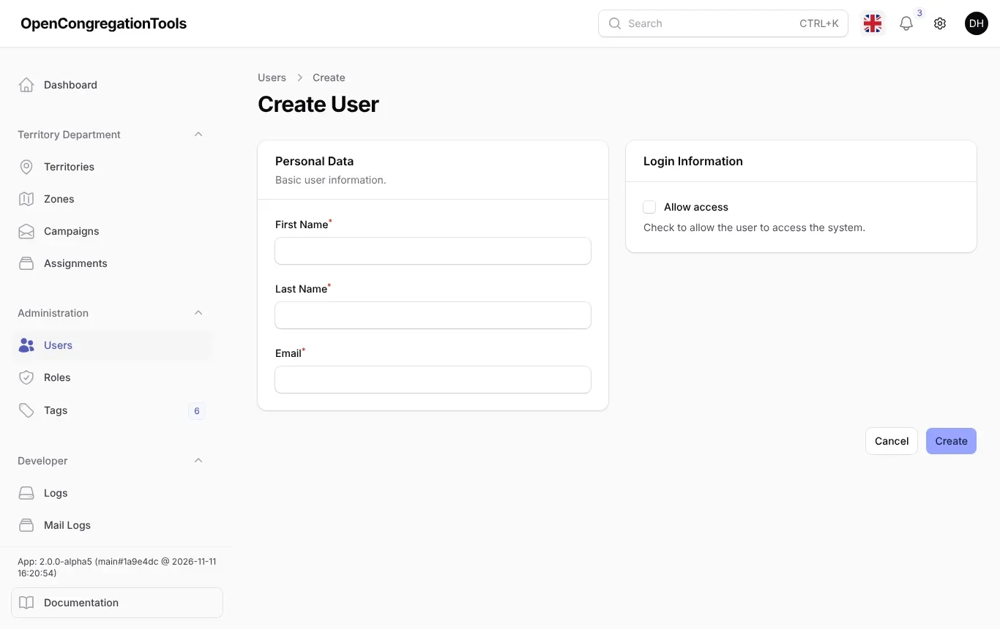

Open **Administration → Users** to manage the people registered in the application.

The table shows name, email, **Departments** and whether the user can log in (**Access enabled?**). From the columns
button next to the filters you can also show the **Role**, whether the email has been verified and whether the user
has set up two-factor authentication. On a phone, each user is shown as a card, with name and email together, and the list can be sorted from the
**Sort by** menu. The **Access** filter shows only the users with access or only the virtual users, and tells
how many there are of each.

## Users and virtual users

Not everybody who works the territories needs to use the application:

- **Users with access** log in with their email and password, and see what their [roles](roles) allow;
- **Virtual users** (without **Allow access**) cannot log in, but territories can be assigned to them. They are
  useful for publishers who receive the territory on paper or through a [shared link](../assignments/sharing).

## Creating a user

1. Click **New user**.
2. Fill in **First Name**, **Last Name** and **Email**.
3. To let the person log in, tick **Allow access** and choose the **Roles**.
4. Click **Create**: if you allowed access, the person receives an email with a link to choose their own password.

> ℹ️ **Note:** only super administrators can assign roles.

The invitation is also sent when you tick **Allow access** for a virtual user who never had a password, and when you
correct the **Email** of a user who has not chosen their password yet: the link sent to the old address stops working.

The invitation link expires after 6 hours. Until the person has chosen their password, you can send a new link with
**Resend invitation**, on the user's page or in the users list (the previous link stops working). A user gets at most
one invitation a minute, however it is sent: if you save changes that would send one within that minute (e.g. you
correct the **Email** again), they are saved but no email is sent, and you can use **Resend invitation** a minute
later. The person can also get a new link with **Forgot password?** on the [login page](../basics/logging-in).

Administrators cannot set or change the password of a user: people choose their own, with the invitation, with
**Forgot password?** on the login page, or from their profile.

## User page

Click a user to open their page:

- the **User** tab shows their data and their **Contact Information** (e.g. emergency contacts), which you can add,
  edit or delete here too (a user has only one **Primary contact**). **Call** and **Open in Maps** start a phone call
  or open the address;
- the **Assignments** tab lists the territories assigned to them.

At the bottom of the **User** tab, **Statistics** shows the **Preferred zones** (every zone the publisher took
territories in, with how many assignments and their share) and the **Preferred territories** (the 5 they take most
often). In-progress and returned assignments are counted. Users who can't see all the assignments only see these
statistics on their own page.

## Impersonating a user

Super administrators can use the application **as another user**, for example to check what a publisher sees.

1. Click **Impersonate** on the user's row (or on their page) and confirm.
2. You are taken to the home page: open the application to use it as that user. A banner at the top reminds you who
   you are impersonating.
3. Click **Leave** in the banner to go back to your account.

Virtual users can be impersonated too; the root user cannot.

## Adding users to a department

Select some users and use the **Add to department** bulk action: choose the **Department** and the **Role in the
department**, and they all join it at once. Those who already serve in the department keep their role. See
[Departments](departments) for what the members can do.

## Deleting users

Use **Delete** in the user page, or select some users and use the **Delete selected** bulk action.

A user who has ever been assigned a territory (even one already returned) cannot be deleted: the history of those
territories (when they were worked, the coverage, the campaigns) would be lost with them. For example, when a publisher
moves away:

1. Click **Delete** in their page: the window explains why they cannot be deleted.
2. Click **Disable access**: they become a [virtual user](#users-and-virtual-users), cannot log in any more, and their
   assignments are kept. Return their territories in progress, if any, when you get them back.

The bulk action deletes the other selected users and says how many were skipped and why. Users cannot delete their own
account either if they have assignments.

## The root user

The root user is the first user, created during the installation. To avoid losing access to the application:

- it can never be deleted (it is skipped by the bulk delete) nor impersonated;
- outside of the production environment, its email, password, access and roles cannot be changed, and its **Edit**
  button is disabled.
