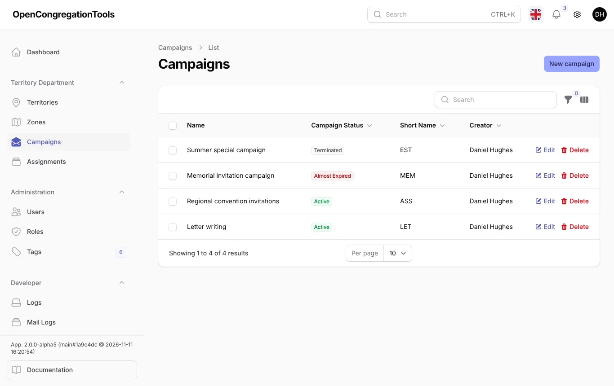
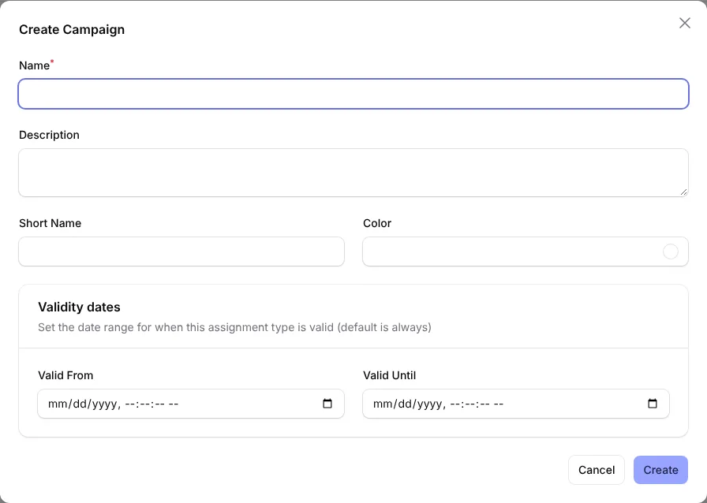
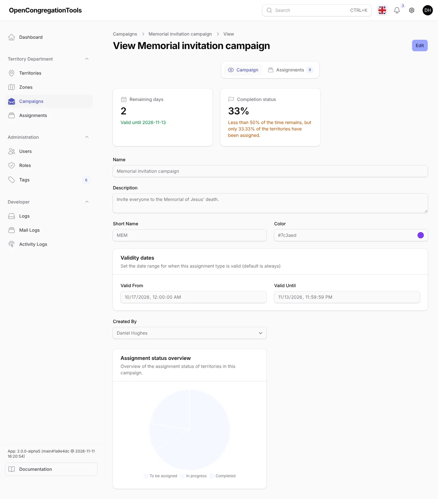
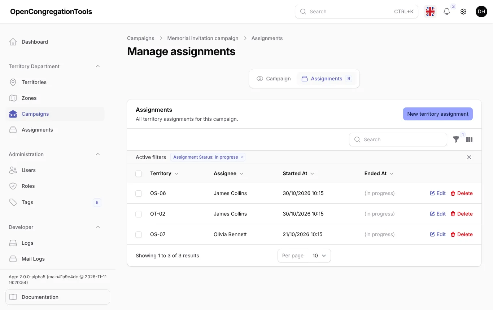
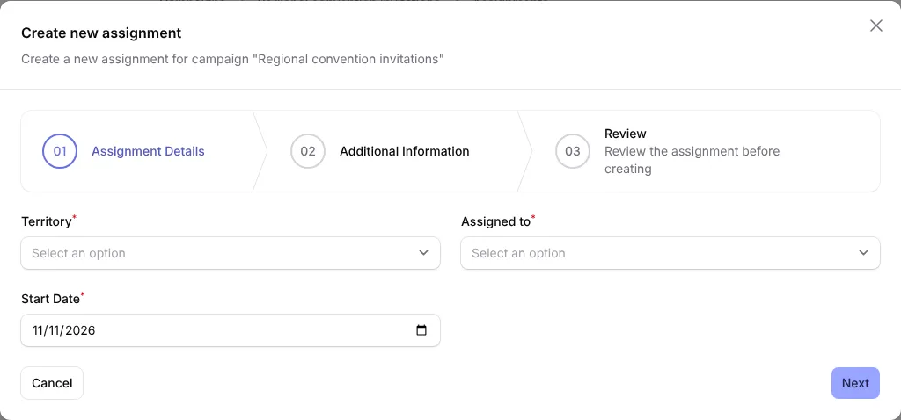

A campaign is a special activity with a start and an end, for example the distribution of the invitations to the
Memorial or to a convention. Linking assignments to a campaign lets you follow how much of the territory has been
covered during it.

Campaigns are optional: an assignment can also have no campaign.

## Campaign status

The **Campaign Status** column is calculated from the **Valid Until** date:

| Status | Meaning |
|--------|---------|
| **Active** | No end date, or more than 7 days left. |
| **Expiring** | 7 days or less left. |
| **Almost Expired** | 3 days or less left. |
| **Terminated** | The end date has passed. Territories can no longer be assigned to the campaign. |

7 and 3 days are the defaults: the super administrators can change them from the
[settings](../administration/settings#campaigns). The other pages of this guide use the defaults.

The number of campaigns ending within 7 days appears in amber next to **Campaigns** in the sidebar.

## Creating a campaign

1. Open **Campaigns** and click **New campaign**.
2. Enter the **Name** and optionally a **Description**, a **Short Name** (e.g. `MEM`) and a **Color**.
3. In **Validity dates**, set **Valid From** and **Valid Until**. Leave them empty for a campaign that is always valid.
4. Click **Create**.

Every user who can log in is notified of the new campaign.

## Following a campaign

Click a campaign to open its page. At the top, two indicators summarize its progress:

- **Remaining days**: days left before the end of the campaign (∞ if it has no end date);
- **Completion status**: the percentage of all the territories that have been assigned during the campaign. It turns
  orange or red when the time is running out compared to the work done, e.g. *Less than 50% of the time remains, but
  only 33% of the territories have been assigned*.

At the bottom, the **Assignment status overview** chart shows how many territories are *To be assigned*,
*In progress* and *Completed*.

## Managing the campaign assignments

The **Assignments** tab of a campaign lists its assignments (by default the ones in progress).

- **New territory assignment** opens a guided procedure in three steps: **Assignment Details** (territory, assignee and
  start date), **Additional Information** (notes) and **Review**. Only territories that are not already out are offered.
  The button is not shown once the campaign has ended.
- Tick some assignments and choose **Terminate assignments** from the bulk actions to return them all at once, for
  example when the campaign ends. Assignments that were already returned are skipped.
- Assignments still in progress when the campaign has ended, or ends within 7 days, are highlighted in red or amber
  (see [Assignment history](history)).

You can also assign territories to a campaign when assigning them from the territories list, by choosing the campaign
in the **Campaign** field (see [Assigning and returning](assigning)).

> 💡 **Tip:** in the **Territories** list, **Group by → Campaign** shows which territories are being worked for each
> campaign.
