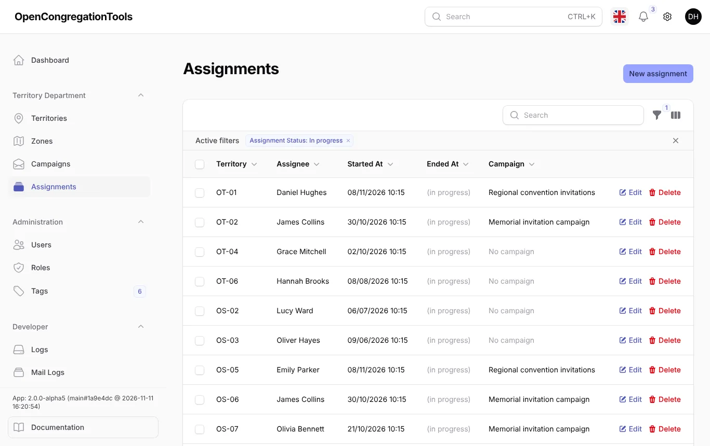
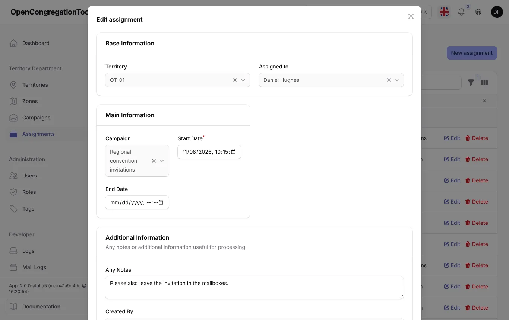

Every assignment, in progress or returned, is kept. You can find them:

- in **Assignments** in the sidebar, for all territories;
- in the **Assignment History** tab of a territory;
- in the **Assignments** tab of a user;
- in the **Assignments** tab of a campaign.

The table shows the **Territory**, the **Assignee**, the **Started At** and **Ended At** dates (*(in progress)* if not
returned yet) and the **Campaign**, which can be hidden with the columns button.

## Assignments of ended or ending campaigns

Assignments still in progress whose campaign has ended, or ends within 7 days, stand out in the table:

- a **red** edge on the left of the row when the campaign has ended, an **amber** one when it ends within 7 days;
- under the campaign name, when it ended or when it ends (e.g. *Campaign ended 3 days ago*, *Campaign ends in 5 days*).

Above the table, the **Campaign ended** and **Campaign ending soon** tabs show only those assignments, with their
number. When some territories are still out for a campaign that has ended, a banner says how many: **Show them** opens
the **Campaign ended** tab, and **Return all** returns them all at once, if your role allows it.

The number of territories still out for an ended campaign also appears in red next to **Assignments** in the sidebar.

## Filters

By default only the assignments **in progress** are shown, also in the tabs of a territory, a user and a campaign: to
see the returned ones too, open the filters and choose *All statuses*. The number next to these tabs counts all the
assignments, returned ones included. The filters are:

- **Assignment Status**: *All statuses*, *Returned* or *In progress*;
- **My assignments only**: only the territories assigned to you;
- **Deleted records**: show the deleted assignments too.

## Assignment details

Click a row to open the assignment. The page shows:

- **Territory Information**: territory, zone, its map and image, description and notes;
- **Assignment Information**: assignee, campaign, start and end of the assignment.

If the campaign of the assignment has ended, or ends within 7 days, a banner at the top of the page says so and
reminds to return the territory. If your role allows it, **End Assignment** in the banner returns it right away.

If the assignee has asked to return the territory (see [Assigning and returning](assigning#return-requests)), a banner
says when: **End Assignment** in the banner returns it, if your role allows it. The assignee asks it with
**Ask to return** at the top of the page, offered until they have asked.

While the assignment is in progress and no banner offers it, **End Assignment** at the top of the page returns the
territory, if your role allows it (see [Assigning and returning](assigning#returning-a-territory)). From the **Actions** menu you can share the
assignment with a public link (see [Sharing an assignment](sharing)).

## Correcting an assignment

Click **Edit** on a row to change the **Start Date**, the **End Date** or the notes: the territory, the assignee, the
campaign and who created the assignment are shown but cannot be changed. Setting the **End Date** returns the territory.

**Delete** moves an assignment to the trash, from where it can be restored. Deleted assignments do not count in the
history and the statistics (when the territory was last worked, the coverage, the campaigns), as the confirmation
reminds: to record that a territory has been worked, return it with **End Assignment** instead. **Force delete**
removes a deleted assignment permanently, and cannot be undone.

## Who can see what

Users allowed to see all assignments see everything described above. The others (e.g. publishers) only see **their own
assignments**, wherever assignments are listed.
