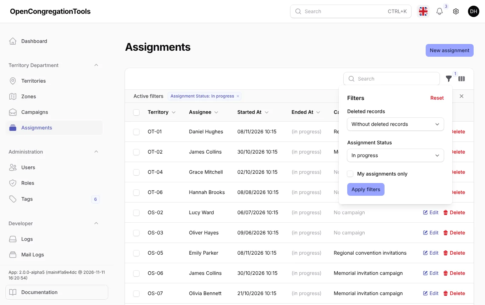
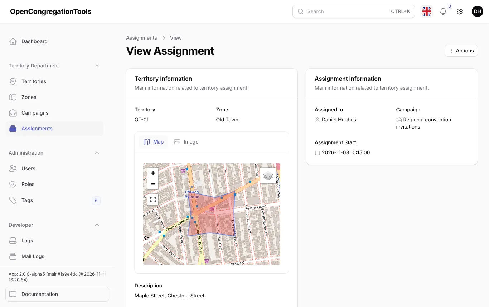

Every assignment, in progress or returned, is kept. You can find them:

- in **Assignments** in the sidebar, for all territories;
- in the **Assignment History** tab of a territory;
- in the **Assignments** tab of a user;
- in the **Assignments** tab of a campaign.

The table shows the **Territory**, the **Assignee**, the **Started At** and **Ended At** dates (*(in progress)* if not
returned yet) and the **Campaign**.

## Filters

By default only the assignments **in progress** are shown. Open the filters to change it:

- **Assignment Status**: *All statuses*, *Returned* or *In progress*;
- **My assignments only**: only the territories assigned to you;
- **Deleted records**: show the deleted assignments too.

## Assignment details

Click a row to open the assignment. The page shows:

- **Territory Information**: territory, zone, its map and image, description and notes;
- **Assignment Information**: assignee, campaign, start and end of the assignment.

From the **Actions** menu you can share the assignment with a public link (see [Sharing an assignment](sharing)).

## Correcting an assignment

Click **Edit** on a row to change the territory, the assignee, the campaign, the start and end dates, the notes or who
created it. Setting the **End Date** returns the territory.

**Delete** moves an assignment to the trash, from where it can be restored. Deleted assignments do not count in the
history and the statistics.

## Who can see what

Users allowed to see all assignments see everything described above. The others (e.g. publishers) only see **their own
assignments**, wherever assignments are listed.
