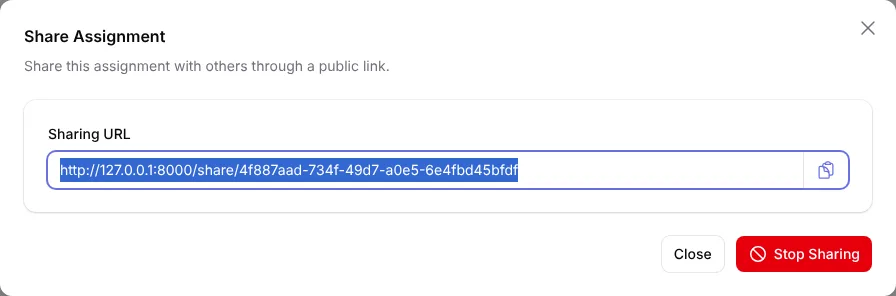
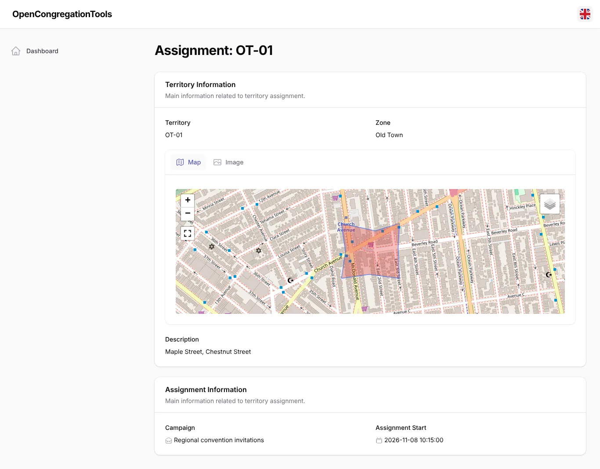

You can share an assignment with a **public link**, for example to send the territory map to a publisher who does not
have an account. Whoever has the link can see the territory without logging in.

## Creating the link

1. Open the assignment (from **Assignments**, or from the history of the territory).
2. Click **Actions → Share**.
3. Click **Create link**: until you do, the assignment is not shared.
4. Click the copy button next to **Sharing URL** and send the link (by message, email, …).

The link stays the same every time you open **Share** for that assignment.

Only assignments in progress can be shared: once the territory is returned (or the assignment deleted) **Share** is no
longer offered and the link stops working.

Publishers can also share the assignments given to them (and stop sharing them), from the link in the notification
of the assignment, even if they cannot see the other assignments.

## What the recipient sees

The public page shows the territory name, its zone, map, image and description, the campaign and the start date of the
assignment. It has no sidebar or menu, and its dates are in the timezone of the congregation.

If the super administrators allow it from the [settings](../administration/settings#territories), the page also shows
**Ask to return**: whoever has the link can ask the territory department to close the assignment, as the assignee can
from the application (see [Assigning and returning](assigning#return-requests)).

> 🔒 **Privacy:** by default the public page does **not** show the name of the assignee nor the territory notes, which
> may contain personal information. The super administrators can enable them from the
> [Settings](../administration/settings) page. The shared pages also ask search engines (e.g. Google) not to index them,
> so they don't show up in search results.

## Stopping sharing

Open **Actions → Share** again and click **Stop Sharing**, then confirm. The link stops working immediately. If you
share the assignment again later, a new link is created.

The super administrators can also turn sharing off for everyone, from the
[settings](../administration/settings#territories): **Share** is then no longer offered and all the existing links are
deleted.
