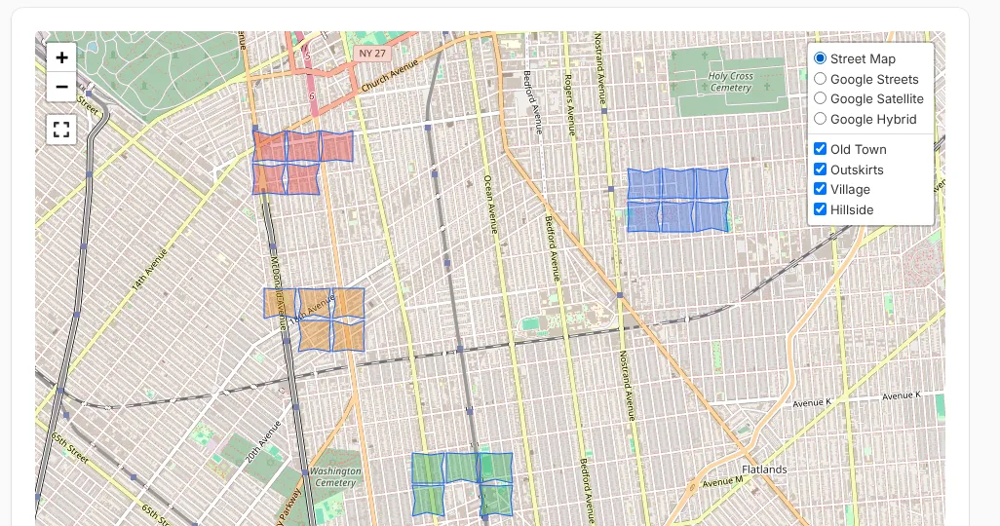

The dashboard is the first page you see after logging in. It gives an overview of the whole territory register.

## Statistics

- **Territories**: the total number of territories.
- **Average monthly assignment duration**: how many days, on average, a territory stayed out before being returned,
  calculated on the assignments started in the last 365 days. The small chart shows how the average changed month by
  month.

The statistics refresh automatically every few seconds.

## Territory map

The map shows every **residential** territory that has a map. Commercial territories and territories without a map
are not shown.

The menu at the top right of the map chooses how the territories are colored. The selection is remembered while you
stay logged in.

| Option | Colors |
|---|---|
| **Zone** (default) | The color of the territory's **zone**. |
| **Current status** | 🟩 **available** (not assigned); ⬜ **not available** (assigned and not returned yet). |
| **Assignment frequency** | How many times the territory was assigned in the **last 12 months**: 🟥 **low** (never); 🟧 **medium** (once); 🟩 **frequent** (twice or more). The super administrators can change the months and the thresholds in the [Settings](../administration/settings#territories). |
| **Campaign status** | The progress of the territory in the campaign chosen in the menu next to it: 🟥 **out for another assignment** (assigned outside of the campaign, so it cannot be assigned for it yet); ⬜ **to be assigned**; 🟧 **in progress** (assigned for the campaign); 🟩 **worked** (returned for the campaign). |

**Campaign status** is only offered when there is a campaign that is not terminated. It shows the active campaign
that started last (or, if none is active, the next one to start), and any other campaign that is not terminated can
be chosen.

Under the map, the **legend** lists the colors with the number of territories of each one.

- Use **+** and **−** (or the mouse wheel) to zoom, and drag to move around.
- Hover a territory to see its name, and click it to see its zone, its status and a link to its page (if you can
  view the territories).
- The **full screen** button enlarges the map to the whole screen.
- The **layers** button (top right) lets you:
  - choose the **base map**: *Street Map* (OpenStreetMap), *Google Streets*, *Google Satellite* or *Google Hybrid*;
  - show or hide the territories of each **zone**.

> 💡 **Tip:** zone colors are set when editing a zone (see [Zones](../territories/zones)). Pick clearly different colors
> so that neighbouring zones are easy to tell apart.
