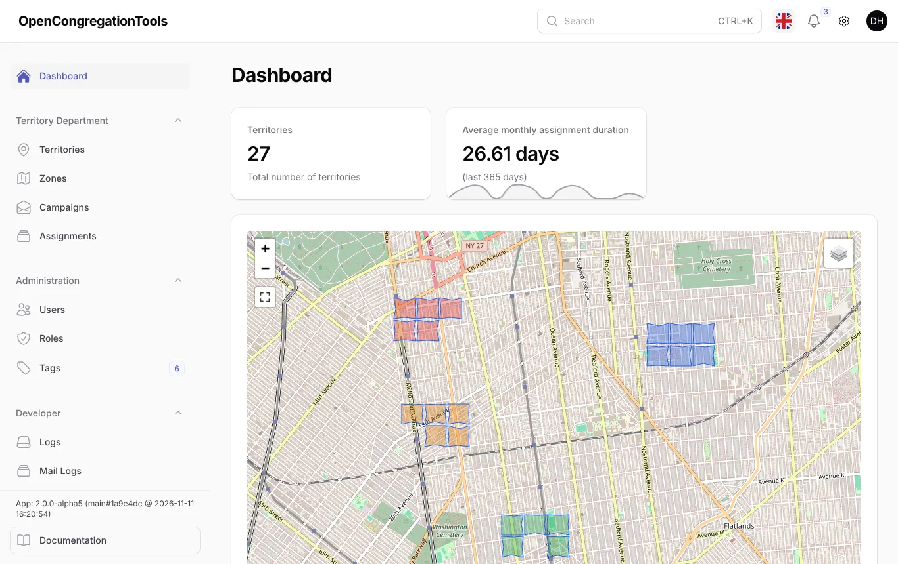

The dashboard is the first page you see after logging in. It gives an overview of the whole territory register.

## Statistics

- **Territories**: the total number of territories.
- **Average monthly assignment duration**: how many days, on average, a territory stayed out before being returned,
  calculated on the assignments started in the last 365 days. The small chart shows how the average changed month by
  month.

The statistics refresh automatically every few seconds.

## Territory map

The map shows every **residential** territory that has a map, colored with the color of its **zone**. Commercial
territories and territories without a map are not shown.

- Use **+** and **−** (or the mouse wheel) to zoom, and drag to move around.
- The **full screen** button enlarges the map to the whole screen.
- The **layers** button (top right) lets you:
  - choose the **base map**: *Street Map* (OpenStreetMap), *Google Streets*, *Google Satellite* or *Google Hybrid*;
  - show or hide the territories of each **zone**.

> 💡 **Tip:** zone colors are set when editing a zone (see [Zones](../territories/zones)). Pick clearly different colors
> so that neighbouring zones are easy to tell apart.
