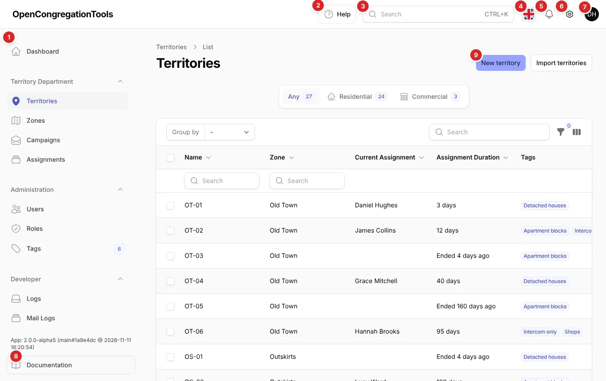
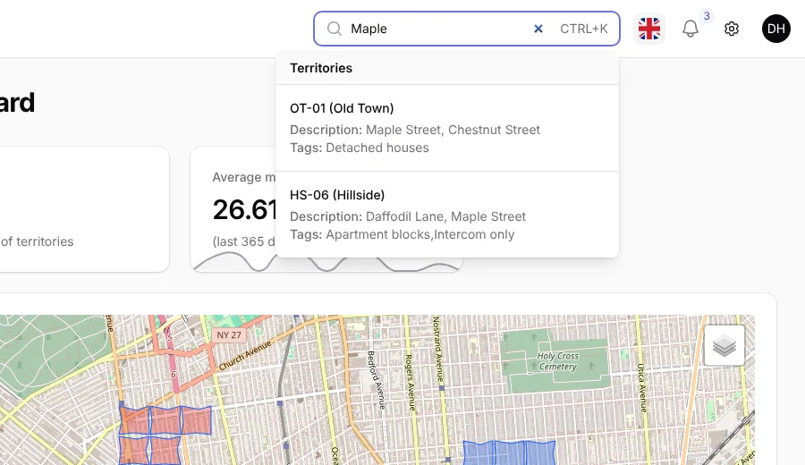
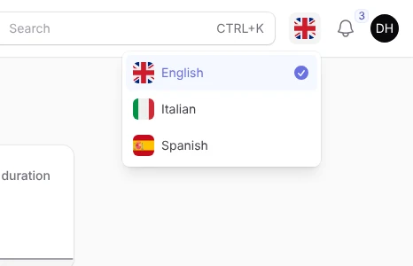
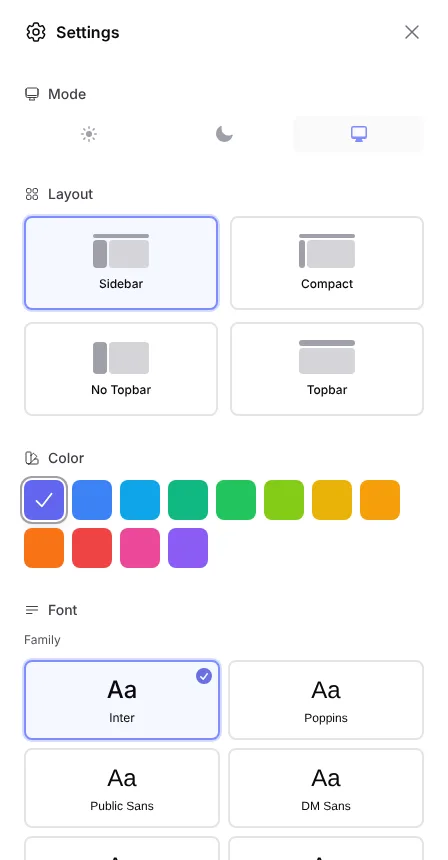
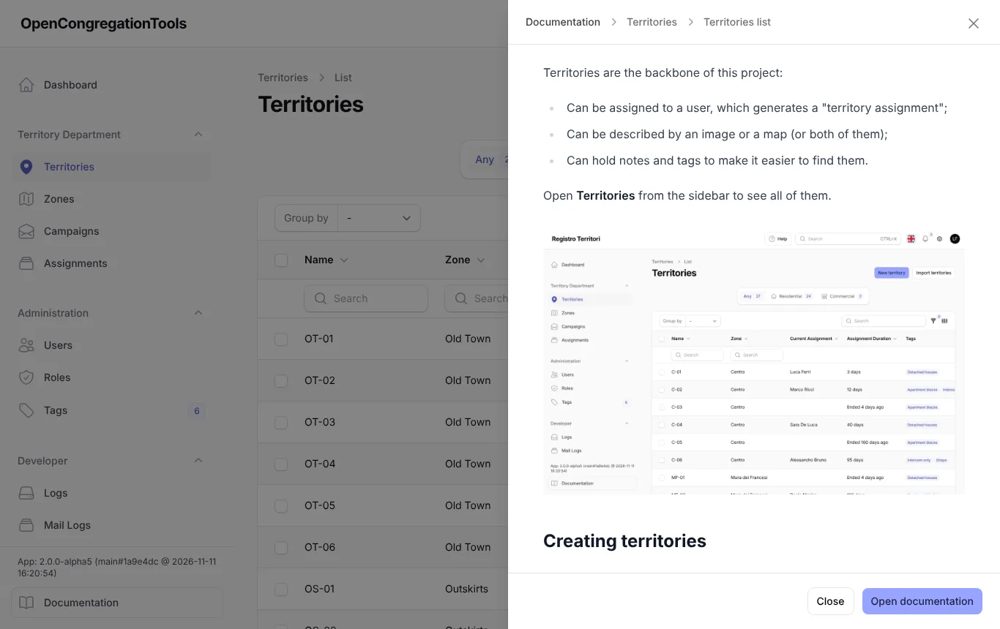
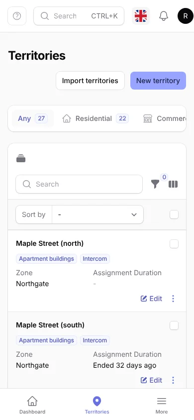

Every page of the application shares the same layout.

1. **Sidebar**: the menu, divided into groups. You only see the items your role allows you to use.
   - **Territory Department**: Territories, Zones, Campaigns and Assignments;
   - **Administration**: Users, Roles and Tags.
2. **Help**: opens the page of this guide that explains the current screen, in a side panel.
3. **Global search**: searches territories, zones and campaigns at once (see below).
4. **Language**: switches the language of the interface (English, Italian or Spanish).
5. **Notifications**: the bell shows the number of unread notifications (see [Notifications](notifications)).
6. **Settings**: customizes the look of the application (see below).
7. **User menu**: your profile and the **Sign out** button.
8. **Documentation**: opens this guide. Above it you can read the version of the application.
9. **Page actions**: the main buttons of the current page (e.g. **New territory**).

## Global search

Click the search field (or press <kbd>Ctrl</kbd>+<kbd>K</kbd>, <kbd>⌘</kbd>+<kbd>K</kbd> on Mac) and start typing. The
search looks into:

- **territories**: name, description, zone, notes and tags;
- **zones**, **campaigns** and **tags**: name.

Click a result to open it.

## Changing language

Click the flag in the top bar and pick a language. The choice is remembered for your browser. The language of the
emails you receive is set in your [profile](profile) instead.

## Customizing the look

The **Settings** button (gear icon) opens a panel where each user can personalize the interface. The choices are saved
in the browser:

- **Mode**: light, dark or follow the system;
- **Layout**: sidebar, compact sidebar, no top bar or top navigation bar;
- **Color**: the accent color;
- **Font**: font family and size, and the **density** of the interface.

## Help panel

On pages linked to this guide, the **Help** button opens the related documentation in a side panel, without leaving
the page. Click **Open documentation** to read it in full.

## Tables

Most pages show a table. All tables work the same way:

- click a **column header** to sort;
- use the **Search** field above the table, or the search fields under some headers, to filter the rows;
- the **filter** button (funnel icon) opens the available filters; the number on it tells how many are active;
- the **columns** button lets you show or hide optional columns;
- tick the **checkboxes** on the left to select rows and run **bulk actions** on them;
- the **Per page** selector at the bottom changes the number of rows shown.

## Unsaved changes

If you try to leave a page with unsaved changes, the application asks for confirmation.

## On smartphones

On small screens the sidebar is replaced by a **bottom navigation bar**. Tap **More** to reach the other menu items.
Forms and dialogs open as panels sliding from the side, which are easier to use with a finger.

