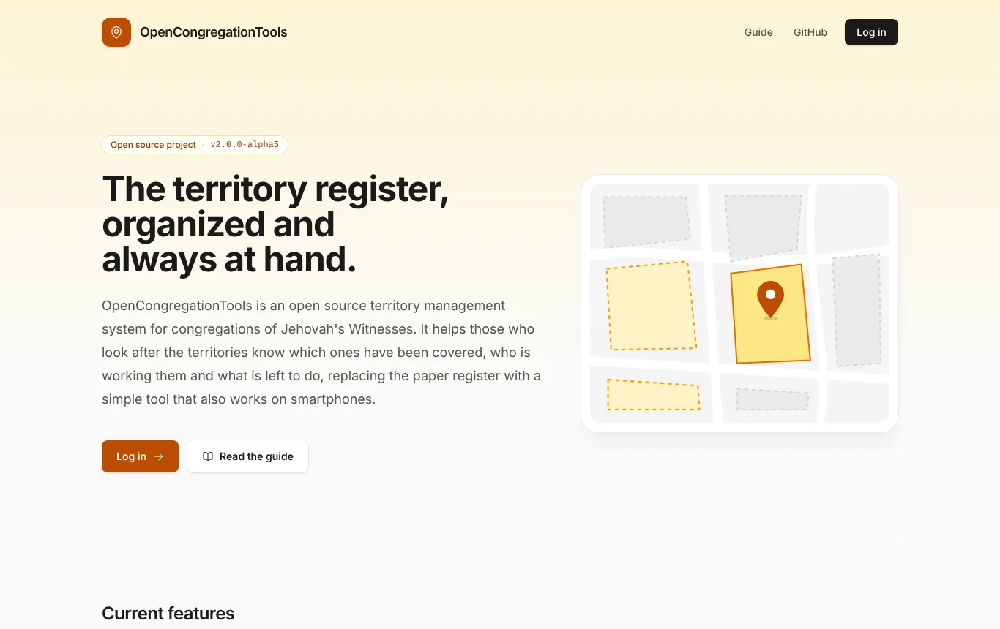
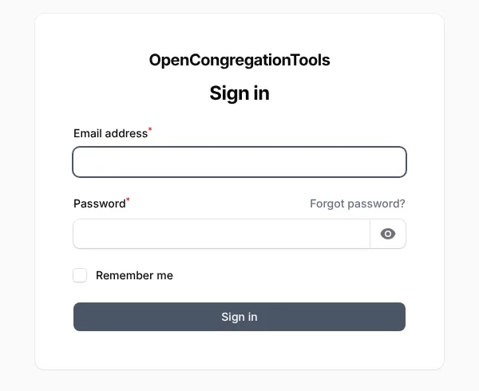
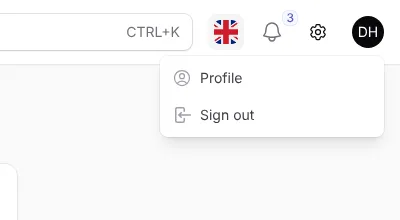

The home page of the application describes the project and has three links: **Guide** (this documentation),
**GitHub** (the source code) and **Log in**.

## Signing in

1. Click **Log in** (or open `/app/login` directly).
2. Enter your **email address** and **password**.
3. Tick **Remember me** if you are on a personal device, then click **Sign in**.
4. If you turned on [two-factor authentication](profile#two-factor-authentication), enter the 6-digit code shown by
   your authenticator app (or a recovery code) and click **Confirm sign in**.

> ℹ️ **Note:** accounts are created by an administrator: there is no self-registration. When you are given access, you
> receive an email: click **Choose password** in it to choose your password. If you do not have an account, ask the
> person who manages the territories in your congregation.

## Forgotten password

Click **Forgot password?** on the login page, enter your email address and follow the link you receive by email to
choose a new password.

## Who can log in

Only users with **Allow access** enabled can log in. Users without it are *virtual users*: territories can be assigned
to them, but they cannot open the application (see [Users](../administration/users)).

## Signing out

Open the user menu (your initials in the top right corner) and click **Sign out**.

## Reading the documentation without logging in

This guide is available at `/knowledge-base` and can be read by anyone, even without an account.
