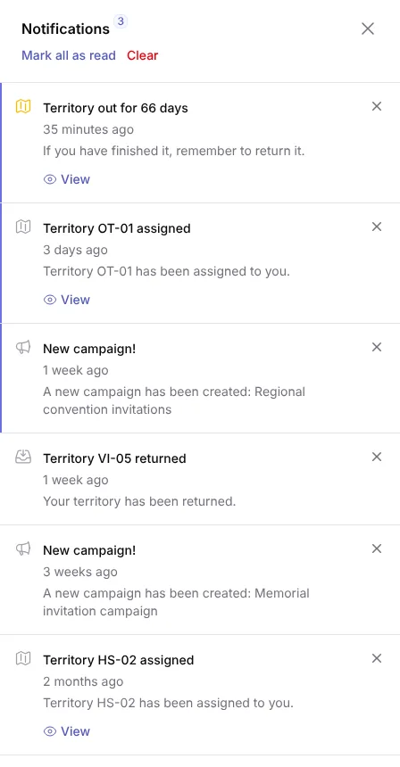

The application informs you about the events that concern you, both **inside the application** (the bell in the top
bar) and **by email**, in the language chosen in your [profile](profile).

## When you receive a notification

| Event | Who is notified |
|-------|-----------------|
| **Territory assigned** | the person who received the territory |
| **Territory returned** | the person who had the territory |
| **New campaign** | every user who can log in |
| **Territory out for *N* days** | the person who has had a territory for more than 60 days. The reminder is sent every Monday until the territory is returned. |

## Managing notifications

- Click the **bell** to open the panel. Unread notifications are highlighted and counted on the bell.
- Click **View** to open the related territory or assignment.
- Click **×** to remove a single notification.
- **Mark all as read** and **Clear** act on all of them at once.

> ℹ️ **Note:** emails are sent in the background. If they arrive late, ask your administrator to check that the
> scheduled tasks are configured (see the [Setup guide](../setup)).
