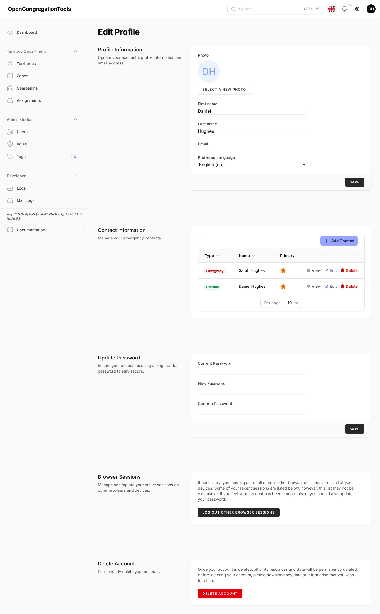
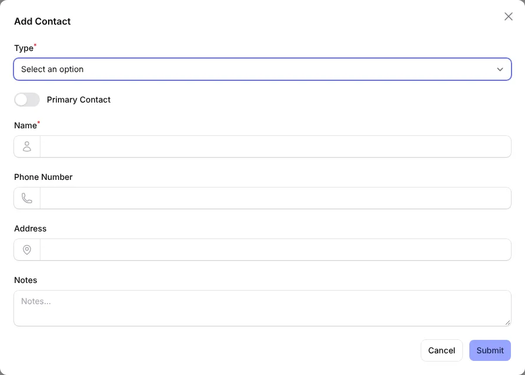
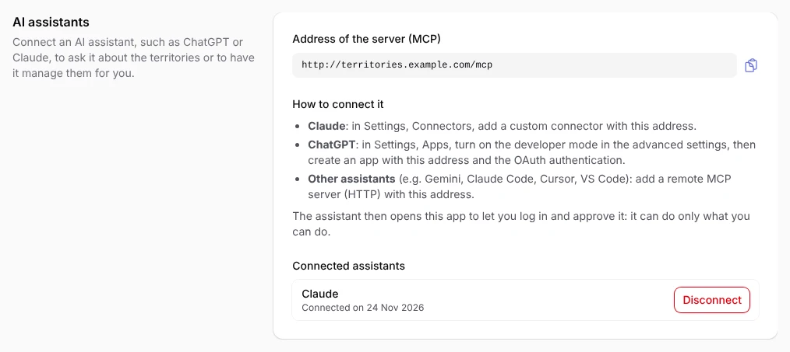

Open the user menu (your initials in the top right corner) and click **Profile**.

## Profile information

- **Photo**: click **Select a new photo** to upload a profile picture, shown instead of your initials.
- **First name**, **Last name** and **Email**.
- **Preferred language**: the language of the emails and notifications you receive.

Click **Save** to apply the changes.

## Contact information

Here you can store the contacts to call in case of need, for example an emergency contact. Administrators can see them
from the user's page (see [Users](../administration/users)).

To add a contact:

1. Click **Add contact**.
2. Choose the **Type**: *Personal*, *Emergency*, *Business* or *Other*.
3. Enable **Primary contact** if this is your main contact. You can have only one: enabling it on a contact turns it
   off on the previous one, whatever its type.
4. Fill in the **Name** and at least a **Phone number** or an **Address**, plus optional **Notes**.
5. Click **Submit**.

Use **View**, **Edit** and **Delete** next to each contact to manage it. When viewing a contact, the **Call** and
**Open in Maps** buttons start a phone call or open the address in your maps app.

## Install the app

Click **Install** to install the application on this device, to open it like any other app (see
[Installing the app](interface#installing-the-app)). The section appears only when the browser can install it, and says
so when the application is already installed.

## Push notifications

Receive the notifications on this device too, even when the application is closed: click **Enable on this device**.
See [Notifications](notifications#push-notifications).

## AI assistants

Connect an AI assistant, such as ChatGPT, Claude or Gemini, to ask it about the territories (e.g. *"Which territories
have not been worked for six months?"*) or to have it assign and return them for you. The section appears only when the
administrators allow the AI assistants (see [Settings](../administration/settings#security)).

1. Copy the **Address of the server (MCP)** with the button next to it.
2. Add it to your assistant:
    - **Claude**: in *Settings*, *Connectors*, add a custom connector with this address;
    - **ChatGPT**: in *Settings*, *Apps*, turn on the developer mode in the advanced settings, then create an app with
      this address and the OAuth authentication;
    - **other assistants** (e.g. Gemini, Claude Code, Cursor, VS Code): add a remote MCP server (HTTP) with this
      address.
3. The assistant opens this application: log in, check the name of the assistant and the site you will go back to,
   then click **Approve**.

The assistant can read and do only what you can do in the application, and asks you to confirm before changing
anything. **Connected assistants** lists the ones you approved: click **Disconnect** to remove the access of one of
them, which must then be approved again.

> ⚠️ **Warning:** what the assistant reads (e.g. the names of the publishers) is sent to the company that provides it.
> Ask it only what you need.

## Update password

Enter your **Current password**, then the **New password** twice and click **Save**. Use a long, random password: it
must have at least 12 characters and, unless the administrators turned the check off, must not appear in a known data
leak. The same rules apply when you choose your password from an invitation or with **Forgot password?**.

## Two-factor authentication

Protect your account with a code from an authenticator app on your phone (for example Google Authenticator, Microsoft
Authenticator or Authy), asked after your password at every login.

1. Under **Authenticator app**, click **Set up**.
2. Scan the QR code with the authenticator app (or type the key shown below it).
3. Save the **recovery codes** somewhere safe: each one lets you log in once if you lose your phone.
4. Enter the 6-digit code shown by the app to confirm.

From then on you can **Regenerate recovery codes** or **Turn off** two-factor authentication from the same section. If
the administrators require it (see [Settings](../administration/settings#security)), you are asked to set it up before
using the application, and you cannot use it without.

## Browser sessions

Lists the devices where you are logged in. Click **Log out other browser sessions** (and confirm with your password) if
you used a shared computer or think someone else accessed your account.

## Delete account

Permanently deletes your account. This cannot be undone.

> ⚠️ **Warning:** the root user (the first user created during the installation) can never be deleted.
