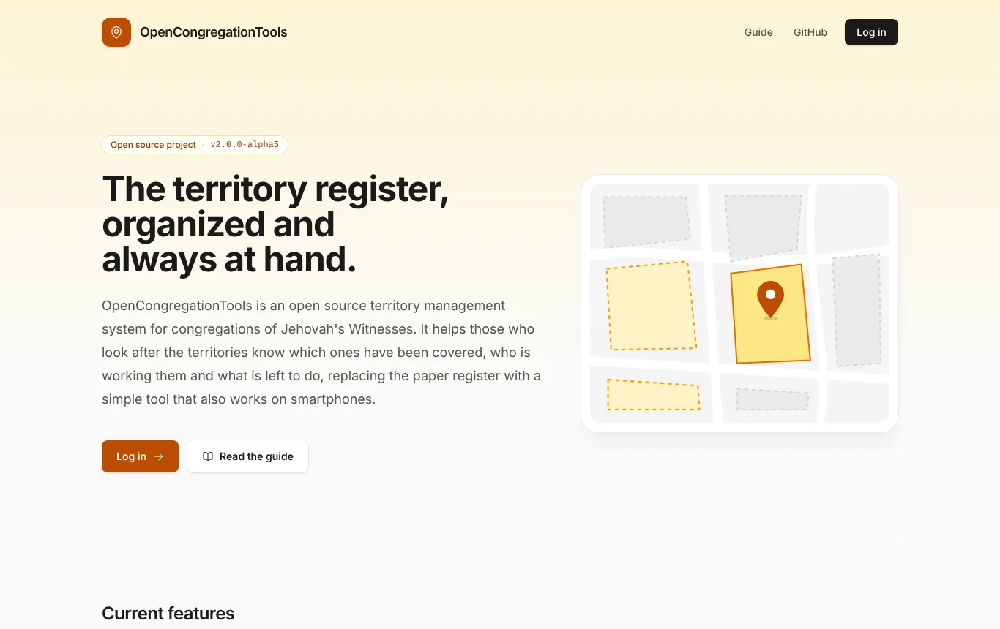

# OpenCongregationHelper

This project aims at having an **Open Source** territory management system for **Jehovah's Witnesses**.

It replaces the paper territory register: it keeps track of which territories exist, who is working
them, since when, and which ones have been covered. It runs in the browser and also works on smartphones.

> 💡 **Try it:** the [public demo](https://ochdemo.altervista.org) runs the latest version with dummy data. Anyone can
> sign in to it as administrator and its data is reset every night: never enter real names or addresses there.

## Key concepts

| Concept | What it is |
|---------|------------|
| **Territory** | An area to be worked, identified by a name (e.g. `OT-01`). It can have a map drawn on OpenStreetMap, an image (e.g. a scanned paper card), notes and tags. A territory is either *residential* or *commercial*. |
| **Zone** | A group of territories (e.g. a neighbourhood). Each zone has a color, used on the dashboard map. Territory names are unique inside the same zone. |
| **Assignment** | The fact that a territory has been given to a person, with a start date and, once returned, an end date. A territory can have only one assignment in progress at a time. All past assignments form its history. |
| **Campaign** | An optional label for assignments made for a special activity (e.g. the Memorial invitations), with validity dates and progress statistics. |
| **User** | A person registered in the application. Users can be *virtual* (they receive territories but cannot log in) or have access to the application with one or more **roles**. |

## How this guide is organized

- **Basics**: logging in, the interface, the dashboard, your profile and notifications.
- **Territories**: browsing, creating, mapping and importing territories, and organizing them into zones.
- **Assignments**: assigning and returning territories, the assignment history, sharing assignments and campaigns.
- **Public Witnessing**: the posters and the places where they are stored.
- **Publications**: the regular publications and the publication requests of the publishers.
- **Administration**: users, roles and permissions, departments, tags and settings.
- **Guides**: step-by-step walkthroughs of the most common tasks.
- **[Setup guide](setup)** and **[Backup and upgrade](backup-and-upgrade)**: installing, backing up and upgrading the
  application, for whoever maintains it.

> 💡 **Tip:** while using the application, the **Help** button in the top bar (where available) opens the page of this
> guide that describes the current screen. The **Documentation** button at the bottom of the sidebar opens the whole
> guide, which can also be read without logging in.

## How can I contribute?

- Report bugs or suggest features using the [Issues](https://github.com/OpenCHelper/OpenCongregationHelper/issues):
  to report a bug from the application, open the user menu, click **About** and then **Report a bug**, which fills in
  the details of your installation for you;
- If you have the required programming skills, you can contribute by making [Pull Requests](https://github.com/OpenCHelper/OpenCongregationHelper/pulls);
- Help translate the UI in other languages, or improve existing ones.

The full code can be found on its [official Github repository](https://github.com/OpenCHelper/OpenCongregationHelper).
