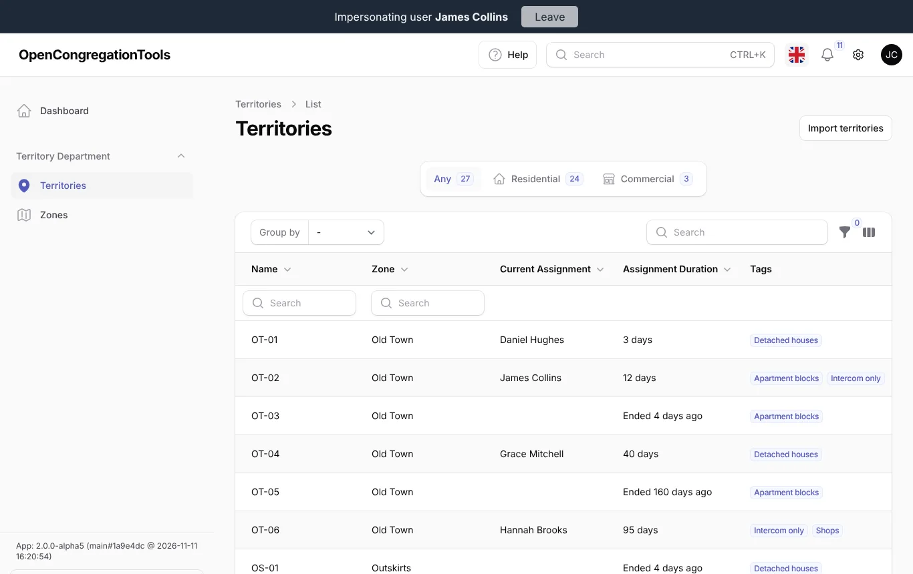

If you received an account to see your territories, this is what you need to know. Depending on the permissions
given by your congregation, some menu items may be missing.

## Finding your territories

- The **Territories** list shows all the territories, with who is working them. Click one to see its map or image.
- The **notifications** (bell icon) tell you when a territory is assigned to you, and remind you when you have had it
  for a long time. You also receive them by email.

## Using the map

In the territory page, the **Map** tab shows the boundaries of the territory on an interactive map: zoom in to read
the street names, and use the **full screen** button to see it better on a smartphone.

## Returning a territory

When you have finished, tell the person who manages the territories, or click **End Assignment** in the territory page
if your role allows it.

## Keeping your data up to date

From your [profile](../basics/profile) you can change your password, choose the language of the emails and add an
emergency contact.

## Using it on the smartphone

The application works in the browser of your phone: open its address, log in and use the bottom bar to move between
the pages. You can add it to the home screen from the browser menu to open it like an app.
