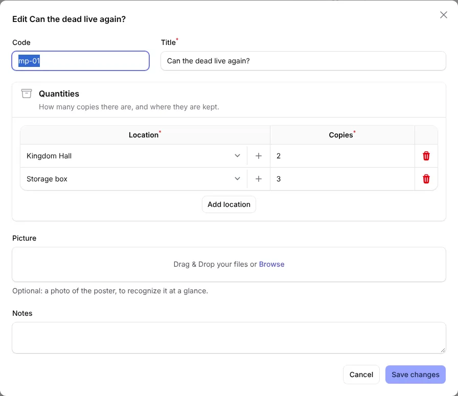
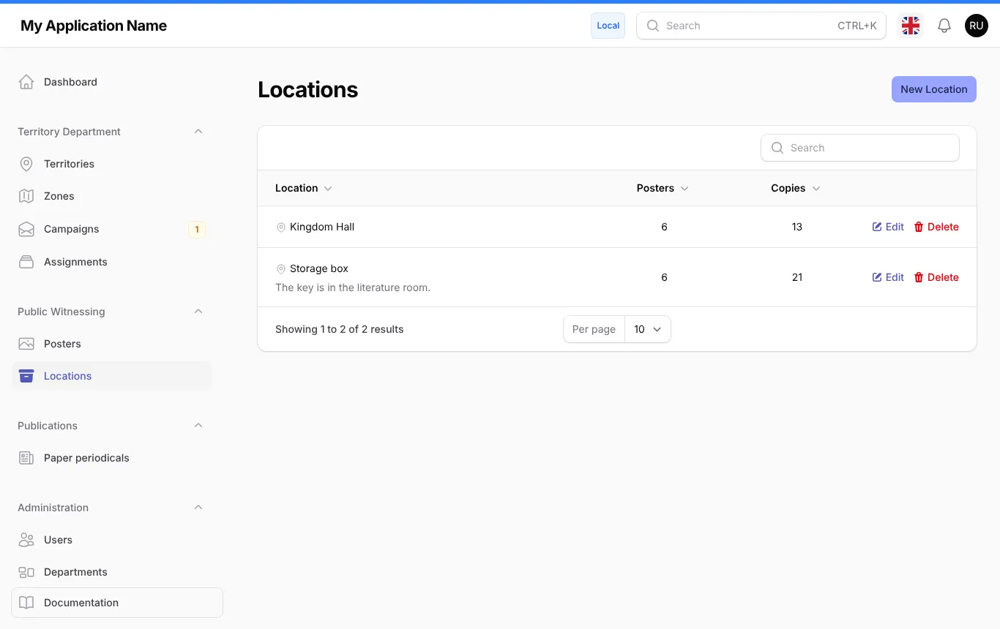

Open **Public Witnessing → Posters** to see the inventory of the magnetic posters of the carts and displays: their
**Code**, **Title**, and how many copies are kept in each location (e.g. the *Kingdom Hall* or a *storage box*).

The table has a column for each location and a **Total** column, red when no copy is left. The **Summary** row at the
bottom adds up the copies of the posters shown. Use the filters to see the posters **Kept in** a location, or only
the ones that are **Available** or **Out of stock**.

## Adding or editing a poster

1. Click **New Poster** (or **Edit** on an existing one).
2. Fill in the **Code** (optional, e.g. `mi-25`) and the **Title**.
3. Under **Quantities**, choose a **Location** and enter the number of **Copies**. Click **Add location** to add the
   copies kept in another place. To create a new location on the fly, click **+** next to the location.
4. Optionally, upload a **Picture** of the poster to recognize it at a glance.
5. Click **Create** (or **Save changes**).

## Locations

Click **Locations** at the top of the page (or **Public Witnessing → Locations**) to manage the places where the
posters are kept, with optional notes (e.g. where the key is). Each location shows how many posters and copies it
holds. Deleting a location also deletes the quantities of the posters kept there.

The members of the [Public Witnessing department](../administration/departments) can manage the posters and the
locations.
