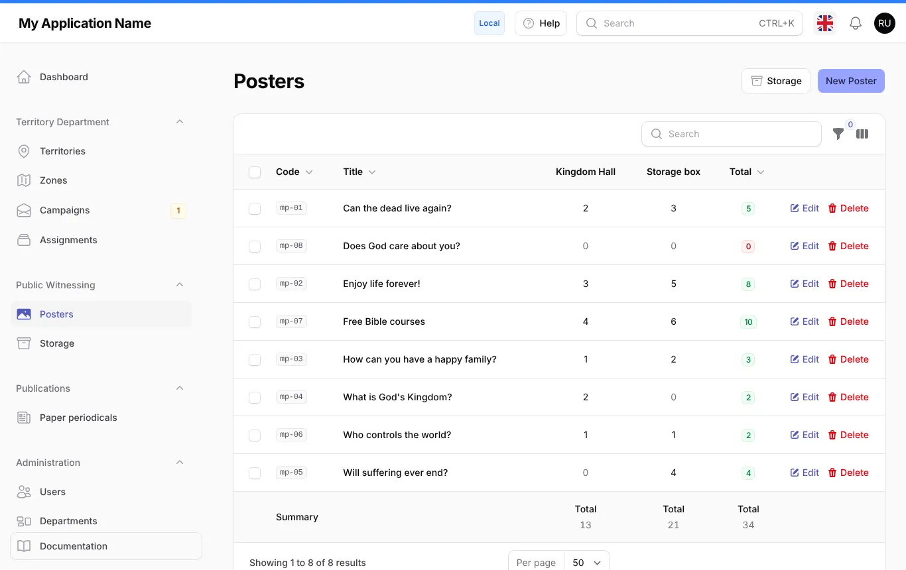
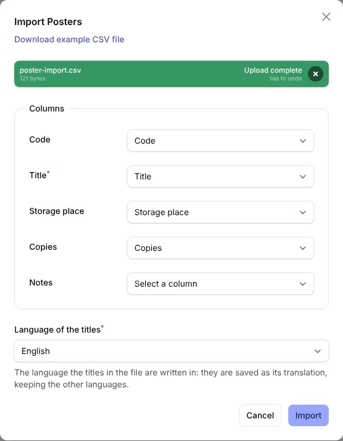

Open **Public Witnessing → Posters** to see the inventory of the magnetic posters of the carts and displays: their
**Code**, **Title**, and how many copies are kept in each storage place (e.g. the *Kingdom Hall* or a *storage box*).

The table has a column for each storage place and a **Total** column, red when no copy is left; the columns button
hides the storage places and the **Code**. The **Summary** row at the bottom adds up the copies of the posters shown.
Use the filters to see the posters **Kept in** a storage place, or only the ones that are **Available** or **Out of
stock**.

## Adding or editing a poster

1. Click **New Poster** (or **Edit** on an existing one).
2. Fill in the **Code** (optional, e.g. `mi-25`) and the **Title** in your language; you can also enter it in the
   other languages, otherwise they show it as you wrote it.
3. Under **Quantities**, choose a **Storage place** and enter the number of **Copies**. Click **Add storage place** to add the
   copies kept in another place. To create a new storage place on the fly, click **+** next to it.
4. Optionally, upload a **Picture** of the poster to recognize it at a glance.
5. Click **Create** (or **Save changes**).

## Importing and exporting posters

To load many posters at once, e.g. from an existing spreadsheet, open **Import / Export → Import Posters** at the top of
the page and upload a CSV file with a row for each poster and storage place:

| Code | Title | Storage place | Copies | Notes |
|------|-------|---------------|--------|-------|
| mi-25 | Enjoy life forever! | Kingdom Hall | 2 | |
| mi-25 | Enjoy life forever! | Storage box | 3 | |

Only the **Title** is required; **Download example CSV file** in the window gives a file to start from. The columns are
recognised by their name, in the language of the interface or in English (e.g. *Code*, *Title*, *Storage place*,
*Copies*); check them under **Columns** (a column with another name can always be chosen by hand), then click
**Import**. A notification tells when the import is over, with the rows that could not be imported.

- The rows with the same **Code** (or with the same **Title**, when there is no code) are the same poster: importing
  the file again updates the posters and their copies instead of duplicating them.
- The **Copies** of a row replace the ones of that storage place; the storage places that don't exist yet are created.
- The **Titles** are saved in the **Language of the titles** chosen in the window (your language by default): the
  translations in the other languages are kept.

To save the list of the posters, e.g. to keep a copy or to edit it in a spreadsheet, open **Import / Export → Export
Posters**, choose the columns and the **Language of the titles**, then click **Export**. A notification gives the file,
as CSV or Excel, when it is ready: it has the same columns as the import, with a row for each poster and storage place,
so it can be imported again.

## Storage

Click **Storage** at the top of the page (or **Public Witnessing → Storage**) to manage the places where the posters
are kept, with optional notes (e.g. where the key is). Each storage place shows how many posters and copies it holds.
Deleting a storage place also deletes the quantities of the posters kept there.

These are only the places where the material is **kept**, not the sites where the carts are set up.

The storage places can be imported and exported too, from **Import / Export** on their page, with a row for each one
(*Name*, *Notes*): importing a name that already exists updates its notes.

The members of the [Public Witnessing department](../administration/departments) can manage the posters and the
storage places.
