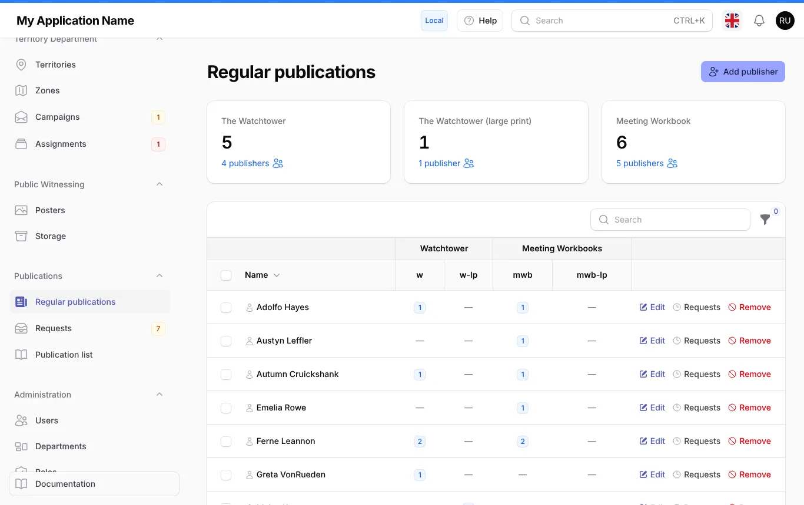
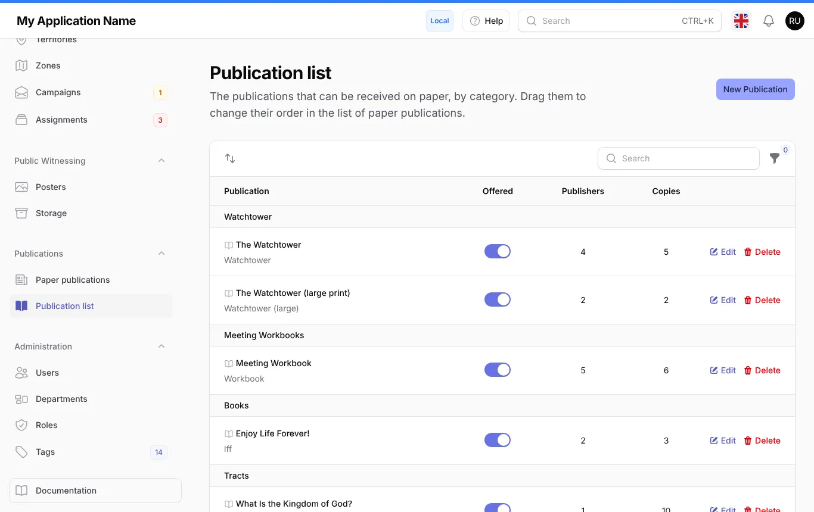

Open **Publications → Regular publications** to see who receives publications on paper regularly (e.g. *The Watchtower*
or the *Meeting Workbook*), and how many copies. Each one is [requested](requests) again automatically every period
(e.g. every month), and every request stays in the history.

There is a row for each publisher and a column for each publication (**—** when not received), grouped by category.
The cards at the top, and the **Summary** row at the bottom, show the **total copies to order** of each publication and
how many publishers receive it. Use the **Receives** filter to see only who receives a publication: the totals follow
the filters and the search.

## Adding a publisher

1. Click **Add publisher**.
2. Choose the **Publisher** (only the ones not already in the list are shown).
3. Under **Copies received**, click **Add publication**, choose the **Publication** (only the ones that renew, grouped
   by category; you can type to search it) and enter the number of **Copies**. Repeat for each publication received:
   at least one is needed. The first request of each one is made right away.
4. Optionally, add some **Notes** (e.g. who delivers them).
5. Click **Create**, or **Create & create another** to add more publishers in a row.

To change the copies click **Edit**: change the numbers (they apply to the next requests), add a publication or remove
one with its bin icon (it will no longer be requested). When a publisher no longer receives anything, click **Remove**:
their publications are no longer requested, but their history is kept and you can add them again later. The
**Requests** button opens the history of their requests.

## The publication list

The publications that can be received are not fixed: open **Publications → Publication list** to add, rename or remove
them. The list starts with the Bible (*New World Translation of the Holy Scriptures*) and the periodicals, already
translated in every language: *The Watchtower* (also in large print and the public edition), *Awake!* and the *Meeting
Workbook* (also in large print). Like any other publication, they can be changed, turned off or deleted (a deleted one
is not created again).

1. Click **New** and enter the **Name** in your language (e.g. *Enjoy Life Forever!*): you can also enter it in the
   other languages, otherwise they show it as you wrote it.
2. Choose the **Category**, as in the Watchtower Online Library: *Bibles*, *Watchtower*, *Awake!*, *Meeting Workbooks*,
   *Books*, *Brochures and Booklets*, *Tracts*, *Indexes*, *Programs*, *Manuals and Guidelines*, *DVD* or *Other*.
3. Enter its **Code** (e.g. `lff`): it is required, the same in every language and shown in the header of its column.
4. For the publications received regularly, turn on **Received regularly** and enter every how many months it **Renews**
   (e.g. 1 for *The Watchtower*, 2 for the *Meeting Workbook*); leave it off for the ones requested once (e.g. a book).
5. Click **Create**: a publication that renews gets its own column in the regular publications; all of them can be
   [requested](requests).

The publications are listed by category; drag them (with the button at the top of the table) to change their order
within it. To stop offering a publication, turn off **Offered**: it can no longer be chosen in the regular publications
and in new requests, and it is no longer requested again for whoever received it regularly, but the copies already
entered are kept. Deleting it deletes those copies and its requests too. The **Pending** column counts its requests not
delivered yet, and the **Requests** button opens their history.

To edit many publications at once, open **Import / Export** at the top of the publication list. **Export Publications**
gives a file with a row for each publication: the **Name** in your language first, then *Code*, *Category*, *Renews
every (months)* and *Offered* (`yes`/`no`), then the name in the other languages. **Import Publications** reads the same
file: a row with the code of an existing publication updates it (the names left empty keep their translation), the
others are added; the category can be written in any language.

The members of the [Publications department](../administration/departments) can manage both lists.
