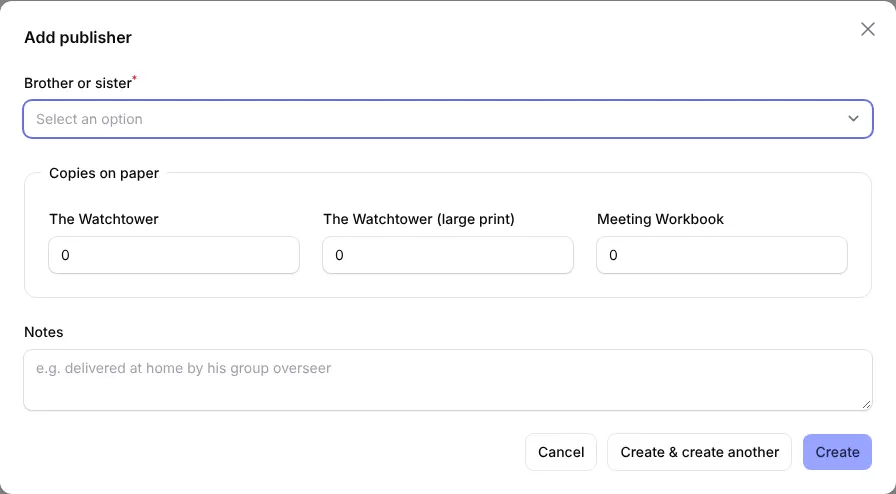

Open **Publications → Paper publications** to see who receives publications on paper (e.g. *The Watchtower* or the
*Meeting Workbook*), and how many copies.

There is a row for each publisher and a column for each publication (**—** when not received), grouped by category.
The cards at the top, and the **Summary** row at the bottom, show the **total copies to order** of each publication and
how many publishers receive it. Use the **Receives** filter to see only who receives a publication: the totals follow
the filters and the search.

## Adding a publisher

1. Click **Add publisher**.
2. Choose the **Publisher** (only the ones not already in the list are shown).
3. Enter the copies of each publication, grouped by category: leave `0` for the ones not received. At least one copy
   is needed.
4. Optionally, add some **Notes** (e.g. who delivers them).
5. Click **Create**, or **Create & create another** to add more publishers in a row.

To change the copies click **Edit**; when a publisher no longer receives anything click **Remove**.

## The publication list

The publications that can be received are not fixed: open **Publications → Publication list** to add, rename or remove
them. The list starts with *The Watchtower*, its large print edition and the *Meeting Workbook*.

1. Click **New** and enter the **Name** (e.g. *Awake!*).
2. Choose the **Category**, as in the Watchtower Online Library: *Bibles*, *Watchtower*, *Awake!*, *Meeting Workbooks*,
   *Books*, *Brochures and Booklets*, *Tracts*, *Indexes*, *Programs*, *Manuals and Guidelines* or *Other*.
3. Optionally, enter a **Short name** (e.g. the symbol `lff`), shown in the header of its column.
4. Click **Create**: the publication gets its own column and field in the paper publications.

The publications are listed by category; drag them (with the button at the top of the table) to change their order
within it. To stop offering a publication, turn off **Offered**: it disappears from the paper publications, but the
copies already entered are kept. Deleting it deletes those copies too.

The members of the [Publications department](../administration/departments) can manage both lists.
