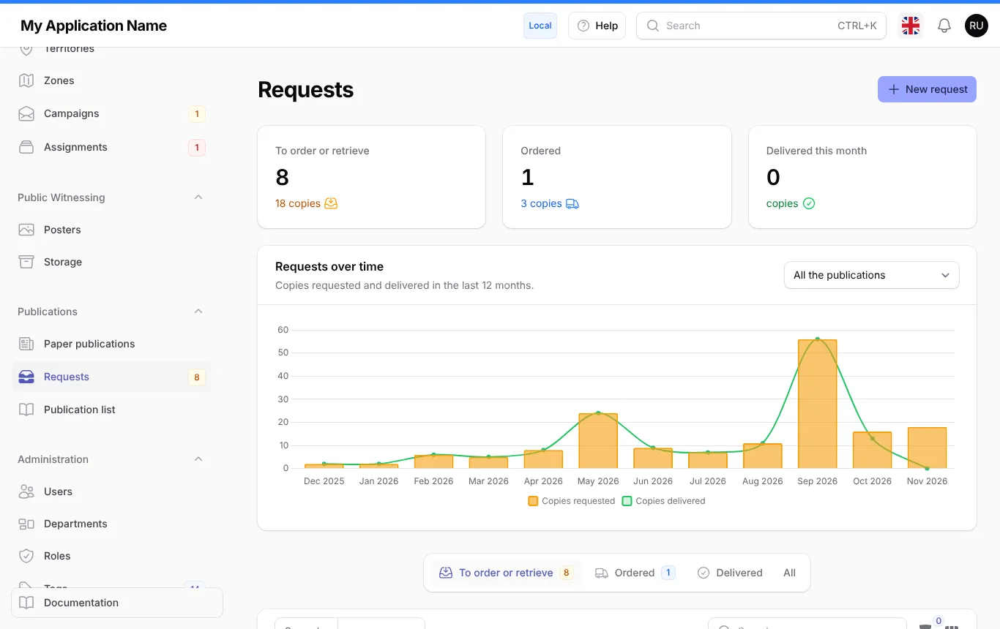
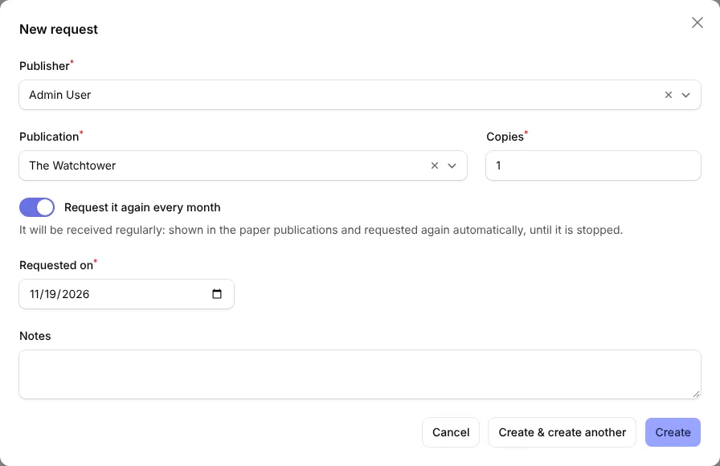

Open **Publications → Requests** to see every publication requested by the publishers, from the request to the
delivery, and when there were more requests.

Each request has up to three steps:

1. **Requested**: the publisher asked for it;
2. **Ordered** (optional): it was ordered from the branch. Skip it when the copies are already in storage;
3. **Delivered**: the copies were handed over.

The tabs show the requests **To order or retrieve**, the ones **Ordered** and waiting for delivery, the ones
**Delivered**, or **All**. The number next to **Requests** in the menu tells how many are still to order or retrieve.

## Adding a request

1. Click **New request**.
2. Choose the **Publisher**, the **Publication** and the number of **Copies**, and check the date it was
   **Requested on**.
3. For a publication received regularly (e.g. *The Watchtower*), **Request it again every month** is on: the
   publication is added to the publisher's [regular publications](periodicals) and requested again automatically every
   period, until it is stopped. Turn it off for a single request.
4. Click **Create**, or **Create & create another**.

## Ordering and delivering

- Click **Ordered** on a request when you order it from the branch, and **Delivered** when you hand it over (also
  directly, when it was already in storage). Choose the date, today by default.
- To do it for many requests at once (e.g. after sending the order to the branch), select them and use the same
  actions from the menu of the selected rows.
- **Group by → Publication** adds up the copies of each publication: in the **To order or retrieve** tab, this is the
  list to order.

## The history

- The **Requests over time** chart shows the copies requested (bars) and delivered (line) in each of the last 12
  months; choose a publication at its top right to see only that one.
- The renewed requests (made automatically for the publications received regularly) have an icon with two circling
  arrows in the **Renewal** column; the **Kind** filter shows only them, or only the single requests.
- The **Requests** button of a publisher in the [regular publications](periodicals), or of a publication in the
  **Publication list**, opens the history of that publisher or publication. The page of a user has a
  **Publication requests** tab too, like their assignments.

The renewed requests are made every day by the scheduler of the application (see the [setup guide](../setup)), on
the 1st of the month of each period: a day missed is caught up the next one.

The members of the [Publications department](../administration/departments) can manage the requests.
