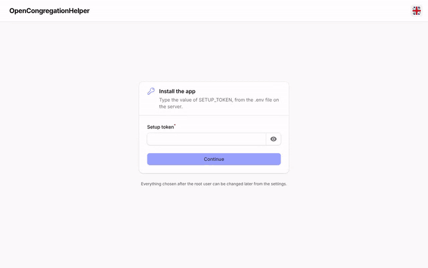

This page is meant for whoever **installs and maintains** the application. If you only need to use it, start from the
**Basics** section.

## Requirements

- PHP 8.2 or newer, with the `pdo_mysql` (or `pdo_sqlite`), `gd`, `intl` and `zip` extensions;
- a MySQL/MariaDB database (SQLite works too, mostly for local development);
- Node.js, only to build the frontend assets (`npm run build`);
- a way to send emails (the native PHP `mail()` function is supported out of the box).

The application also runs on shared hosting without shell access (e.g. Altervista): see
[Scheduled tasks and emails](#scheduled-tasks-and-emails).

## Configuration

The application is configured using the `.env` file.

> ⚠️ **Warning** ⚠️
>
> Never ever submit the `.env` file to version control.

A minimal working configuration could look like the following:

```shell
APP_NAME="My Application Name"
APP_ENV=production
APP_DEBUG=false
APP_TIMEZONE=UTC
APP_URL=https://och-instance.example.com

# Choose here your default locale
APP_LOCALE=en

DB_CONNECTION=mysql
DB_HOST=localhost
DB_PORT=3306
DB_DATABASE=my_database_name
DB_USERNAME=my_database_username
DB_PASSWORD=my_database_password
DB_ENGINE=InnoDB

# This will be the root user
INITIAL_ROOT_USERNAME="Root User"
INITIAL_ROOT_USERMAIL="root@example.com"
INITIAL_ROOT_PASSWORD="a-long-and-unique-passphrase"
```

### Main settings

`MAP_DEFAULT_CENTER`, `ENABLE_SHARED_PII`, `GUEST_ALLOW_RETURNING_ASSIGNMENT` and `PASSWORD_LEAK_CHECK` are only the
defaults: the super administrators can change them from the [Settings](administration/settings) pages, without editing
`.env`. If the settings cache is enabled (`SETTINGS_CACHE_ENABLED=true`), run `php artisan settings:clear-cache` after
changing them in `.env`, or the settings not changed from those pages keep the previous value.

| Variable | Description |
|----------|-------------|
| `APP_URL` | Public URL of the application. Used in emails and in the links of shared assignments. |
| `APP_LOCALE` | Default language (`en`, `it` or `es`). Each user can then pick their own language. |
| `APP_TIMEZONE` | Timezone used to display dates, and in which the day and time of the weekly reminders (see the [Settings](administration/settings) pages) and the daily renewal of the publications (at 9:00) are counted. |
| `DB_PREFIX` / `DB_ENGINE` | Optional table prefix and storage engine, useful on shared databases: `db:wipe` and `migrate:fresh` then drop only the tables with this prefix. |
| `TRUSTED_PROXIES` | Addresses (or CIDR ranges, comma-separated) of the reverse proxies in front of the application, whose `X-Forwarded-For` and `X-Forwarded-Proto` headers are trusted. Defaults to `*` (any peer, needed when the address of the proxy is not known, e.g. on Altervista); leave it empty when the application is reached directly, without a proxy. |
| `INITIAL_ROOT_USERNAME`, `INITIAL_ROOT_USERMAIL`, `INITIAL_ROOT_PASSWORD` | Name (first and last name separated by a space), email and password of the **root** user, created by `och:install` while the database has no users. The password follows the same rules as the passwords chosen by the users (see `PASSWORD_LEAK_CHECK`): `och:install` and `och:recover-root` refuse one that breaks them, or ask for another one when run from a terminal. |
| `PASSWORD_LEAK_CHECK` | When `APP_ENV` is `production`, the passwords need at least 12 characters (8 elsewhere). When this is `true`, they must not appear in a known data leak either: they are checked with [Have I Been Pwned](https://haveibeenpwned.com/Passwords), by sending only the first 5 characters of their SHA-1 hash to `api.pwnedpasswords.com`. If the service does not answer within 5 seconds the password is accepted. Defaults to `true` in production (set it to `false` on servers that cannot reach the service) and to `false` elsewhere. The super administrators can change it from the [Security settings](administration/settings#security). |
| `MAIL_MAILER`, `MAIL_FROM_ADDRESS`, `MAIL_FROM_NAME` | How emails are sent. `failover` tries the native PHP `mail()` function first and falls back to the log. |
| `QUEUE_CONNECTION` | `database` (recommended in production) or `sync` (emails are sent immediately, during the request). |
| `SETUP_TOKEN` | Opens the [setup wizard](#from-the-browser) while the application is not installed. Choose a long random value: the wizard removes it from `.env` once installed. |
| `SETUP_WIZARD` | `false` turns the setup wizard off, e.g. for the installations set up from the terminal. Defaults to `true`. |
| `ARTISAN_CRON_TOKEN` | Secret required by the endpoints that process the queue and the scheduled jobs. If empty, those endpoints are disabled. |
| `ENABLE_SHARED_PII` | When `true`, the public page of a shared assignment also shows the assignee's name and the territory notes. Defaults to `false`. |
| `GUEST_ALLOW_RETURNING_ASSIGNMENT` | When `true`, whoever opens the public page of a shared assignment can ask the territory department to close it (as the assignee can from the application). Defaults to `false`. |
| `DEMO_PREFILL_LOGIN_CREDENTIALS` | **Demo installations only**, with dummy data: when `true`, the login page is pre-filled with the credentials of the **root** user, so anyone can log in as root. Never enable it on an installation with real data. Always ignored when `APP_ENV` is `production`. Defaults to `false`. |
| `APP_VERSION_BRANCH_FILE`, `APP_VERSION_COMMIT_FILE` | Files the Git branch and commit are read from (by default `.git/HEAD` and `.git/refs/heads/<branch>`), shown in **About** in the user menu outside of `production`. Useful on servers without the `.git` folder. |

## Installation

### From the browser



Once the files are on the server (with the PHP dependencies and the frontend assets), add a `SETUP_TOKEN` of your
choice to the `.env` file, then open the application: until it is installed, every page opens the **setup wizard**
(`/setup`), which asks for the token and then:

1. checks the server: PHP version and extensions, HTTPS and its certificate, writable folders and `.env` file;
2. asks for the values missing from `.env` (address, timezone, language, database and email) and adds them to the file,
   after checking that the database can be reached. The values already set are shown but never changed (the passwords
   only as set), except the database settings (`DB_*`, table prefix included: a password left empty is kept) and the
   mailer (`MAIL_MAILER`), which can be switched among those of `config/mail.php` so that the test email can be sent
   another way. The database connection and the email settings can be tested before going on. The values with a fallback
   in the configuration can be left empty. The keys of the [push notifications](#push-notifications) are created when
   both are missing, and those of the [AI assistants](#ai-assistants) when missing;
3. shows how to run the [scheduled tasks and the queue](#scheduled-tasks-and-emails), with a shell (the cron lines)
   or without one (the addresses an external cron service calls, with their `ARTISAN_CRON_TOKEN`, created on request),
   and lets you choose the queue (`QUEUE_CONNECTION`);
4. creates the database tables and the permissions;
5. creates the root user (a password can be generated), and can send a test email to it;
6. sets the name, logo and colour of the app, its administrators (who are invited by email) and its features: the AI
   assistants, the sharing of the assignments and the requirements of the accounts. Requiring the email confirmation
   needs a test email that went through first; requiring two-factor authentication makes the root user set it up right
   after logging in;
7. shows a summary of the choices before installing.

Reloading the page goes on from the last step completed, with the values typed so far (except the passwords). Before
its first change, the wizard copies `.env` to `.env.backup-<date>-<time>`, next to it.

The root user it creates is also written in `INITIAL_ROOT_*` (replacing their values), for `och:recover-root`, and
`SETUP_TOKEN` is removed from `.env` (remove it yourself if the server sets it, or if the file cannot be written).
Then log in as the root user. Without a token, the wizard only explains how to add
one, so that nobody else can install the application first.

### From the terminal

1. Install the PHP dependencies and build the frontend assets:

    ```shell
    composer install --no-dev --optimize-autoloader
    npm ci && npm run build
    ```

2. Create the `.env` file (see above) and generate the application key:

    ```shell
    php artisan key:generate
    ```

3. Create the database tables, the permissions, the keys of the [AI assistants](#ai-assistants) and the root user
   with the `super_admin` role, then the `public/storage` link and the caches:

    ```shell
    php artisan och:post-deploy
    ```

    It reads the root user from the `INITIAL_ROOT_*` variables and asks for the missing ones.

4. Check that nothing is missing, then open `/app/login` and log in with the `INITIAL_ROOT_*` credentials. Then follow
   the [Setting up the congregation](guides/first-setup) guide.

    ```shell
    php artisan och:doctor
    ```

> 🔒 **The root user** is the user with ID 1, until it hands its role over to another super administrator (see
> [Users](administration/users#handing-the-root-user-over)). It can never be deleted nor impersonated and, outside of the `production`
> environment, its email, password, access and roles cannot be changed by anyone.

## Updating

Replace the files with the ones of the new version (keeping `.env` and `storage/`), then run:

```shell
php artisan och:post-deploy
```

It runs the new migrations, creates what is still missing (`och:install`), recreates the `public/storage` link and
rebuilds the caches, stopping at the first step that fails. With `--no-cache` the caches are only cleared, not built
again (e.g. on a development machine, where they would hide the changes to the code).

**Without shell access**, the commands run through the `/api/artisan/execute` endpoint, authorized by a one-time token
uploaded through FTP: `scripts/remote_artisan.sh` does both. For example:

```shell
scripts/remote_artisan.sh --base-url https://och-instance.example.com \
    --ftp-hostname <host> --ftp-username <user> --ftp-password <password> \
    och:post-deploy --no-interaction
```

## Troubleshooting

- **`php artisan och:doctor`** checks the configuration (application key and URL, HTTPS, database and migrations,
  storage link, keys of the AI assistants, root user and its two-factor authentication, super administrators, emails,
  push notifications, cron endpoints, a `SETUP_TOKEN` left after the installation) and tells what to do about each
  problem. It changes nothing, so it can run any time. The [setup wizard](#from-the-browser) checks the server the same
  way.
- **`php artisan och:recover-root`** gives the access to the root user back when nobody can manage the application
  anymore (e.g. a lost password, or its access or roles removed in production): it sets its password from
  `INITIAL_ROOT_PASSWORD` (or asks for it), lets it log in again, marks its email as verified, turns off its two-factor
  authentication and makes it a super administrator. It asks for a confirmation, or needs `--force` when run without a
  terminal (e.g. through `scripts/remote_artisan.sh`), and it is always written to the log.

## Scheduled tasks and emails

Notification emails are queued, a weekly job sends the reminders for territories that have been out for a long time and
a daily one renews the regular publications. They need something that runs periodically:

- **With shell access**, run the queue worker (`php artisan queue:work`) and the Laravel scheduler, either from the
  crontab (`* * * * * php /path/to/artisan schedule:run`) or as a long-running process (`php artisan schedule:work`,
  e.g. with Supervisor). Restart the queue worker after deploying a new version.
- **Without shell access** (shared hosting), set `ARTISAN_CRON_TOKEN` and configure an external cron service to call
  these endpoints, which are served under the `/api/artisan` path of `APP_URL`:

    ```shell
    # Process the queue (e.g. every 5 minutes)
    curl -X POST -H "X-Cron-Token: <your token>" https://och-instance.example.com/api/artisan/queue/process

    # Run the scheduled jobs (e.g. every hour)
    curl -X POST -H "X-Cron-Token: <your token>" https://och-instance.example.com/api/artisan/schedule/process
    ```

  The endpoints are rate limited (10 requests per minute).

## Push notifications

Push notifications are optional: until they are configured, the notifications are sent only by email and inside the
application, and the profile does not offer to enable them. To enable them, generate the keys once:

```shell
php artisan webpush:vapid
```

The command writes `VAPID_PUBLIC_KEY` and `VAPID_PRIVATE_KEY` to the `.env` file. Never change them afterwards, or every
user will have to enable the push notifications again. Optionally, set `VAPID_SUBJECT` to a contact of the
administrator (e.g. `mailto:admin@example.com`), given to the push services of the browsers (`APP_URL` when not set).

Push notifications need HTTPS and, like the emails, are sent by the queue (see above).

> ⚠️ **In production**, generate the keys once, by hand, and keep a copy with the other secrets of the installation:
> never let a deployment pipeline generate them. Only the test environments whose database is reset on every
> deployment (Nightly and the PR previews) get new keys every time, as their subscriptions are deleted anyway.

Users who cannot log in receive no push notifications, and their devices are forgotten when their access is revoked.

## AI assistants

The users can connect AI assistants (e.g. ChatGPT, Claude, Gemini) to the application through its MCP server
(`/mcp`), once a super administrator allows them in the [Security settings](administration/settings#security). The
assistants authorize themselves with OAuth, whose tokens are signed by two keys created once by `och:install` (also run
by `och:post-deploy`), or on their own with:

```shell
php artisan och:ensure-passport-keys
```

The command creates `storage/oauth-private.key` and `storage/oauth-public.key` only when they are missing, so it can run
on every deployment: keep them between deployments, as new keys disconnect every assistant. Like the `.env` file, they
must never be reachable from the web (the `.htaccess` of the project serves only the `public/` folder).

The assistants of ChatGPT, Claude and Gemini connect from their own servers: the application must be reachable from the
internet over HTTPS, with a valid certificate.

## Environments

Super administrators see a colored border and badge with the name of the environment (`APP_ENV`): red in
`production`, other colors elsewhere (e.g. `local`, `nightly`, `staging`), so they never confuse a test installation
with the real one.
