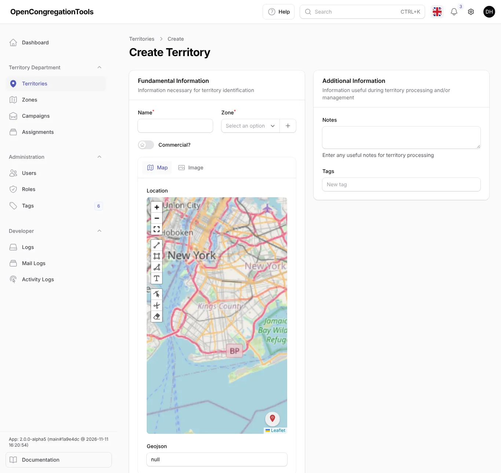
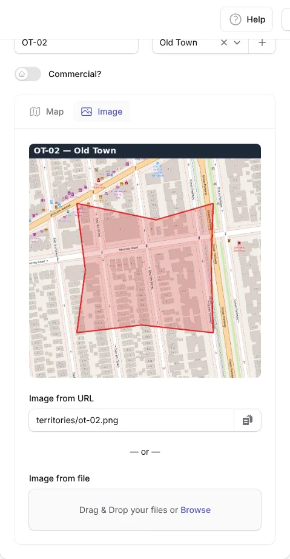

## Creating a territory

1. Open **Territories** and click **New territory**.
2. Fill in the **Fundamental Information**:
   - **Name**: e.g. `OT-01`. It must be unique within its zone;
   - **Zone**: pick an existing zone, or click **+** to create a new one without leaving the page;
   - **Commercial?**: turn it on for territories made of shops and businesses.
3. Describe where the territory is, using the **Map** tab, the **Image** tab or both (see below).
4. Optionally fill in the **Additional Information**:
   - **Notes**: anything useful for whoever works the territory (e.g. *do not call at no. 7*);
   - **Tags**: type a tag and press <kbd>Enter</kbd>. Existing tags are suggested while typing; new ones are created
     automatically (see [Tags](../administration/tags)).
5. Click **Create**.

> ℹ️ **Note:** the territory description (usually the list of its streets) is shown in the assignment details and is
> used by the search, but it can currently be set only by [importing](importing) the territory.

## Map or image?

A territory can be described in two ways, and they can coexist:

| | **Map** | **Image** |
|-|---------|-----------|
| What it is | A shape drawn on an interactive OpenStreetMap map | A picture, e.g. a photo or scan of the paper territory card |
| Shown on the dashboard | Yes, colored like its zone | No |
| Can be zoomed and used to navigate | Yes | No |
| Best for | New territories | Territories coming from the paper register |

Drawing the map is described in [Drawing maps](maps).

## Adding an image

In the **Image** tab you can either:

- paste a link in **Image from URL**, or
- drag a file onto **Image from file** (or click **Browse**): a PNG, JPEG or WebP picture. The built-in editor lets
  you crop and rotate the image before saving it.

The two options are alternative: filling one disables the other. Uploaded images are stored privately and can only be
seen by logged-in users. When you edit a territory with an uploaded image, the image is in **Image from file**:
remove it to upload another one or to use a link instead.

## Editing a territory

Click **Edit** on the territory row (or **⋮ → Edit** in the territory page), change what you need and click
**Save changes**. The **Delete** button at the top of the edit page moves the territory to the trash (see
[Territories list](introduction)).
