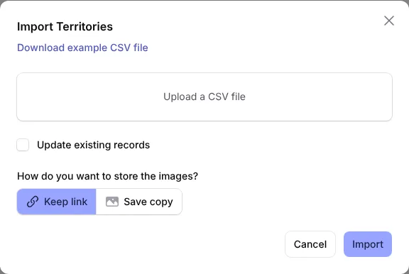

When you start using the application you probably already have a list of territories, for example in a spreadsheet.
Instead of creating them one by one, you can import them from a **CSV file**.

## Preparing the file

Click **Download example CSV file** in the import window to get a template. Each row is a territory, with these
columns (a column is matched automatically when its header is the one of the example file or the name of the field):

| Field | Column of the example file | Required | Content |
|-------|----------------------------|----------|---------|
| **Name** | `name` | Yes | Name of the territory, e.g. `OT-01`. |
| **Zone** | `territoryZone` | Yes | Name of the zone. If no zone with that name exists, it is created. |
| **Commercial?** | `is_commercial` | Yes | `1`/`0`, `yes`/`no` or `true`/`false`. |
| **Description** | `description` | No | Usually the list of streets. |
| **Notes** | `notes` | No | Notes for whoever works the territory. |
| **Image** | `image_path` | No | Absolute link (`http://` or `https://`) to an image of the territory. |
| **GeoJSON** | `geojson` | No | The map of the territory, as a GeoJSON `FeatureCollection`. |

> 💡 **Tip:** spreadsheet programs (LibreOffice Calc, Excel, Google Sheets) can save a sheet as CSV with
> *File → Save as / Download → CSV*.

## Importing

1. Open **Territories** and click **Import territories**.
2. Click **Upload a CSV file** and choose your file.
3. Check how the columns of the file are matched to the territory fields, and fix the matching if needed.
4. Choose the options:
   - **Update existing records**: when a territory with the same name already exists **in the same zone**, it is
     updated instead of being reported as a duplicate;
   - **How do you want to store the images?**: **Keep link** saves the link as it is, **Save copy** downloads the image
     into the application, so it keeps working even if the original link stops working.
5. Click **Import**.

The import runs in the background. When it finishes you receive a notification with the number of imported rows and,
if some rows failed, a link to download them with the reason of the failure, so you can fix them and import them again.

## Rules and limits

- A row is rejected if a territory with the same name already exists in the same zone (also among deleted ones),
  unless **Update existing records** is selected.
- A row is also rejected if it would update a territory you are not allowed to edit, or if its zone does not exist
  and you are not allowed to create zones.
- With **Save copy**, images are downloaded only from public addresses, must be real images (`image/*`) and at most
  10 MB.
