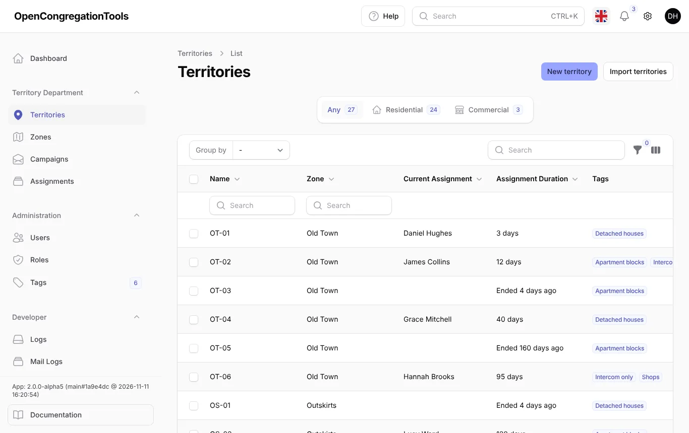
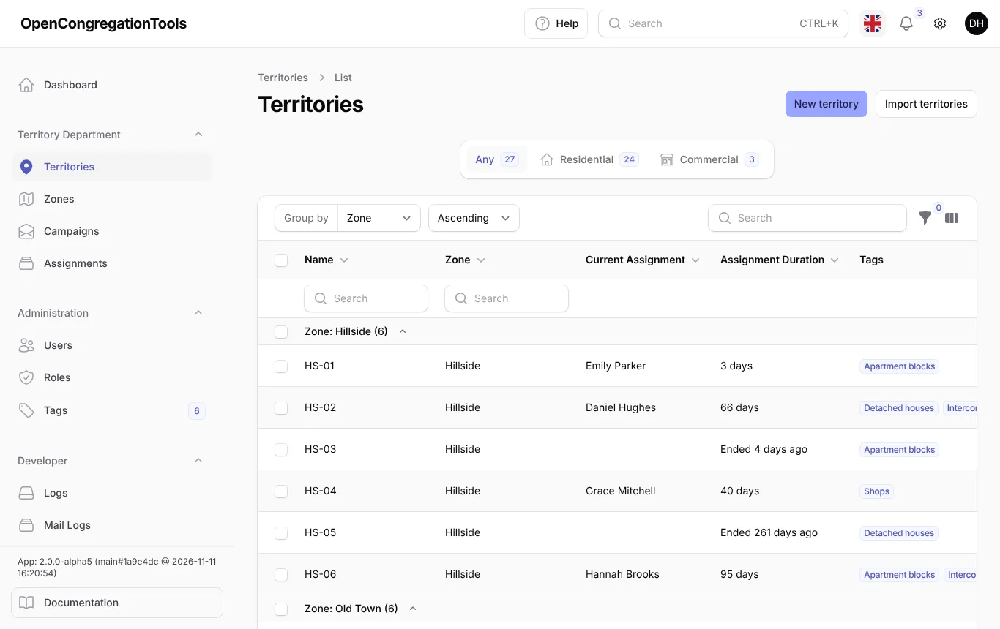
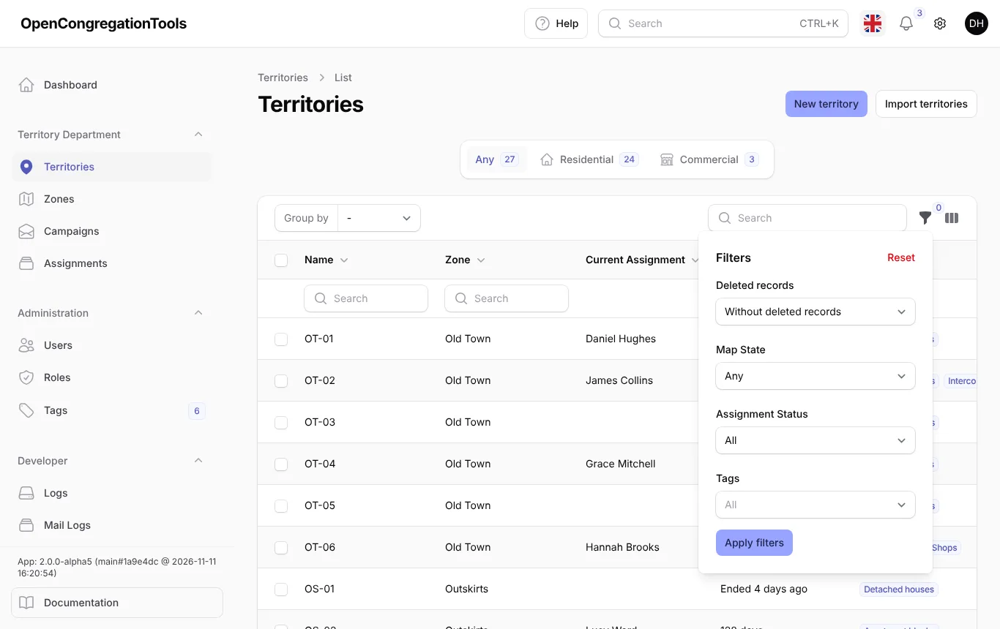
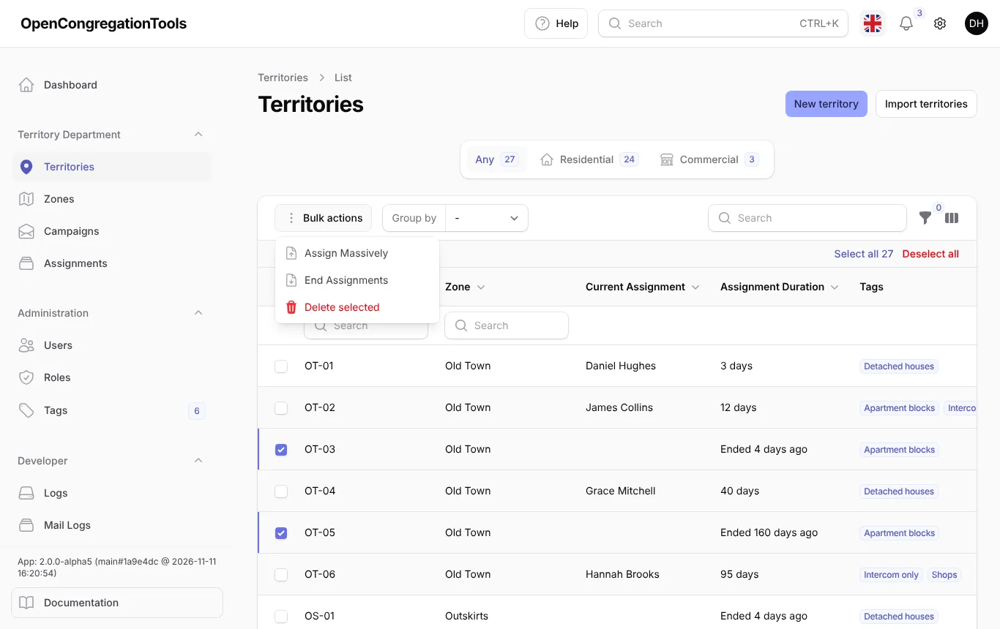
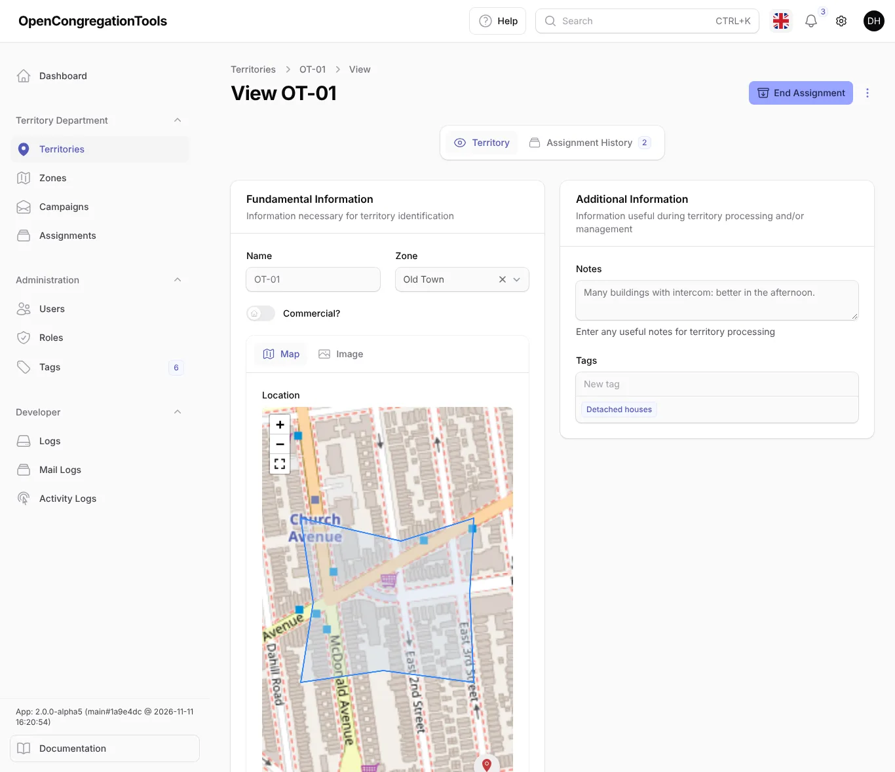
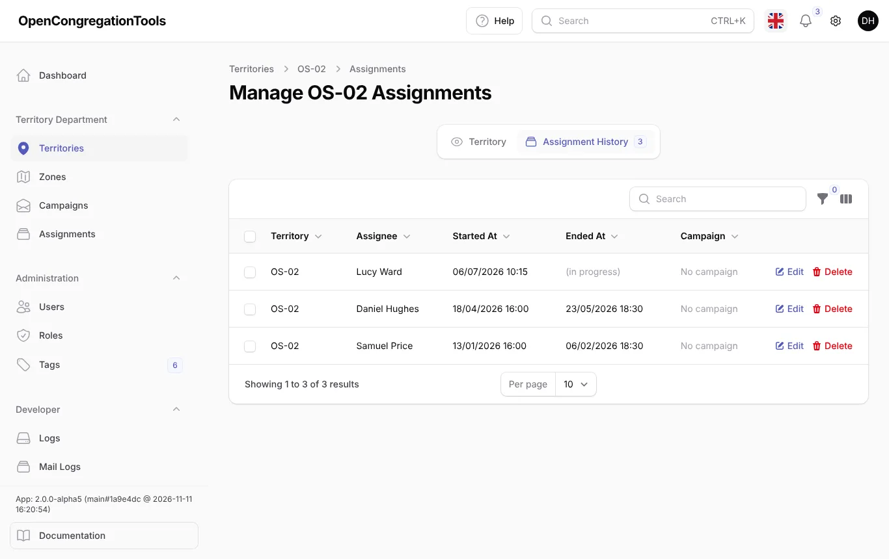

Territories are the backbone of this project:

- Can be assigned to a user, which generates a "territory assignment";
- Can be described by an image or a map (or both of them);
- Can hold notes and tags to make it easier to find them.

Open **Territories** from the sidebar to see all of them.

## Creating territories

It is possible to create new territories in two ways:

1. **Create** a new territory one by one, with the **New territory** button (see
   [Creating and editing territories](creating));
2. **Import** one or more territories in batch from a CSV file, with the **Import territories** button (see
   [Importing territories](importing)).

## Reading the table

| Column | Meaning |
|--------|---------|
| **Name** | Name of the territory. Click the row to open its details. |
| **Zone** | Zone the territory belongs to. |
| **Current Assignment** | Who is working the territory right now. Empty if it is available. |
| **Assignment Duration** | For a territory that is out: how long it has been out (e.g. *40 days*). For an available territory: how long ago it was returned (e.g. *Ended 4 days ago*). A dash means it has never been assigned. |
| **Tags** | Tags of the territory. |

The **Commercial?**, **Created At** and **Updated At** columns are hidden by default: show them with the columns
button, which can also hide the **Tags**.

> 💡 **Tip:** sort by **Assignment Duration** to quickly find the territories that have been out the longest, or the
> ones that have not been worked for a long time.

## Residential and commercial territories

The tabs above the table show **Any**, **Residential** or **Commercial** territories, with their count.

## Searching

Use the **Search** field above the table to search everywhere, or the fields under the **Name** and **Zone** headers to
search only in that column.

## Grouping

Choose a value in **Group by** to split the table:

- **Zone**: one group per zone;
- **Campaign**: groups the territories by the campaign of their current assignment. Available territories, and those
  assigned outside a campaign, are listed under *No Campaign*.

Each group title shows how many territories it contains among those matching the current tab, filters and search.

Click a group title to collapse or expand it.

## Filters

Click the **filter** button (funnel icon) to filter by:

- **Deleted records**: show or hide the deleted territories (see below);
- **Map State**: territories *with* or *without* a map;
- **Assignment Status**: *Assigned* (currently out) or *Unassigned* (available);
- **Tags**: territories having at least one of the selected tags.

## Actions

On each row:

- **Edit** opens the edit form;
- the **⋮** menu contains **Assign Territory** (if available) or **End Assignment** (if it is out), described in
  [Assigning and returning](../assignments/assigning).

Tick one or more rows to use the **bulk actions**:

- **Assign Massively**: assigns all the selected available territories to the same person;
- **End Assignments**: returns all the selected territories that are out;
- **Delete selected**.

## Territory details

Click a row to open the territory. The page shows the territory data, with its **Map** and **Image** in separate tabs,
and the **End Assignment** / **Assign Territory** button at the top. The **⋮** menu contains **Edit**; the **Delete**
button is in the edit page.

The **Average coverage time** shows how long the territory takes to be covered on average, from the start to the end
of its returned assignments; assignments still in progress are not counted.

The **Assignment History** tab lists every assignment of the territory, from the most recent. By default it only shows
the assignment in progress: remove the *Assignment Status* filter to see all of them.

## Deleting and restoring

Deleted territories are not lost: they are moved to the trash. A territory that is still assigned cannot be deleted:
end its assignment first. To get a deleted territory back:

1. open the filters and set **Deleted records** to *With deleted records* or *Only deleted records*;
2. open the **⋮** menu of the territory and click **Restore**.

**Force delete** removes a territory permanently. While deleted records are shown, the bulk actions also include
**Restore selected** and **Force delete selected**.

> ⚠️ **Warning:** a zone that still contains territories cannot be deleted (see [Zones](zones)). The territories
> already deleted of a deleted zone stay hidden, even among the deleted records, until the zone is restored.
