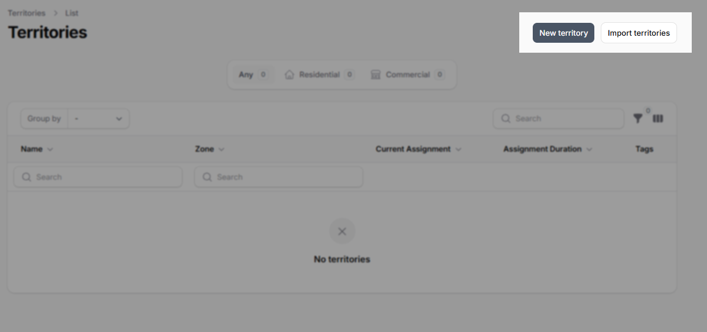

# Territories

Territories are the backbone of this project:

- Can be assigned to a user, which generates a "territory assignment";
- Can be described by an image or a map (or both of them);
- Can hold notes and tags to make it easier to find them;

## Creating territories

It is possible to create new territories in two ways:

1. **Create** a new territory one by one
2. **Import** one or more territories in batch

