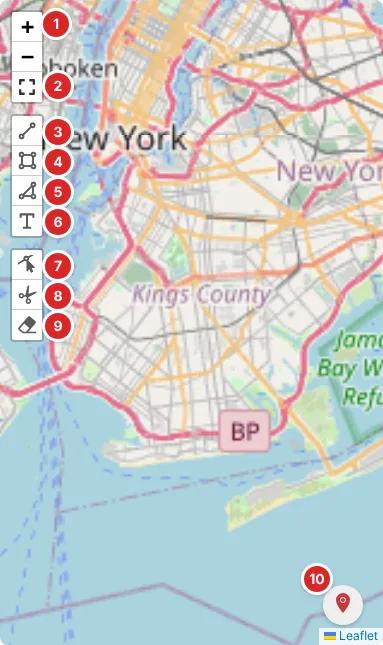
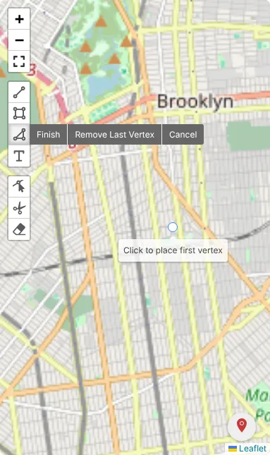

The **Map** tab of the territory form contains an interactive map where you draw the boundaries of the territory.

## Finding the area

A new map starts zoomed out. To reach the area of the territory:

- click the **location** button (red pin, bottom right) to center the map on your current position (the browser asks
  for permission the first time), or
- zoom with **+** / **−** or the mouse wheel and drag the map to the right place.

## The toolbar

1. **Zoom in / zoom out**.
2. **Full screen**: enlarges the map, handy when drawing large territories.
3. **Draw polyline**: draws a line (e.g. a street to work).
4. **Draw rectangle**: click and drag to draw a rectangle.
5. **Draw polygon**: the tool used for most territories (see below).
6. **Draw text**: adds a text label on the map.
7. **Edit layers**: drag the vertices of the existing shapes to fix them.
8. **Cut layers**: draw a shape to cut it out of an existing one (e.g. to exclude a park).
9. **Remove layers**: click a shape to delete it.

## Drawing a polygon

1. Click **Draw polygon** (5).
2. Click on the map to place the first vertex, then click on each corner of the territory, following the streets.
3. To close the shape click the first vertex again, or click **Finish**. **Remove Last Vertex** undoes the last click,
   **Cancel** discards the shape.
4. Save the territory.

> 💡 **Tip:** zoom in before drawing, so that the vertices follow the streets precisely. You can always fix them later
> with **Edit layers**.

The drawn shapes are stored in GeoJSON format (shown in the **Geojson** field below the map). Territories with many
existing maps can also be loaded in one go with the [import](importing), which accepts a GeoJSON column.
