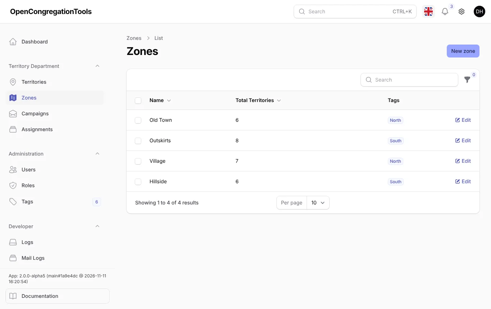
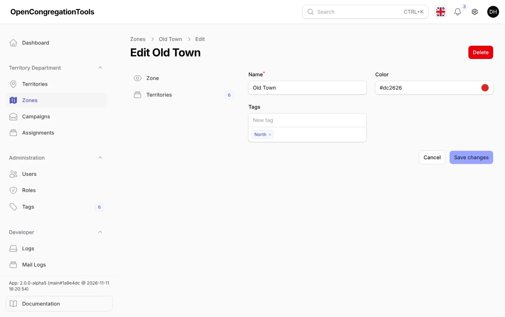
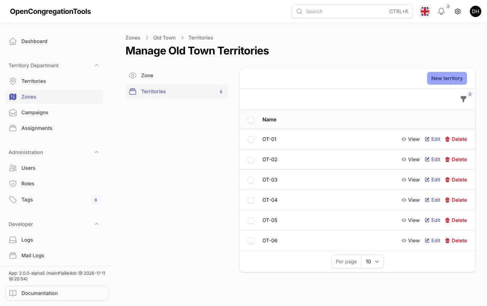

Zones group territories, usually by neighbourhood. Every territory belongs to exactly one zone. Open **Zones** from the
sidebar to see them, with the number of territories and the tags of each one.

## Creating a zone

1. Click **New zone**.
2. Enter the **Name** and pick a **Color**: it is used to draw the zone's territories on the dashboard map.
3. Optionally add some **Tags** (e.g. *North*, *South*).
4. Click **Create**.

You can also create a zone directly from the territory form, with the **+** button next to the **Zone** field.

## Territories of a zone

Open a zone and click the **Territories** tab to see its territories. From here you can also create a new territory
directly in this zone, and view, edit or delete the existing ones.

## Filtering

The **Tags** filter shows only the zones with the selected tags. The **Deleted records** filter shows the deleted
zones too, to restore them with **Restore**.

> ⚠️ **Warning:** a zone that still contains territories cannot be deleted: move them to another zone or delete them
> first. To delete a zone permanently (**Force delete**), its deleted territories must also be moved or permanently
> deleted first.
