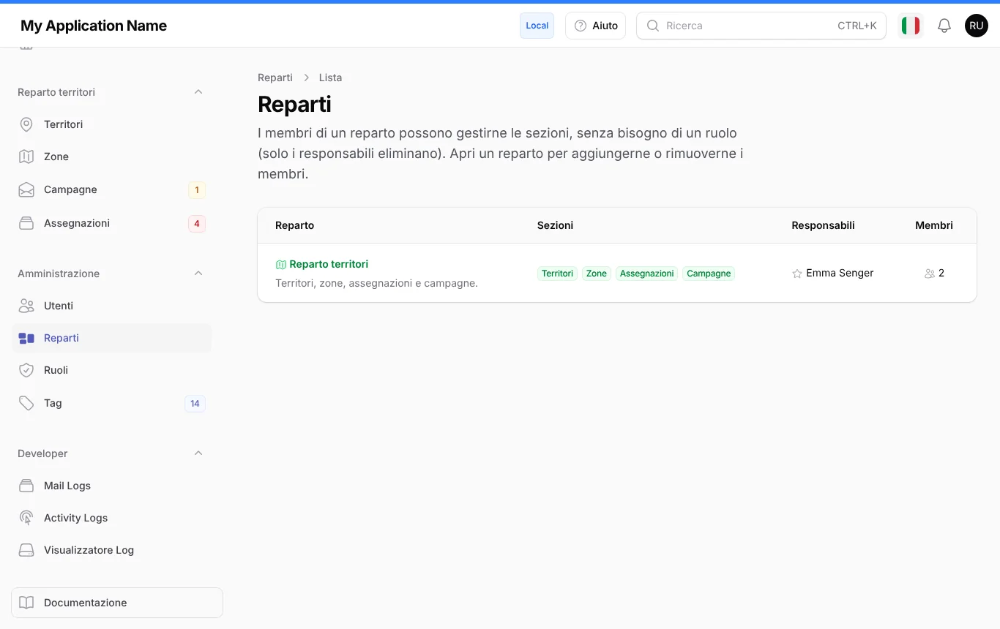
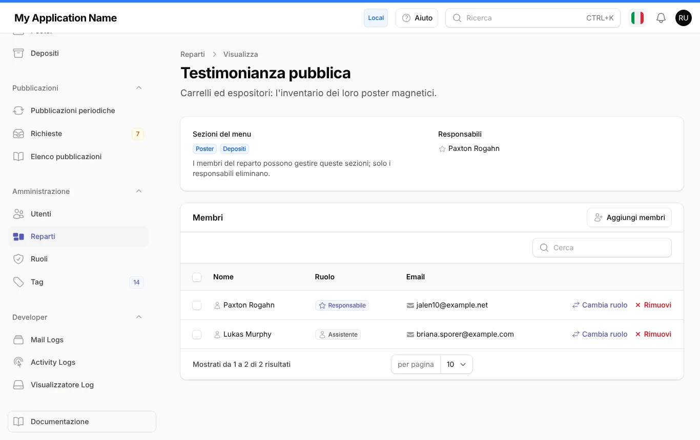
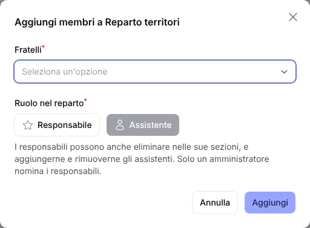

Il lavoro della congregazione è organizzato in **reparti**, ognuno con la sua sezione del menu:

| Reparto | Sezioni |
|---------|---------|
| **Reparto territori** | Territori, Zone, Assegnazioni, Campagne |
| **Testimonianza pubblica** | [Poster e depositi in cui sono conservati](../public-witnessing/posters) |
| **Pubblicazioni** | [Pubblicazioni periodiche](../publications/periodicals), [Richieste](../publications/requests), Elenco pubblicazioni |

Apri **Amministrazione → Reparti** per vederli, con i loro responsabili e il numero di membri.

## Cosa possono fare i membri

I **membri** di un reparto possono **gestirne completamente le sezioni** (vedere, creare, modificare ed eliminare),
senza bisogno di un [ruolo](roles) con quei permessi. Ad esempio, un fratello del reparto *Testimonianza pubblica* vede
la sezione **Testimonianza pubblica** del menu e può aggiornare i poster, anche se i suoi ruoli non gli danno altro.

Tutto il resto (ad esempio gli altri reparti, o gli utenti) dipende ancora dai ruoli, come prima.

Ogni membro ha un **ruolo nel reparto**:

- **Responsabile**: può anche aggiungere e rimuovere i membri del reparto, e cambiarne il ruolo;
- **Assistente**: gestisce le sezioni del reparto.

## Aggiungere o rimuovere membri

1. Apri **Amministrazione → Reparti** e clicca il reparto.
2. Clicca **Aggiungi membri**, scegli uno o più fratelli e il loro **Ruolo nel reparto**, poi clicca **Aggiungi**.
3. Per cambiare il ruolo di un membro clicca **Cambia ruolo**; per toglierlo dal reparto clicca **Rimuovi**.

Gli amministratori possono gestire i membri di ogni reparto; i responsabili solo quelli dei propri reparti.
La colonna e il filtro **Reparti** dell'[elenco degli utenti](users) mostrano chi serve in quale reparto.
