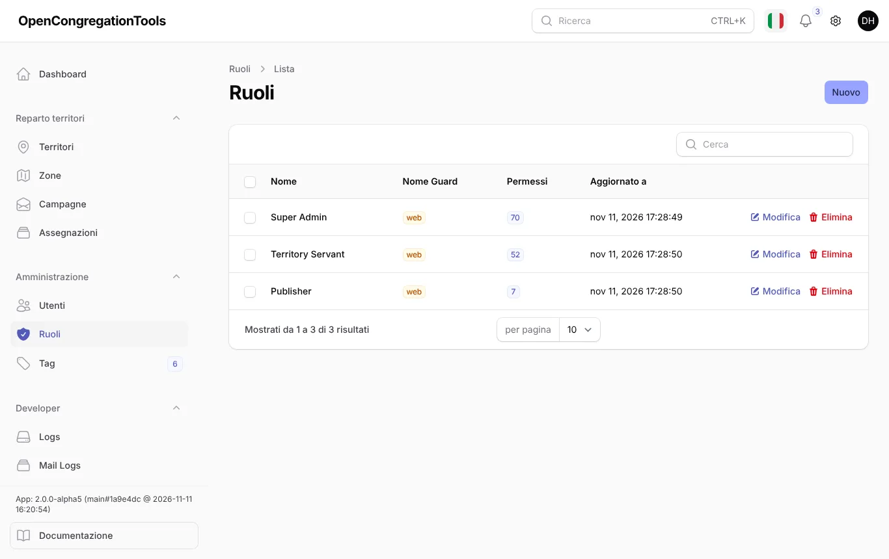
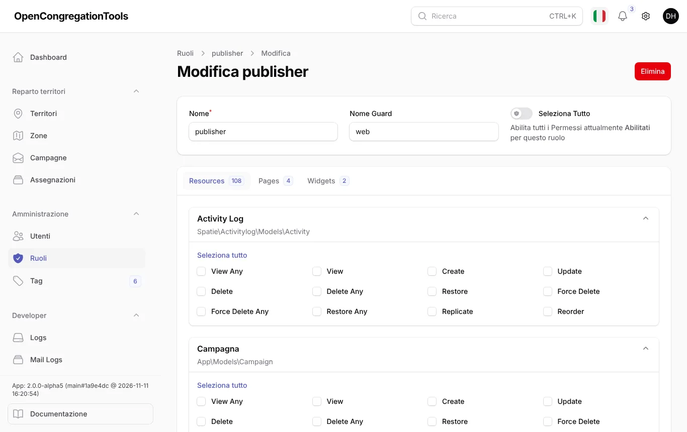

Ciò che ogni utente può vedere e fare dipende dai suoi **ruoli**. Un ruolo è un insieme di **permessi** con un nome.
Apri **Amministrazione → Ruoli** per gestirli.

## Il super amministratore

Il ruolo **super_admin** (*Super Admin*) può fare tutto, comprese le azioni riservate a lui:

- assegnare i ruoli agli utenti;
- impersonare gli utenti.

## Creare o modificare un ruolo

1. Clicca **Nuovo** (o **Modifica** su un ruolo esistente).
2. Inserisci il **Nome** (es. `publisher`). Lascia **Guard Name** impostato su `web`.
3. Spunta i permessi nelle schede **Risorse**, **Pagine** e **Widget**. **Seleziona tutto** in ogni riquadro spunta
   tutti i permessi di quella risorsa; l'interruttore in alto li seleziona tutti.
4. Clicca **Salva modifiche**.

## Significato dei permessi

Per ogni risorsa (Territorio, Zona, Assegnazione, Campagna, Utente, Ruolo, …) esistono gli stessi permessi:

| Permesso | Permette di |
|----------|-------------|
| **View Any** | aprire l'elenco di quella risorsa |
| **View** | aprire i dettagli di un record |
| **Create** / **Update** / **Delete** | creare, modificare, eliminare i record |
| **Restore**, **Force Delete** (e le versioni *Any*) | ripristinare i record eliminati, eliminarli definitivamente |
| **Replicate**, **Reorder** | non usati al momento |

Alcuni permessi hanno un significato particolare:

- **Create** su *Territory Assignment* permette di **assegnare** i territori, **Update** permette di **riconsegnarli**;
- senza **View Any** su *Territory Assignment*, l'utente vede solo **le proprie** assegnazioni;
- le schede *Pagine* e *Widget* controllano, ad esempio, l'accesso alla pagina del profilo e alla mappa della dashboard.

## Ruoli consigliati

| Ruolo | Permessi consigliati |
|-------|----------------------|
| **Proclamatore** | View / View Any su Territorio e Zona, View su Assegnazione, la pagina del profilo e la mappa della dashboard. I proclamatori vedono i territori e solo le proprie assegnazioni. |
| **Servitore di territorio** | Tutto su Territorio, Zona, Assegnazione e Campagna, più View / View Any su Utente. |
| **Amministratore** | Il ruolo **super_admin**. |

> 💡 **Suggerimento:** dopo aver modificato un ruolo, [impersona](users) un utente con quel ruolo per verificare cosa
> vede.
