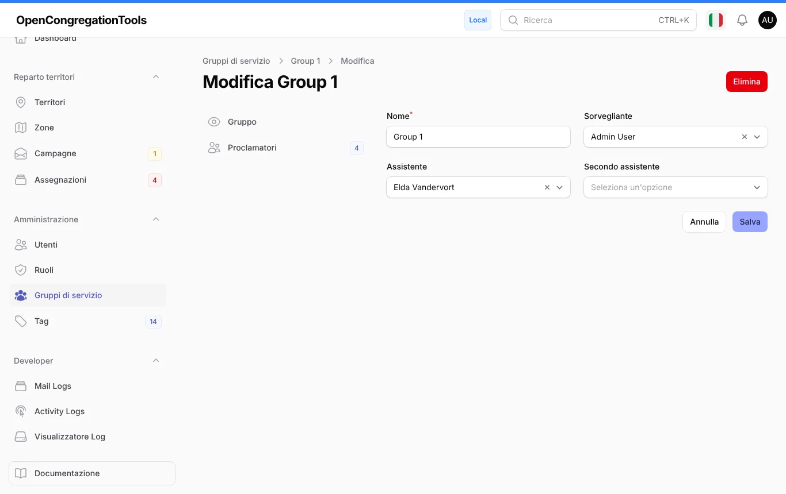
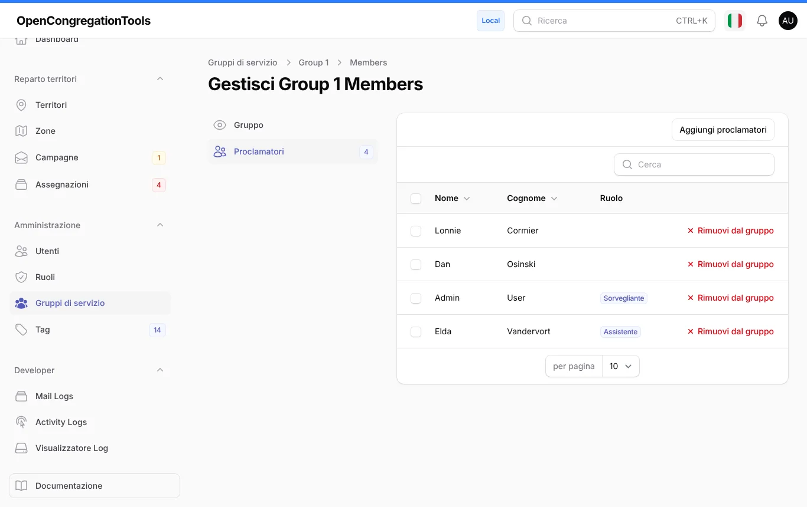
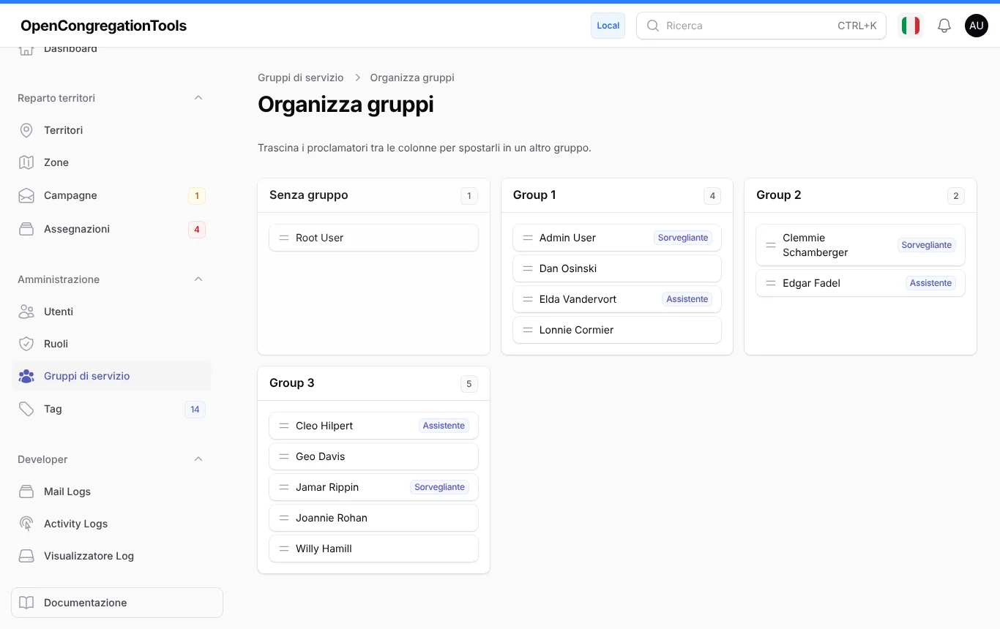

I proclamatori della congregazione possono essere riuniti in **gruppi di servizio**. Ogni gruppo può avere un
**Sorvegliante** e fino a due assistenti. Apri **Amministrazione → Gruppi di servizio** per gestirli: la tabella mostra
ogni gruppo con il sorvegliante, gli assistenti e il numero dei suoi proclamatori.

## Creare un gruppo

1. Clicca su **Nuovo gruppo di servizio**.
2. Inserisci il **Nome** e, se vuoi, scegli il **Sorvegliante**, l'**Assistente** e il **Secondo assistente**.
3. Clicca su **Crea**.

> ℹ️ **Nota:** la stessa persona non può avere due ruoli nello stesso gruppo. Scegliere qualcuno come sorvegliante o
> assistente non lo sposta nel gruppo: aggiungilo anche ai suoi proclamatori.

## Proclamatori di un gruppo

Clicca su un gruppo, poi apri la scheda **Proclamatori** per vedere chi ne fa parte; chi guida il gruppo è indicato come
**Sorvegliante** o **Assistente**.

- **Aggiungi proclamatori** aggiunge una o più persone al gruppo. Chi era in un altro gruppo viene spostato;
- **Rimuovi dal gruppo** lascia un proclamatore senza gruppo.

Eliminare un gruppo non elimina i suoi proclamatori: restano senza gruppo.

## Spostare i proclamatori tra i gruppi

Clicca su **Organizza gruppi** nell'elenco dei gruppi per vederli tutti affiancati, insieme ai proclamatori **Senza
gruppo**. Trascina un proclamatore in un'altra colonna per spostarlo: la modifica viene salvata subito.

Per spostare molte persone insieme (o dal telefono), apri **Amministrazione → Utenti**, selezionale e usa l'azione di
gruppo **Cambia gruppo di servizio**.

## Il gruppo nella pagina di un utente

Il **Gruppo di servizio** di un utente è mostrato nella sua pagina, e si può cambiare [modificandolo](users). Anche la
tabella degli utenti ha una colonna e un filtro **Gruppo di servizio**.
