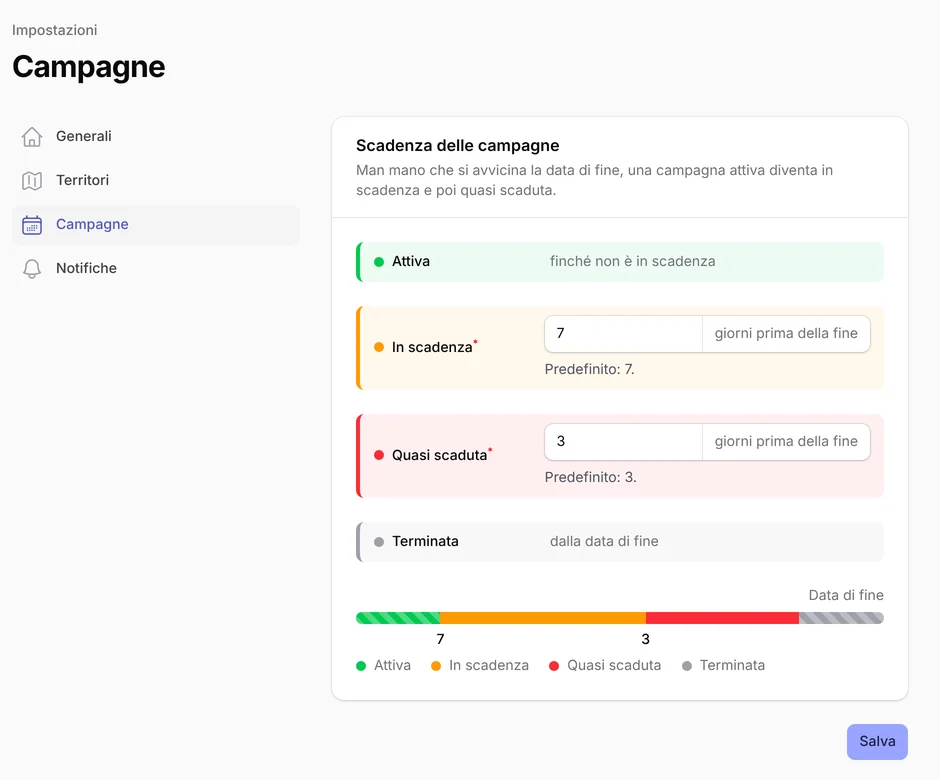
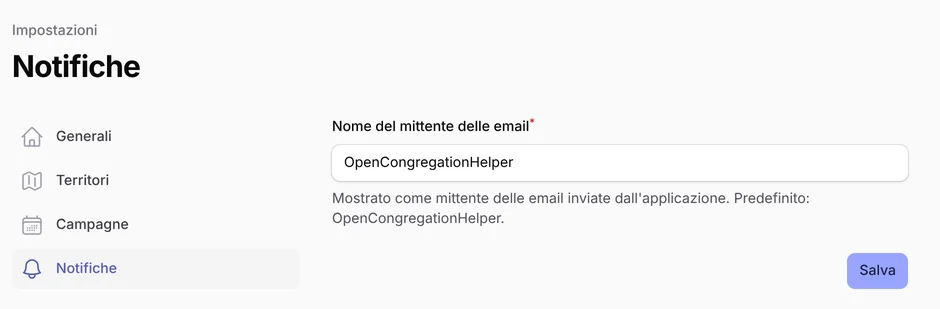

Le pagine **Impostazioni** permettono ai super amministratori di cambiare le opzioni dell'applicazione senza modificare
il file `.env` sul server. Apri **Amministrazione → Impostazioni**: le pagine sono mostrate solo agli utenti con il
ruolo `super_admin`. Le opzioni sono raggruppate per area, con una pagina ciascuna nel menu a lato.

## Generali

- **Nome dell'applicazione**: mostrato nella barra in alto, nella scheda del browser, nelle email e nell'app installata;
- **Lingua predefinita**: la lingua degli utenti che non ne hanno scelta una;
- **Fuso orario**: usato per mostrare le date;
- **Logo**: mostrato nella barra in alto al posto del nome (al massimo 2 MB);
- **Colore principale**: il colore dei pulsanti, dei link e degli elementi selezionati, per gli utenti che non ne hanno
  scelto uno nelle proprie preferenze dell'interfaccia.

## Territori

- **Centro predefinito delle mappe**: dove si aprono le mappe finché nessun territorio ha una mappa, come
  `latitudine, longitudine` (es. `41.159063, -74.255188`). In seguito le mappe si aprono sui territori;
- **Mostra i dati personali nelle pagine condivise**: se attivo, la pagina pubblica di
  un'[assegnazione condivisa](../assignments/sharing) mostra anche il nome dell'assegnatario e le note del territorio.

In **Assegnazioni fuori da troppo tempo**:

- i giorni dopo cui un'assegnazione ancora in corso è fuori da troppo tempo, da molto tempo, da moltissimo tempo o
  persa. Ognuno deve essere maggiore del precedente;
- il **giorno** e l'**ora** (ora di Roma, allo scoccare dell'ora) dei promemoria settimanali inviati agli assegnatari
  delle assegnazioni fuori da troppo tempo. Su un hosting senza cron, il servizio esterno deve chiamare lo scheduler a
  quell'ora (vedi la [Guida al setup](../setup)).

## Campagne

I giorni prima della fine da cui una campagna è **in scadenza** e **quasi scaduta**: questi ultimi devono essere meno.

## Notifiche

- **Nome del mittente delle email**: mostrato come mittente delle email inviate dall'applicazione.

Clicca **Salva** per applicarle: hanno effetto subito, per tutti gli utenti.

## Valori predefiniti

Sotto ogni opzione, **Predefinito** mostra il suo valore prima che venga cambiato qui: per nome, lingua, fuso orario,
centro delle mappe, dati personali e nome del mittente, il valore impostato nel file `.env` da chi ha installato
l'applicazione (vedi la [Guida al setup](../setup)). Queste opzioni continuano a seguire il file `.env` finché non
vengono cambiate qui; per farne seguire di nuovo il file `.env` a una, reimpostala al suo valore predefinito e salva.
