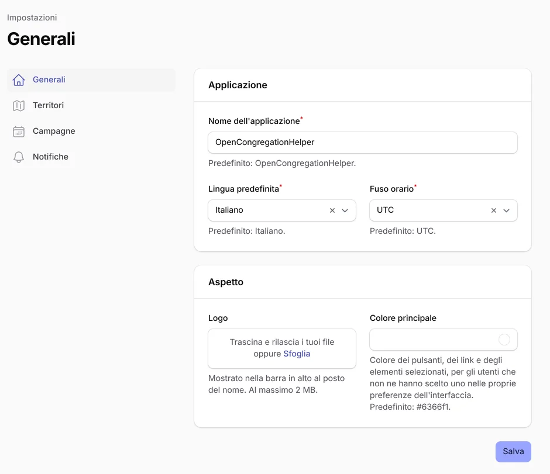
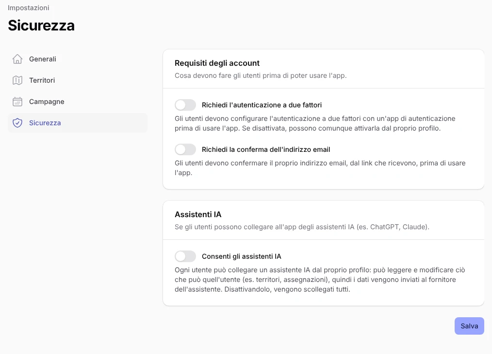

Le pagine **Impostazioni** permettono ai super amministratori di cambiare le opzioni dell'applicazione senza modificare
il file `.env` sul server. Apri **Amministrazione → Impostazioni**: le pagine sono mostrate solo agli utenti con il
ruolo `super_admin`. Le opzioni sono raggruppate per area, con una pagina ciascuna nel menu a lato.

## Generali

- **Nome dell'app**: mostrato nella scheda del browser, nella barra in alto (quando non c'è un logo), sull'[app
  installata](../basics/interface#installare-lapp) e nelle email. Parte da `APP_NAME`, che continua a identificare
  l'installazione sul server;
- **Indirizzo della Sala del Regno**: l'indirizzo della Sala del Regno della congregazione (facoltativo);
- **Logo**: mostrato nella barra in alto al posto del nome (al massimo 2 MB);
- **Colore principale**: il colore dei pulsanti, dei link e degli elementi selezionati, per gli utenti che non ne hanno
  scelto uno nelle proprie preferenze dell'interfaccia. Colora anche la barra dell'[app installata](../basics/interface#installare-lapp).

## Territori

- **Centro predefinito delle mappe**: dove si aprono le mappe finché nessun territorio ha una mappa, come
  `latitudine, longitudine` (es. `41.159063, -74.255188`). In seguito le mappe si aprono sui territori.

In **Privacy delle pagine condivise** scegli prima se le assegnazioni possono essere [condivise](../assignments/sharing)
(**Condivisione delle assegnazioni**, attiva per impostazione predefinita). Se disattivata, **Condividi** non viene più
offerto a nessuno e i link esistenti vengono eliminati al salvataggio: smettono di funzionare per sempre, anche se la
condivisione viene riattivata. Se ce ne sono, ti viene chiesto prima di confermare. Le opzioni seguenti sono mostrate
solo mentre la condivisione è attiva.

Poi scegli cosa mostra la pagina pubblica di un'assegnazione condivisa a chiunque ne abbia il link:

- **Nascondi i dati personali** (consigliato): solo il territorio, la sua mappa e le date;
- **Mostra i dati personali**: anche il nome dell'assegnatario e le note del territorio, che possono descrivere dei
  padroni di casa. I link condivisi non scadono mai e possono essere inoltrati, quindi sceglilo solo se la congregazione
  è d'accordo e le note non contengono dati personali. Prima di sceglierlo ti viene chiesto di confermare di aver capito
  cosa comporta: se annulli, i dati personali restano nascosti.

Lì scegli anche, con **Richiesta di riconsegna dalle pagine condivise**, se chiunque apra la pagina pubblica può
chiedere di riconsegnare il territorio, senza un account: i membri del reparto territori ricevono allora una notifica,
come quando lo chiede l'assegnatario dall'applicazione.

In **Assegnazioni fuori da troppo tempo** i livelli sono elencati in ordine, ognuno con il suo colore, e la barra sotto
li disegna in scala mentre scrivi:

- i giorni dopo cui un'assegnazione ancora in corso è fuori da troppo tempo e poi persa: questi ultimi devono essere di
  più;
- il **giorno** e l'**ora** (nel fuso orario dell'applicazione, `APP_TIMEZONE`) dei promemoria settimanali inviati agli
  assegnatari delle assegnazioni fuori da troppo tempo. Allo stesso momento i membri del reparto territori (vedi
  **Reparti**) ne ricevono un riepilogo via email e nell'app. Vengono inviati solo se a quell'ora lo scheduler è in
  esecuzione, come cron job o come processo sempre attivo (es. con Supervisor); su un hosting senza cron, il servizio
  esterno deve chiamarlo a quell'ora (vedi la [Guida al setup](../setup));
- i **Destinatari del riepilogo**: tutti i membri del reparto territori (predefinito) o solo i suoi responsabili.

In **Frequenza di assegnazione** scegli come la **Frequenza di assegnazione** della [mappa della dashboard](../basics/dashboard)
colora i territori:

- i **mesi considerati**: si contano solo le assegnazioni iniziate in questi ultimi mesi;
- le assegnazioni da cui un territorio è assegnato con frequenza **media**, e poi **frequente**: queste ultime devono
  essere di più. Con meno assegnazioni, o nessuna, la frequenza è **bassa**. La barra sotto le disegna in scala mentre
  scrivi.

In **Copertura del territorio** scegli i periodi della [copertura del territorio](../basics/dashboard#copertura-del-territorio)
della dashboard:

- i **periodi**, in mesi, offerti nel suo menu (6, 12 e 24 di default): premi Invio dopo ognuno;
- il **periodo mostrato di default** (12 mesi di default), uno dei periodi.

## Campagne

I giorni prima della fine da cui una campagna è **in scadenza** e **quasi scaduta**: questi ultimi devono essere meno.
Gli stati sono elencati in ordine, con i colori dei badge delle campagne, e la barra sotto li disegna in scala mentre
scrivi.

## Sicurezza

In **Requisiti degli account** scegli cosa deve fare ogni utente prima di usare l'applicazione. Entrambi sono
disattivati in modo predefinito:

- **Richiedi l'autenticazione a due fattori**: agli utenti che non l'hanno configurata viene chiesto di farlo, con
  un'app di autenticazione, prima di poter aprire qualsiasi pagina. Se disattivata, ogni utente può comunque attivarla
  dal proprio [profilo](../basics/profile#autenticazione-a-due-fattori);
- **Richiedi la conferma dell'indirizzo email**: agli utenti con l'indirizzo email non confermato viene chiesto di
  confermarlo, dal link ricevuto via email, prima di poter aprire qualsiasi pagina. L'email viene inviata quando
  arrivano per la prima volta su quella pagina; da lì possono chiederne un'altra.

Agli utenti che hanno già effettuato l'accesso viene chiesto alla pagina successiva. Con entrambi attivi, prima
confermano l'email, poi configurano l'autenticazione a due fattori.

> ⚠️ **Attenzione:** perché l'utente root (il primo utente creato durante l'installazione, se non ha ceduto il ruolo) non resti mai bloccato fuori,
> un requisito si può attivare solo quando l'utente root lo soddisfa: configura prima l'autenticazione a due fattori o
> conferma l'indirizzo email dell'utente root. Disattivare un requisito è sempre possibile. Inoltre all'utente root non
> viene mai chiesto di confermare l'email, anche se la cambia in seguito, così che possa sempre raggiungere queste
> impostazioni.

In **Password**, **Rifiuta le password compromesse** verifica le password scelte dagli utenti (da un invito, da **Hai
smarrito la password?** o dal proprio profilo) nelle fughe di dati note di [Have I Been
Pwned](https://haveibeenpwned.com/Passwords), e rifiuta una password trovata lì. L'applicazione invia solo i primi 5
caratteri dell'hash SHA-1 della password, mai la password stessa. Se il servizio non risponde entro 5 secondi, la
password viene accettata. È attivo in modo predefinito in produzione e disattivato altrove (vedi `PASSWORD_LEAK_CHECK`
nella [Guida al setup](../setup)): disattivalo se il server non può raggiungere il servizio.

In **Assistenti IA**, **Consenti gli assistenti IA** permette agli utenti di collegare all'applicazione un assistente
IA (es. ChatGPT, Claude o Gemini), dal proprio [profilo](../basics/profile#assistenti-ia). È disattivato in modo
predefinito:

- ogni assistente lavora per conto dell'utente che lo ha collegato, e può leggere e modificare solo ciò che può
  quell'utente (ha gli stessi ruoli e permessi), quindi ciò che legge viene inviato all'azienda che fornisce
  l'assistente;
- disattivandolo, vengono scollegati subito tutti gli assistenti: gli utenti dovranno approvarli di nuovo quando verrà
  riattivato.

Clicca **Salva** per applicarle: hanno effetto subito, per tutti gli utenti.

## Valori predefiniti

Sotto ogni opzione, **Predefinito** mostra il suo valore prima che venga cambiato qui: per il centro delle mappe, i
dati personali, le richieste di riconsegna dalla pagina pubblica e la verifica delle password compromesse, il valore
impostato nel file `.env` da chi ha installato l'applicazione (vedi la [Guida al setup](../setup)). Queste quattro
opzioni continuano a seguire il file `.env`
finché non vengono cambiate qui; per farne seguire di nuovo il file `.env` a una, reimpostala al suo valore
predefinito e salva. Il nome, la lingua e il fuso orario dell'applicazione si impostano solo nel file `.env`.
