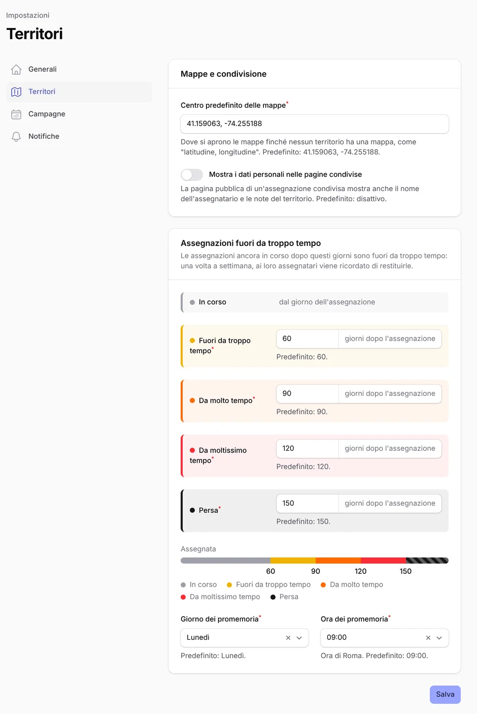

Le pagine **Impostazioni** permettono ai super amministratori di cambiare le opzioni dell'applicazione senza modificare
il file `.env` sul server. Apri **Amministrazione → Impostazioni**: le pagine sono mostrate solo agli utenti con il
ruolo `super_admin`. Le opzioni sono raggruppate per area, con una pagina ciascuna nel menu a lato.

## Generali

- **Nome dell'applicazione**: mostrato nella barra in alto, nella scheda del browser, nelle email e nell'app installata;
- **Lingua predefinita**: la lingua degli utenti che non ne hanno scelta una;
- **Fuso orario**: usato per mostrare le date.

## Territori

- **Centro predefinito delle mappe**: dove si aprono le mappe finché nessun territorio ha una mappa, come
  `latitudine, longitudine` (es. `41.159063, -74.255188`). In seguito le mappe si aprono sui territori;
- **Mostra i dati personali nelle pagine condivise**: se attivo, la pagina pubblica di
  un'[assegnazione condivisa](../assignments/sharing) mostra anche il nome dell'assegnatario e le note del territorio.

Clicca **Salva** per applicarle: hanno effetto subito, per tutti gli utenti.

## Valori predefiniti

Sotto ogni opzione, **Predefinito** mostra il valore impostato nel file `.env` da chi ha installato l'applicazione (vedi
la [Guida al setup](../setup)). Un'opzione continua a seguire il file `.env` finché non viene cambiata qui; per farle
seguire di nuovo il file `.env`, reimpostala al suo valore predefinito e salva.
