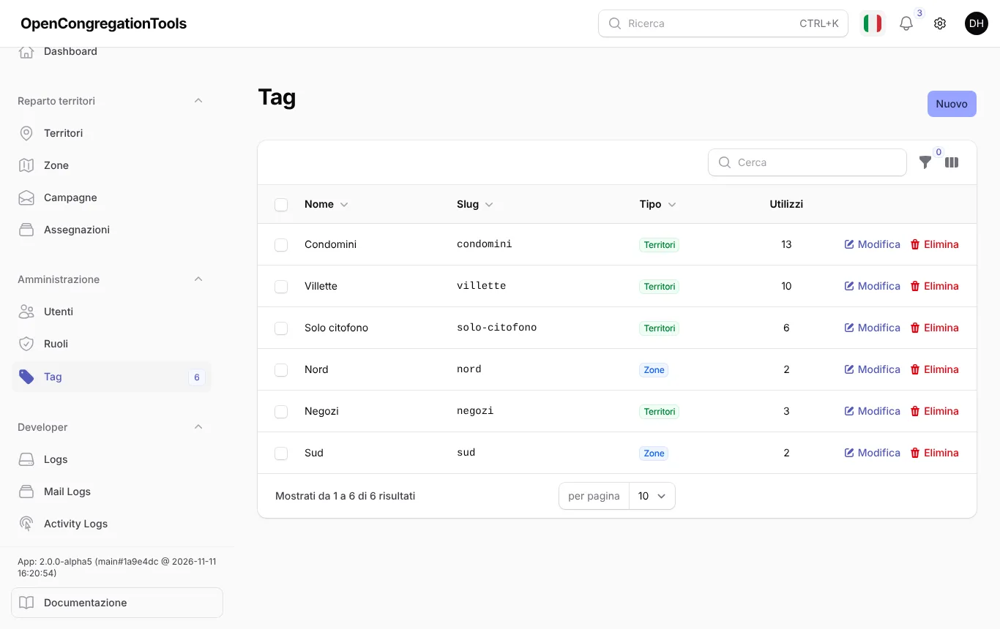
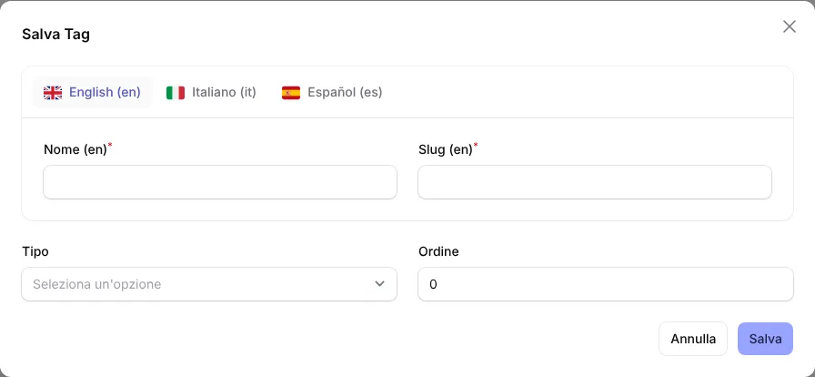

I tag sono brevi etichette che aiutano a descrivere e trovare territori e zone, ad esempio *Condomini*, *Solo citofono*
o *Nord*. Apri **Amministrazione → Tag** per gestirli; il numero accanto alla voce di menu è il totale dei tag.

Esistono due **tipi** di tag, mostrati con colori diversi:

- **Territori**: usati nel modulo dei territori e nel filtro **Tag** dell'elenco dei territori;
- **Zone**: usati nel modulo e nel filtro delle zone.

La colonna **Utilizzi** indica quanti territori o zone usano ciascun tag. Usa il filtro **Filtra per Tipo** per vedere
un solo tipo.

## Creare e modificare i tag

I tag vengono creati automaticamente quando ne scrivi uno nuovo nel modulo di un territorio o di una zona. Da questa
pagina puoi anche:

1. Cliccare **Nuovo** (o **Modifica** su un tag esistente).
2. Compilare **Nome** e **Slug** (una versione semplificata del nome, es. `condomini`: quando crei un tag, viene
   compilato dal nome). Un tag ha un solo nome, uguale in tutte le lingue dell'interfaccia.
3. Scegliere il **Tipo** e, se vuoi, un numero di **Ordine** per ordinare i tag.
4. Cliccare **Salva**.

## Eliminare i tag

Eliminando un tag lo si toglie anche da tutti i territori e le zone che lo usano (che restano). Prima di eliminarlo, la
conferma indica quanti territori e zone lo usano (o usano i tag selezionati, quando se ne eliminano più di uno).
