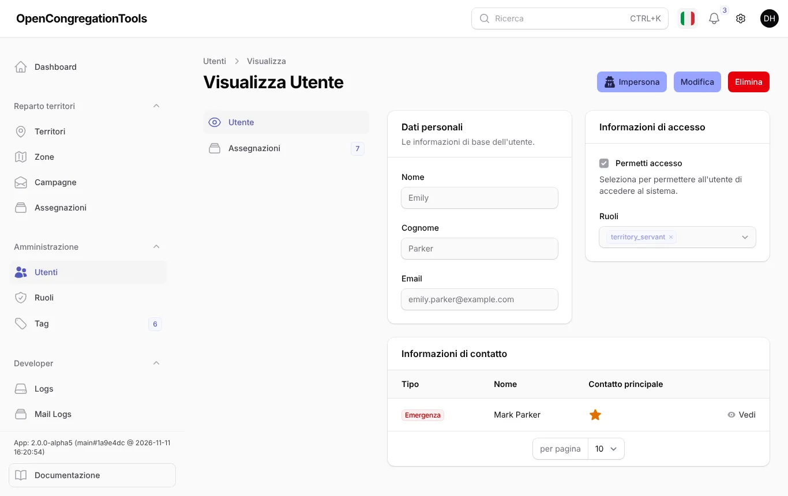
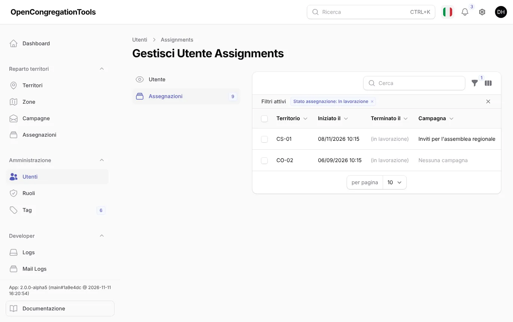
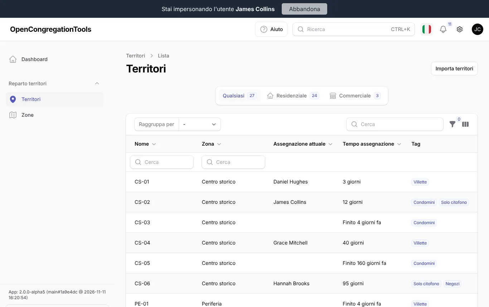

Apri **Amministrazione → Utenti** per gestire le persone registrate nell'applicazione.

La tabella mostra nome, email, **Ruolo**, se l'email è stata verificata e se l'utente può accedere
(**Accesso abilitato?**). Il filtro **Accesso** mostra solo gli utenti con accesso o solo gli utenti virtuali, e quanti
sono gli uni e gli altri.

## Utenti e utenti virtuali

Non tutti quelli che lavorano i territori devono usare l'applicazione:

- gli **utenti con accesso** entrano con email e password e vedono ciò che i loro [ruoli](roles) permettono;
- gli **utenti virtuali** (senza **Permetti accesso**) non possono accedere, ma possono ricevere territori. Sono utili per
  i proclamatori che ricevono il territorio su carta o tramite un [link condiviso](../assignments/sharing).

## Creare un utente

1. Clicca **Nuovo**.
2. Compila **Nome**, **Cognome** ed **Email**.
3. Per permettere alla persona di accedere, spunta **Permetti accesso** e scegli i **Ruoli**.
4. Clicca **Crea**: se hai permesso l'accesso, la persona riceve un'email con un link per scegliere la sua password.

> ℹ️ **Nota:** solo i super amministratori possono assegnare i ruoli.

L'invito viene inviato anche quando spunti **Permetti accesso** per un utente virtuale che non ha mai avuto una
password, e quando correggi l'**Email** di un utente che non ha ancora scelto la sua password: il link inviato al
vecchio indirizzo smette di funzionare.

Il link dell'invito scade dopo 6 ore. Finché la persona non ha scelto la sua password, puoi inviarle un nuovo link con
**Invia di nuovo l'invito**, nella pagina dell'utente o nell'elenco degli utenti (il link precedente smette di
funzionare). Un utente riceve al massimo un invito al minuto, in qualunque modo venga inviato: se entro quel minuto salvi
modifiche che ne invierebbero uno (es. correggi di nuovo l'**Email**), vengono salvate ma non viene inviata nessuna
email, e puoi usare **Invia di nuovo l'invito** un minuto dopo. La persona può anche riceverne uno nuovo con
**Hai smarrito la password?** nella [pagina di accesso](../basics/logging-in).

Gli amministratori non possono impostare o modificare la password di un utente: ognuno sceglie la sua, con l'invito, con
**Hai smarrito la password?** nella pagina di accesso o dal suo profilo.

## Pagina dell'utente

Clicca un utente per aprirne la pagina:

- la scheda **Utente** mostra i suoi dati e le sue **Informazioni di contatto** (es. i contatti di emergenza), che puoi
  aggiungere, modificare o eliminare anche da qui (un utente ha un solo **Contatto principale**). **Chiama** e
  **Apri in Maps** avviano una telefonata o aprono l'indirizzo;
- la scheda **Assegnazioni** elenca i territori assegnati all'utente.

In fondo alla scheda **Utente**, **Statistiche** mostra le **Zone preferite** (ogni zona in cui il proclamatore ha
preso territori, con il numero di assegnazioni e la loro percentuale) e i **Territori preferiti** (i 5 che prende più
spesso). Sono contate le assegnazioni in corso e quelle restituite. Chi non può vedere tutte le assegnazioni vede
queste statistiche solo nella propria pagina.

## Impersonare un utente

I super amministratori possono usare l'applicazione **come un altro utente**, ad esempio per verificare cosa vede un
proclamatore.

1. Clicca **Impersona** sulla riga dell'utente (o nella sua pagina) e conferma.
2. Vieni portato alla home page: apri l'applicazione per usarla come quell'utente. Un banner in alto ti ricorda chi
   stai impersonando.
3. Clicca **Abbandona** nel banner per tornare al tuo account.

Si possono impersonare anche gli utenti virtuali; l'utente root no.

## Aggiungere utenti a un reparto

Seleziona alcuni utenti e usa l'azione di massa **Aggiungi al reparto**: scegli il **Reparto** e il **Ruolo nel
reparto**, e vi entrano tutti insieme. Chi serve già nel reparto mantiene il suo ruolo. Vedi
[Reparti](departments) per cosa possono fare i membri.

## Eliminare utenti

Usa **Elimina** nella pagina dell'utente, oppure seleziona alcuni utenti e usa l'azione di massa
**Elimina selezionati**.

Un utente a cui è stato assegnato almeno un territorio (anche se già restituito) non può essere eliminato: con lui
andrebbe persa la storia di quei territori (quando sono stati percorsi, la copertura, le campagne). Ad esempio, quando
un proclamatore si trasferisce:

1. Clicca **Elimina** nella sua pagina: la finestra spiega perché non può essere eliminato.
2. Clicca **Disabilita accesso**: diventa un [utente virtuale](#utenti-e-utenti-virtuali), non può più accedere e le
   sue assegnazioni vengono conservate. Restituisci i suoi territori in corso, se ce ne sono, quando li riavrai.

L'azione di massa elimina gli altri utenti selezionati e indica quanti sono stati esclusi e perché. Nemmeno gli utenti
con delle assegnazioni possono eliminare il proprio account.

## L'utente root

L'utente root è il primo utente, creato durante l'installazione. Per evitare di perdere l'accesso all'applicazione:

- non può mai essere eliminato (viene escluso dall'eliminazione di massa) né impersonato;
- al di fuori dell'ambiente di produzione, non se ne possono modificare email, password, accesso e ruoli, e il suo
  pulsante **Modifica** è disabilitato.
