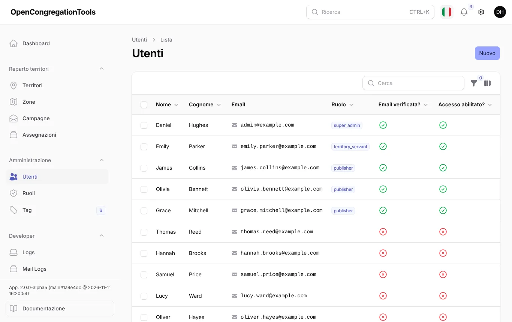
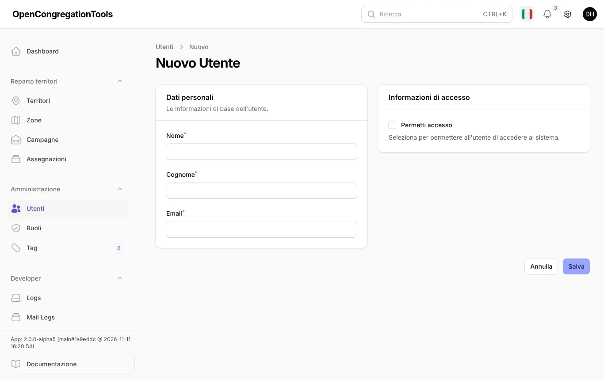

Apri **Amministrazione → Utenti** per gestire le persone registrate nell'applicazione.

La tabella mostra nome, email, **Ruolo**, se l'email è stata verificata e se l'utente può accedere
(**Accesso abilitato?**). Il filtro **Accesso abilitato?** mostra solo gli utenti che possono, o non possono, accedere.

## Utenti e utenti virtuali

Non tutti quelli che lavorano i territori devono usare l'applicazione:

- gli **utenti con accesso** entrano con email e password e vedono ciò che i loro [ruoli](roles) permettono;
- gli **utenti virtuali** (senza **Permetti accesso**) non possono accedere, ma possono ricevere territori. Sono utili per
  i proclamatori che ricevono il territorio su carta o tramite un [link condiviso](../assignments/sharing).

## Creare un utente

1. Clicca **Nuovo**.
2. Compila **Nome**, **Cognome** ed **Email**.
3. Per permettere alla persona di accedere, spunta **Permetti accesso**, poi imposta una **Password** e i **Ruoli**.
4. Clicca **Crea**.

> ℹ️ **Nota:** solo i super amministratori possono assegnare i ruoli. Quando modifichi un utente, lascia vuota la
> **Password** per mantenere quella attuale.

## Pagina dell'utente

Clicca un utente per aprirne la pagina:

- la scheda **Utente** mostra i suoi dati e le sue **Informazioni di contatto** (es. i contatti di emergenza), che puoi
  aggiungere, modificare o eliminare anche da qui. **Chiama** e **Apri in Maps** avviano una telefonata o aprono
  l'indirizzo;
- la scheda **Assegnazioni** elenca i territori assegnati all'utente.

## Impersonare un utente

I super amministratori possono usare l'applicazione **come un altro utente**, ad esempio per verificare cosa vede un
proclamatore.

1. Clicca **Impersona** sulla riga dell'utente (o nella sua pagina) e conferma.
2. Vieni portato alla home page: apri l'applicazione per usarla come quell'utente. Un banner in alto ti ricorda chi
   stai impersonando.
3. Clicca **Abbandona** nel banner per tornare al tuo account.

Si possono impersonare anche gli utenti virtuali; l'utente root no.

## Eliminare utenti

Usa **Elimina** nella pagina dell'utente, oppure seleziona alcuni utenti e usa l'azione di massa
**Elimina selezionati**.

## L'utente root

L'utente root è il primo utente, creato durante l'installazione. Per evitare di perdere l'accesso all'applicazione:

- non può mai essere eliminato (viene escluso dall'eliminazione di massa) né impersonato;
- al di fuori dell'ambiente di produzione, non se ne possono modificare email, password, accesso e ruoli, e il suo
  pulsante **Modifica** è disabilitato.
