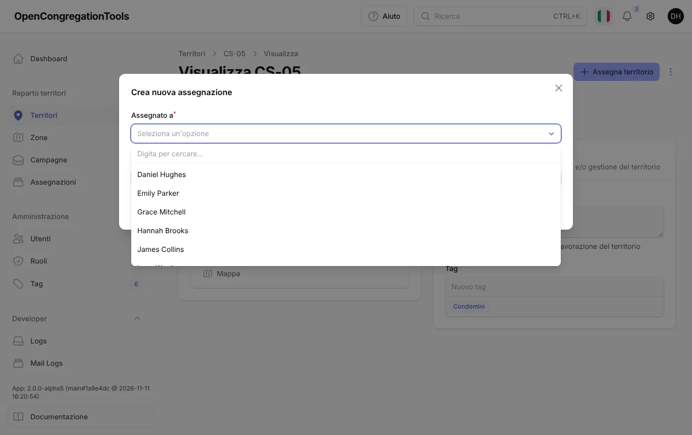
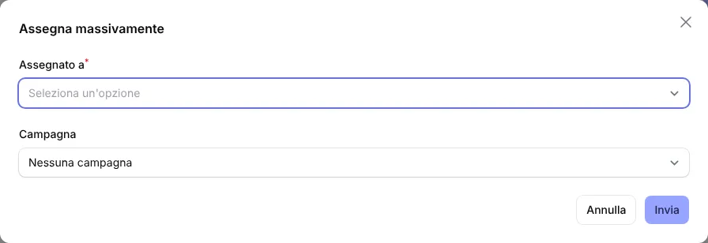

Assegnare un territorio significa registrare che una persona lo sta lavorando, a partire da oggi. Riconsegnarlo chiude
l'assegnazione, che resta nello storico del territorio.

## Assegnare un territorio

1. Apri il territorio (oppure usa il menu **⋮** sulla sua riga nell'elenco **Territori**).
2. Clicca **Assegna territorio**.
3. In **Assegnato a** scegli la persona (puoi scrivere per cercarla). Sono elencati sia gli utenti che possono accedere
   sia gli utenti virtuali, in ordine alfabetico.
4. Se vuoi, scegli una **Campagna** (vengono proposte solo le campagne non ancora terminate).
5. Clicca **Crea**.

L'assegnatario riceve una notifica e un'email (tranne se è un utente virtuale), e il territorio risulta fuori
nell'elenco dei territori.

> ℹ️ **Nota:** un territorio può avere una sola assegnazione in corso. **Assegna territorio** compare solo per i
> territori disponibili: per affidare a qualcun altro un territorio già assegnato, prima riconsegnalo.

## Riconsegnare un territorio

1. Apri il territorio e clicca **Termina assegnazione** (oppure usa il menu **⋮** sulla sua riga).
2. Controlla l'assegnatario e la campagna, poi clicca **Termina**.

L'assegnazione viene chiusa con la data di oggi e l'assegnatario riceve una notifica (tranne se è un utente virtuale).

Puoi riconsegnarlo anche da **Assegnazioni** (e dallo storico delle assegnazioni di un territorio, di una persona o di
una campagna): clicca **Termina assegnazione** sulla riga di un'assegnazione in corso, oppure in cima alla pagina
dell'assegnazione. Per registrare una riconsegna in un'altra data, clicca invece **Modifica** nel menu **⋮** della riga
e imposta la **Data fine** (vedi [Storico delle assegnazioni](history#correggere-unassegnazione)).

### Richieste di riconsegna

L'assegnatario può chiedere di riconsegnare il territorio: nella pagina dell'assegnazione (es. aperta dalla notifica)
clicca **Chiedi di riconsegnare** e conferma. I membri del reparto territori ricevono una notifica, e la pagina
dell'assegnazione mostra **Riconsegna richiesta il …** con **Termina assegnazione**, che la riconsegna per chi ha un
ruolo che lo permette.

## Assegnare o riconsegnare più territori insieme

Nell'elenco **Territori**, spunta i territori, poi apri il menu delle **azioni di massa** e scegli:

- **Assegna massivamente**: scegli la persona (e, se vuoi, una campagna) e clicca **Invia**. I territori già fuori
  vengono saltati;
- **Termina assegnazioni**: riconsegna, dopo una conferma, tutti i territori selezionati che sono fuori. Gli altri
  vengono saltati, come quelli che il tuo ruolo non ti permette di riconsegnare.

Un messaggio indica poi quanti territori sono stati assegnati o riconsegnati ed elenca quelli saltati, con il motivo: è
verde se non ne è stato saltato nessuno, giallo se alcuni sono stati saltati, rosso se nessuno è andato a buon fine.

> 💡 **Suggerimento:** combina il filtro **Stato assegnazione** impostato su **Non assegnati** con
> **Raggruppa per Zona** per trovare subito tutti i territori disponibili di una zona e assegnarli alla stessa persona.

## Registrare assegnazioni passate

Per registrare un'assegnazione con date diverse (es. quando ricopi il registro cartaceo), apri **Assegnazioni**, clicca
**Nuovo** e indica il territorio, l'assegnatario, la **Data inizio** e, se già riconsegnato, la **Data fine** (nessuna
delle due può essere nel futuro). Valgono gli stessi controlli: un territorio non può avere due assegnazioni in corso e
non si possono usare campagne terminate.
