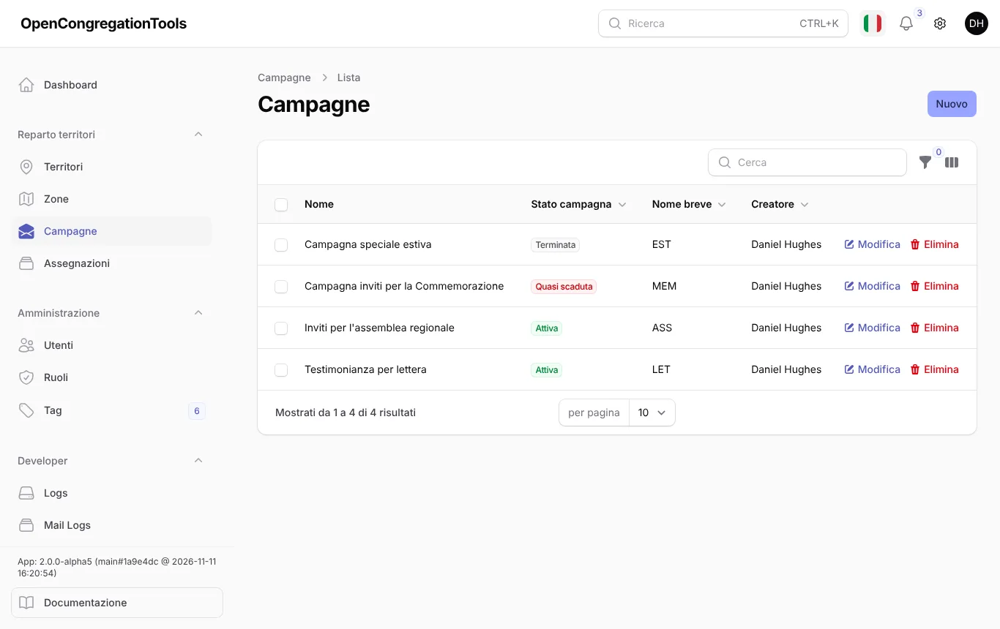
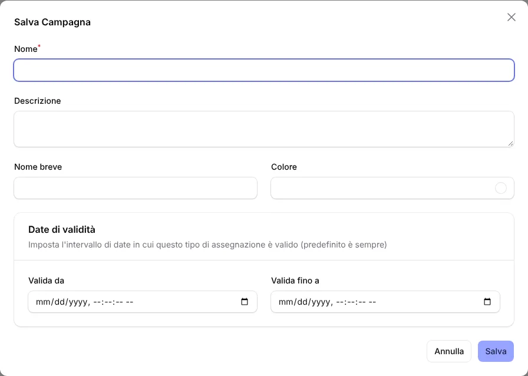
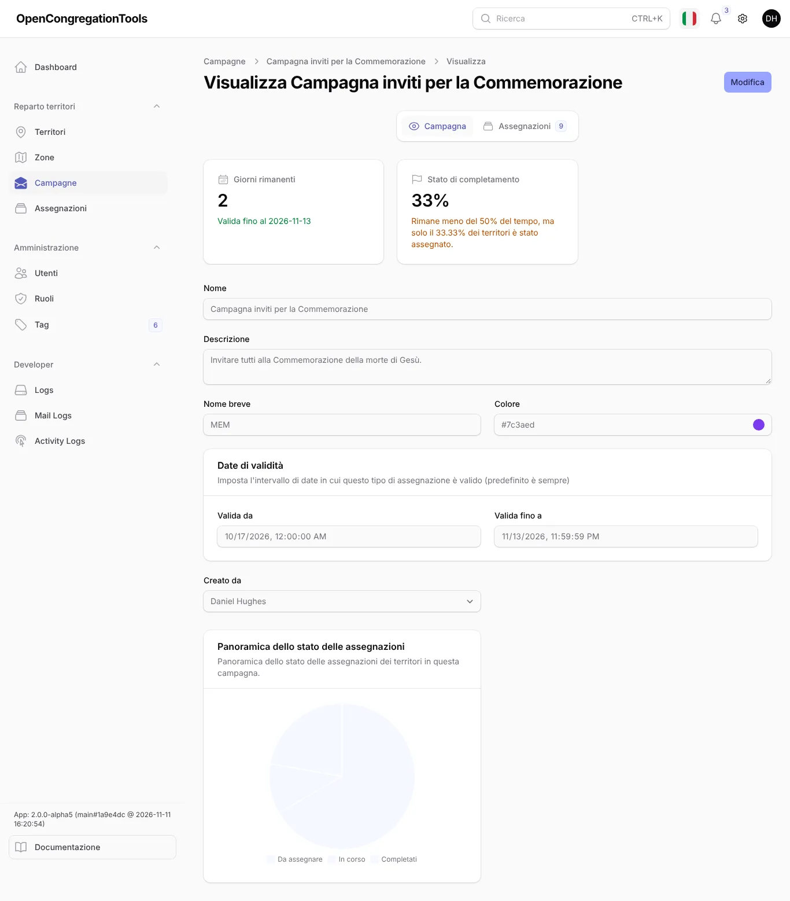
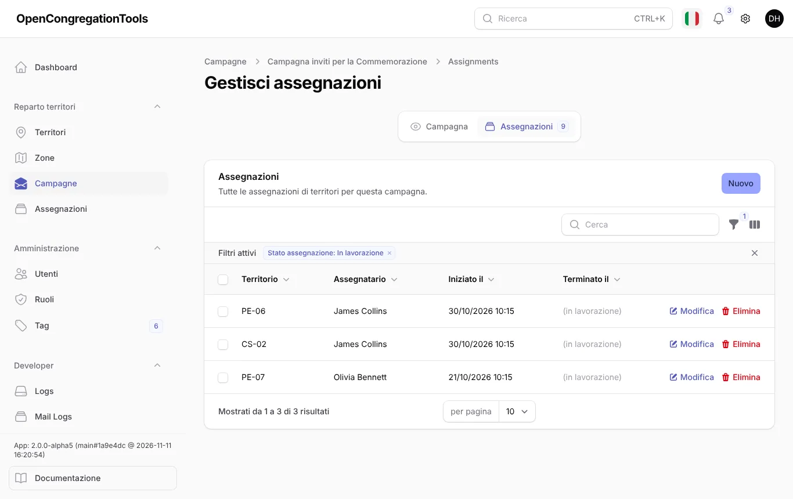
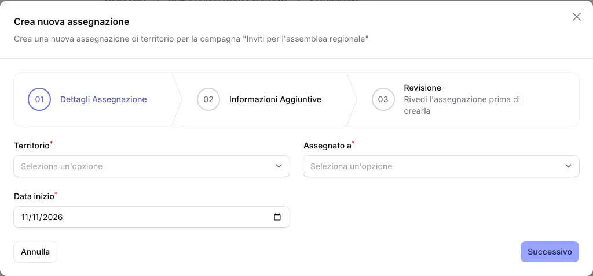

Una campagna è un'attività speciale con un inizio e una fine, ad esempio la distribuzione degli inviti per la
Commemorazione o per un'assemblea. Collegare le assegnazioni a una campagna permette di seguire quanta parte del
territorio è stata percorsa durante la campagna.

Le campagne sono facoltative: un'assegnazione può anche non avere una campagna.

## Stato della campagna

La colonna **Stato campagna** viene calcolata a partire dalla data **Valida fino a**:

| Stato | Significato |
|-------|-------------|
| **Attiva** | Nessuna data di fine, oppure mancano più di 7 giorni. |
| **In scadenza** | Mancano 7 giorni o meno. |
| **Quasi scaduta** | Mancano 3 giorni o meno. |
| **Terminata** | La data di fine è passata. Non è più possibile assegnare territori alla campagna. |

7 e 3 giorni sono i valori predefiniti: i super amministratori possono cambiarli dalle
[impostazioni](../administration/settings#campagne). Le altre pagine di questa guida usano i valori predefiniti.

Il numero di campagne che terminano entro 7 giorni compare in arancione accanto a **Campagne** nella barra laterale.

## Creare una campagna

1. Apri **Campagne** e clicca **Nuovo**.
2. Inserisci il **Nome** e, se vuoi, una **Descrizione**, un **Nome breve** (es. `MEM`) e un **Colore**.
3. In **Date di validità** imposta **Valida da** e **Valida fino a**. Lasciale vuote per una campagna sempre valida.
4. Clicca **Crea**.

Tutti gli utenti che possono accedere ricevono una notifica della nuova campagna.

## Seguire una campagna

Clicca una campagna per aprirne la pagina. In alto, due indicatori ne riassumono l'avanzamento:

- **Giorni rimanenti**: i giorni che mancano alla fine della campagna (∞ se non ha una data di fine);
- **Stato di completamento**: la percentuale di tutti i territori assegnati durante la campagna. Diventa arancione o
  rosso quando il tempo stringe rispetto al lavoro fatto, es. *Rimane meno del 50% del tempo, ma solo il 33% dei
  territori è stato assegnato*.

In basso, il grafico **Panoramica dello stato delle assegnazioni** mostra quanti territori sono *Da assegnare*,
*In corso* e *Completati*.

## Gestire le assegnazioni della campagna

La scheda **Assegnazioni** di una campagna ne elenca le assegnazioni (di default quelle in corso).

- Il pulsante per creare una nuova assegnazione apre una procedura guidata in tre passaggi: **Dettagli Assegnazione**
  (territorio, assegnatario e data di inizio), **Informazioni Aggiuntive** (note) e **Revisione**. Vengono proposti solo
  i territori non già fuori; per uno già lavorato nella campagna, una casella ti chiede di confermare che debba uscire
  di nuovo. Il pulsante non compare più quando la campagna è terminata.
- Spunta alcune assegnazioni e scegli **Termina assegnazioni** dalle azioni di massa per riconsegnarle tutte insieme, ad
  esempio alla fine della campagna. Le assegnazioni già riconsegnate vengono saltate.
- Le assegnazioni ancora in corso quando la campagna è terminata, o termina entro 7 giorni, sono evidenziate in rosso o
  in arancione (vedi [Storico delle assegnazioni](history)).

Puoi assegnare territori a una campagna anche dall'elenco dei territori, scegliendo la campagna nel campo **Campagna**
(vedi [Assegnare e riconsegnare](assigning)).

> 💡 **Suggerimento:** nell'elenco **Territori**, **Raggruppa per → Campagna** mostra quali territori si stanno
> lavorando per ogni campagna.
