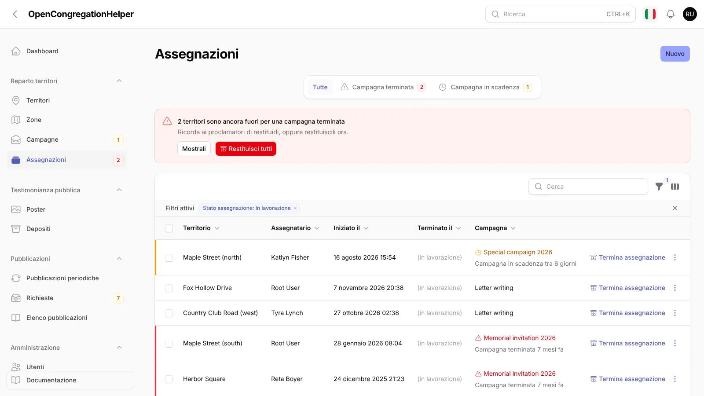
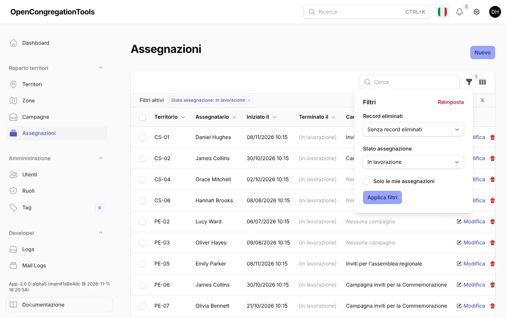
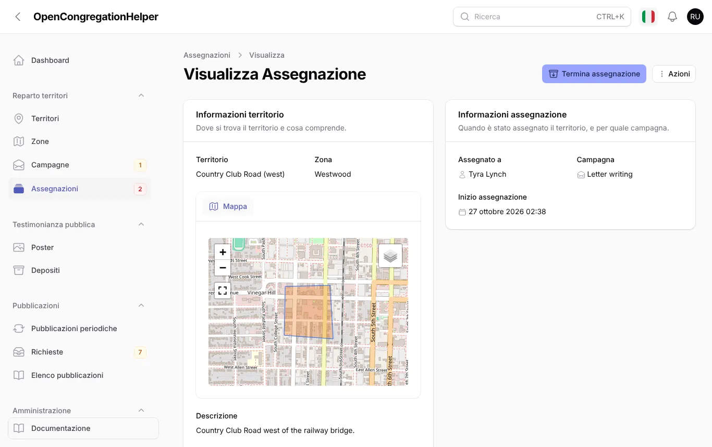
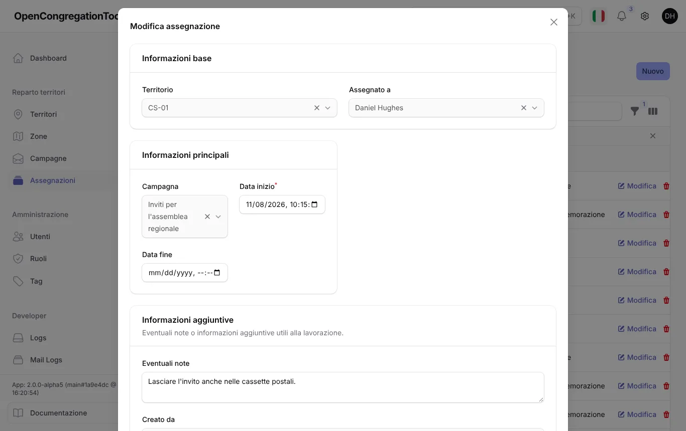

Ogni assegnazione, in corso o riconsegnata, viene conservata. Le trovi:

- in **Assegnazioni** nella barra laterale, per tutti i territori;
- nella scheda **Storico uscite** di un territorio;
- nella scheda **Assegnazioni** di un utente;
- nella scheda **Assegnazioni** di una campagna.

La tabella mostra il **Territorio**, l'**Assegnatario**, le date **Iniziato il** e **Terminato il** (*(in lavorazione)*
se non ancora riconsegnato) e la **Campagna**, che si può nascondere con il pulsante delle colonne.

## Assegnazioni di campagne terminate o in scadenza

Le assegnazioni ancora in corso la cui campagna è terminata, o termina entro 7 giorni, risaltano nella tabella:

- un bordo **rosso** a sinistra della riga quando la campagna è terminata, **arancione** quando termina entro 7 giorni;
- sotto il nome della campagna, quando è terminata o quando termina (es. *Campagna terminata 3 giorni fa*, *Campagna in
  scadenza tra 5 giorni*).

Sopra la tabella, le schede **Campagna terminata** e **Campagna in scadenza** mostrano solo queste assegnazioni, con il
loro numero. Quando alcuni territori sono ancora fuori per una campagna terminata, un avviso indica quanti sono:
**Mostrali** apre la scheda **Campagna terminata**, e **Restituisci tutti** li riconsegna tutti insieme, se il tuo ruolo
lo permette.

Il numero di territori ancora fuori per una campagna terminata compare anche in rosso accanto ad **Assegnazioni** nella
barra laterale.

## Filtri

Di default vengono mostrate solo le assegnazioni **in lavorazione**, anche nelle schede di un territorio, di un utente e
di una campagna: per vedere anche quelle riconsegnate, apri i filtri e scegli *Tutti gli stati*. Il numero accanto a
queste schede conta tutte le assegnazioni, comprese quelle riconsegnate. I filtri sono:

- **Stato assegnazione**: *Tutti gli stati*, *Restituito* o *In lavorazione*;
- **Solo le mie assegnazioni**: solo i territori assegnati a te;
- **Record eliminati**: mostra anche le assegnazioni eliminate.

## Dettagli dell'assegnazione

Clicca una riga per aprire l'assegnazione. La pagina mostra:

- **Informazioni territorio**: territorio, zona, mappa e immagine, descrizione e note;
- **Informazioni assegnazione**: assegnatario, campagna, inizio e fine dell'assegnazione.

Se la campagna dell'assegnazione è terminata, o termina entro 7 giorni, un avviso in cima alla pagina lo segnala e
ricorda di riconsegnare il territorio. Se il tuo ruolo lo permette, **Termina assegnazione** nell'avviso lo riconsegna
subito.

Se l'assegnatario ha chiesto di riconsegnare il territorio (vedi
[Assegnare e riconsegnare](assigning#richieste-di-riconsegna)), un avviso indica quando: **Termina assegnazione**
nell'avviso lo riconsegna, se il tuo ruolo lo permette. L'assegnatario lo chiede con **Chiedi di riconsegnare** in cima alla pagina,
offerto finché non l'ha chiesto.

Finché l'assegnazione è in corso e nessun avviso lo offre, **Termina assegnazione** in cima alla pagina riconsegna il
territorio, se il tuo ruolo lo permette (vedi [Assegnare e riconsegnare](assigning#riconsegnare-un-territorio)). Dal menu **Azioni** puoi
condividere l'assegnazione con un link pubblico (vedi [Condividere un'assegnazione](sharing)).

## Correggere un'assegnazione

La riga di un'assegnazione in corso mostra **Termina assegnazione** (vedi
[Assegnare e riconsegnare](assigning#riconsegnare-un-territorio)); le altre azioni sono nel menu **⋮** della riga.
Clicca lì **Modifica** per cambiare la **Data inizio**, la **Data fine** o le note: il territorio, l'assegnatario, la
campagna e chi ha creato l'assegnazione sono mostrati ma non si possono cambiare. Impostando la **Data fine** il
territorio viene riconsegnato.

**Elimina**, nello stesso menu, sposta un'assegnazione nel cestino, da cui può essere ripristinata con **Ripristina**.
Le assegnazioni eliminate non vengono considerate nello storico e nelle statistiche (quando il territorio è stato
percorso l'ultima volta, la copertura, le campagne), come ricorda la conferma: per registrare che un territorio è stato
percorso, riconsegnalo invece con **Termina assegnazione**. **Forza eliminazione** rimuove definitivamente
un'assegnazione eliminata, senza possibilità di annullare.

## Chi vede cosa

Gli utenti autorizzati a vedere tutte le assegnazioni vedono tutto quanto descritto sopra. Gli altri (es. i
proclamatori) vedono solo **le proprie assegnazioni**, ovunque vengano elencate.
