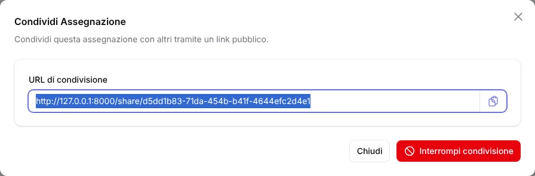
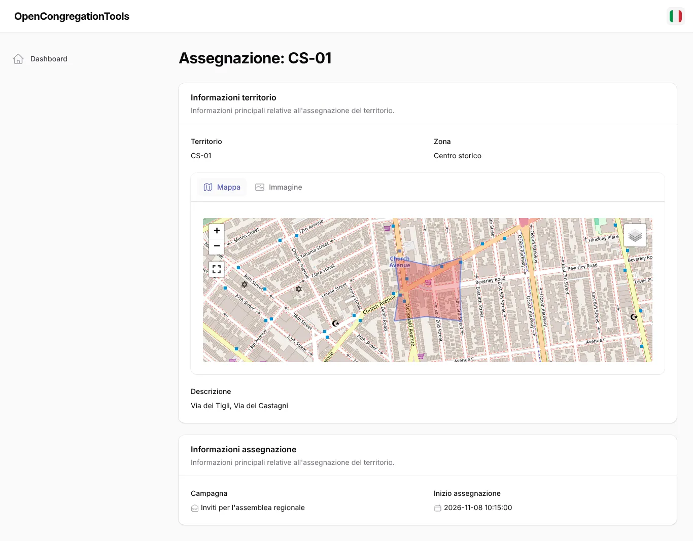

Puoi condividere un'assegnazione con un **link pubblico**, ad esempio per inviare la mappa del territorio a un
proclamatore che non ha un account. Chi ha il link può vedere il territorio senza effettuare l'accesso.

## Creare il link

1. Apri l'assegnazione (da **Assegnazioni**, o dallo storico del territorio).
2. Clicca **Azioni → Condividi**.
3. Clicca **Crea link**: finché non lo fai, l'assegnazione non è condivisa.
4. Clicca il pulsante di copia accanto a **URL di condivisione** e invia il link (via messaggio, email, …).

Il link resta lo stesso ogni volta che apri **Condividi** per quell'assegnazione.

Si possono condividere solo le assegnazioni in corso: quando il territorio viene riconsegnato (o l'assegnazione
eliminata) **Condividi** non viene più offerto e il link smette di funzionare.

Anche i proclamatori possono condividere le assegnazioni affidate a loro (e smettere di condividerle), dal link nella
notifica dell'assegnazione, anche se non possono vedere le altre assegnazioni.

## Cosa vede il destinatario

La pagina pubblica mostra il nome del territorio, la zona, la mappa, l'immagine e la descrizione, la campagna e la data
di inizio dell'assegnazione. Non ha barra laterale né menu, e le sue date sono nel fuso orario della congregazione.

Se i super amministratori lo permettono dalle [impostazioni](../administration/settings#territori), la pagina mostra
anche **Chiedi di riconsegnare**: chiunque abbia il link può chiedere al reparto territori di chiudere l'assegnazione,
come può fare l'assegnatario dall'applicazione (vedi [Assegnare e riconsegnare](assigning#richieste-di-riconsegna)).

> 🔒 **Privacy:** di default la pagina pubblica **non** mostra il nome dell'assegnatario né le note del territorio, che
> possono contenere dati personali. I super amministratori possono abilitarli dalla pagina
> [Impostazioni](../administration/settings). Le pagine condivise chiedono anche ai motori di ricerca (es. Google) di
> non indicizzarle, così non compaiono nei risultati delle ricerche.

## Interrompere la condivisione

Apri di nuovo **Azioni → Condividi**, clicca **Interrompi condivisione** e conferma. Il link smette subito di
funzionare. Se in seguito condividi di nuovo l'assegnazione, viene creato un nuovo link.

I super amministratori possono anche disattivare la condivisione per tutti, dalle
[impostazioni](../administration/settings#territori): **Condividi** non viene più offerto e tutti i link esistenti
vengono eliminati.
