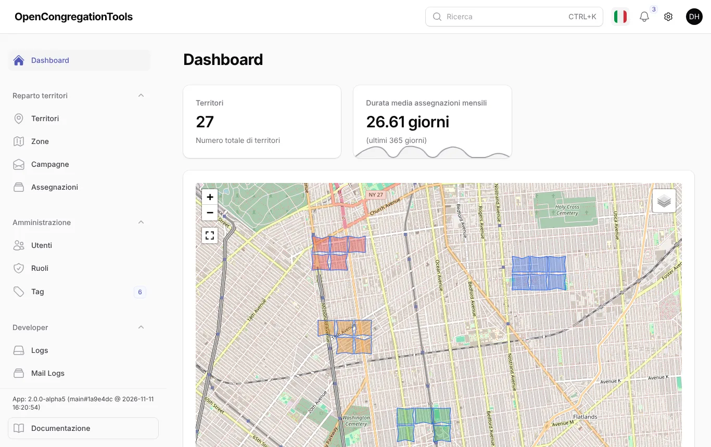
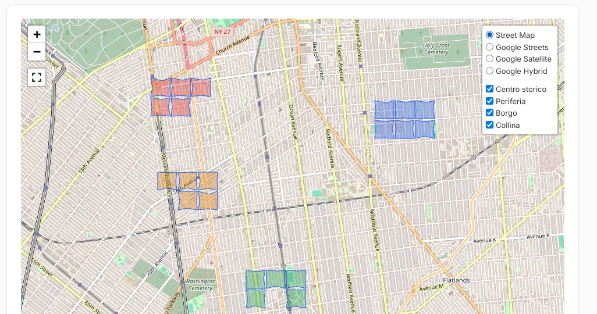

La dashboard è la prima pagina che vedi dopo l'accesso. Offre una panoramica dell'intero registro dei territori.

Cosa vedi dipende dal tuo [ruolo](../administration/roles): le statistiche, la copertura del territorio e la mappa
compaiono solo se puoi vedere i territori. Altrimenti, ad esempio perché non ti è ancora stato assegnato un ruolo, la
dashboard mostra solo un messaggio di benvenuto: chiedi a un amministratore se ti serve l'accesso.

## Statistiche

- **Territori**: il numero totale di territori.
- **Durata media assegnazioni mensili**: quanti giorni, in media, un territorio è rimasto fuori prima di essere
  riconsegnato, calcolato sulle assegnazioni riconsegnate negli ultimi 365 giorni. Il piccolo grafico mostra l'andamento
  della media mese per mese.

Le statistiche si aggiornano automaticamente ogni pochi secondi.

## Copertura del territorio

Quanta parte del territorio è stata lavorata nel periodo scelto nel menu in alto a destra (gli **ultimi 6, 12 o 24
mesi**, 12 di default: i super amministratori possono cambiarli nelle
[Impostazioni](../administration/settings#territori)). La scelta viene ricordata finché resti connesso.

- **Territori lavorati almeno una volta**: la percentuale e il numero di territori con almeno un'assegnazione nel
  periodo, ad es. *98,7% (240 su 243)*: un'assegnazione **riconsegnata** nel periodo, o ancora **in corso**. La
  percentuale è arrotondata per difetto, quindi 100% significa che ogni territorio è stato lavorato.
- **Escluse le campagne**: lo stesso dato, contando solo le assegnazioni che non fanno parte di una campagna.
- **Mai lavorati o non lavorati da più tempo**: i 5 territori mai assegnati, poi quelli riconsegnati da più tempo,
  con la data dell'ultima riconsegna. I territori in corso vengono per ultimi.

> 💡 **Suggerimento:** l'intero territorio dovrebbe essere percorso almeno una volta all'anno: tieni d'occhio il dato
> dei 12 mesi e assegna per primi i territori in cima all'elenco.

## Mappa dei territori

La mappa mostra ogni territorio **residenziale** che ha una mappa. I territori commerciali e quelli senza mappa non
vengono mostrati.

Il menu in alto a destra della mappa sceglie come colorare i territori. La scelta viene ricordata finché
resti connesso.

| Opzione | Colori |
|---|---|
| **Zona** (predefinita) | Il colore della **zona** del territorio. |
| **Stato attuale** | 🟩 **disponibile** (non assegnato); ⬜ **non disponibile** (assegnato e non ancora riconsegnato). |
| **Frequenza di assegnazione** | Quante volte il territorio è stato assegnato negli **ultimi 12 mesi**: 🟥 **bassa** (mai); 🟧 **media** (una volta); 🟩 **frequente** (due o più volte). I super amministratori possono cambiare i mesi e le soglie nelle [Impostazioni](../administration/settings#territori). |
| **Stato campagna** | L'avanzamento del territorio nella campagna scelta nel menu accanto: 🟥 **fuori per un'altra assegnazione** (assegnato al di fuori della campagna, quindi non ancora assegnabile per essa); ⬜ **da fare uscire**; 🟧 **in lavorazione** (assegnato per la campagna); 🟩 **lavorato** (riconsegnato per la campagna). |

**Stato campagna** è disponibile solo se c'è una campagna non terminata. Mostra la campagna attiva iniziata per
ultima (o, se nessuna è attiva, la prossima che inizierà), e si può scegliere qualsiasi altra campagna non terminata.

Sotto la mappa, la **legenda** elenca i colori con il numero di territori di ciascuno.

- Usa **+** e **−** (o la rotellina del mouse) per lo zoom, e trascina per spostarti.
- Passa sopra un territorio per vederne il nome, e cliccalo per vederne la zona, il significato del suo colore (con
  **Frequenza di assegnazione**, anche quante volte è stato assegnato) e, se il tuo ruolo permette di vedere i
  territori, il link **Vai al territorio** alla sua pagina.
- Il pulsante **schermo intero** ingrandisce la mappa a tutto lo schermo.
- Il pulsante dei **livelli** (in alto a destra) permette di:
  - scegliere la **mappa di base**: *Street Map* (OpenStreetMap), *Google Streets*, *Google Satellite* o
    *Google Hybrid*;
  - mostrare o nascondere i territori di ogni **zona**.

> 💡 **Suggerimento:** il colore di una zona si imposta modificando la zona (vedi [Zone](../territories/zones)). Scegli
> colori ben diversi, così da distinguere facilmente le zone vicine.
